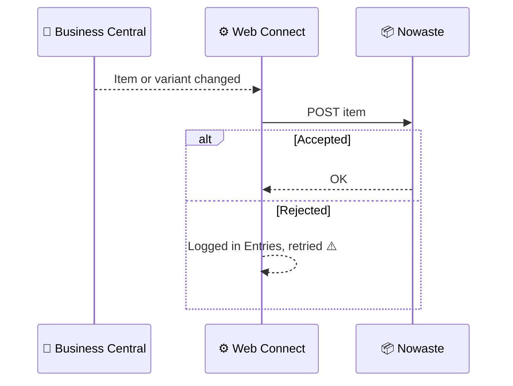

# Business Central to Nowaste: items

When an item or variant changes in Business Central, Web Connect sends it to Nowaste as an item. The item ID combines the item number and the variant code, and the item carries barcodes, weight, country of origin, tariff number, dangerous goods data and attributes such as colour and size.

| | |
|---|---|
| **Direction** | Business Central → Nowaste |
| **Trigger** | A change in one of the trigger fields on the item or variant in Business Central |
| **Result** | The item exists in Nowaste with current data, for each Nowaste warehouse you use |
| **Part of** | [Business Central and Nowaste integration](../overview.md) |

## Step by step

1. An item or variant is created or changed in Business Central (Business Central).
2. The change is caught by an outgoing sync trigger, and the item is queued for the Nowaste warehouse (Web Connect).
3. Web Connect builds the item with its data, barcodes and attributes, and sends it to the Nowaste item endpoint (Web Connect).
4. Nowaste creates the item or updates it if it already exists (Nowaste).

## Data mapping

| Business Central field | Nowaste field | Note |
|---|---|---|
| Item No. and Variant Code | `ItemId` | Combined with the delimiter set in the logistics setup |
| Description | `Description`, `IntrastatDescription` | |
| Base Unit of Measure | `Unit` | |
| Gross Weight, Net Weight | `WeightGross`, `WeightNet` | |
| Country/Region of Origin Code | `CountryOfOrigin` | |
| Tariff No. | `Intrastat` | |
| Item references (barcodes) | `Aliases` | One alias per barcode, with unit and conversion factor |
| Item attributes | `Attributes` | Such as model number, colour, size and season |
| Dangerous goods fields | `UnNumber`, `FlamePoint`, `Lq` | Taken from fields on the item or variant |
| | `WarehouseId` | The Nowaste warehouse the item object belongs to |

## Web Connect objects

| Object | Role |
|---|---|
| `NW-ITEM_<warehouse>` | Sends the item to the Nowaste item endpoint. One object per Nowaste warehouse |
| `NW-ITIEM-DATA` | Item data from the item card |
| `NW-ALIAS` | Barcodes from item references |
| `NW-ATTRIBUTES`, `NW-ITEMSKU` | Attributes per variant |

## Error handling

| Situation | What happens | What to do |
|---|---|---|
| Nowaste rejects the item | The message is retried up to the maximum error count | Read the answer from Nowaste in [Entries](../../../general/entries.md), fix the item and resend |
| An item is missing in Nowaste when an order arrives | Nowaste cannot handle the order or receipt line | Resend the item, then resend the order. Outgoing Sync Triggers can be set so that item data is also sent when a purchase order is sent to the warehouse |

## Frequently asked questions

### Are variants sent to Nowaste as separate items?

Yes. Each variant is sent as its own item in Nowaste. The item ID is the item number and the variant code combined with a delimiter that you choose in the logistics setup.

## Related

- [Business Central and Nowaste integration](../overview.md)
- [Outbound orders](order-outbound.md) · [Inbound deliveries](purchase-order.md)
- [Outgoing Sync Triggers](../../../general/outgoing-mapping/outgoing-sync-triggers.md) · [Logistics Setup](../../../general/logistics-setup.md)
