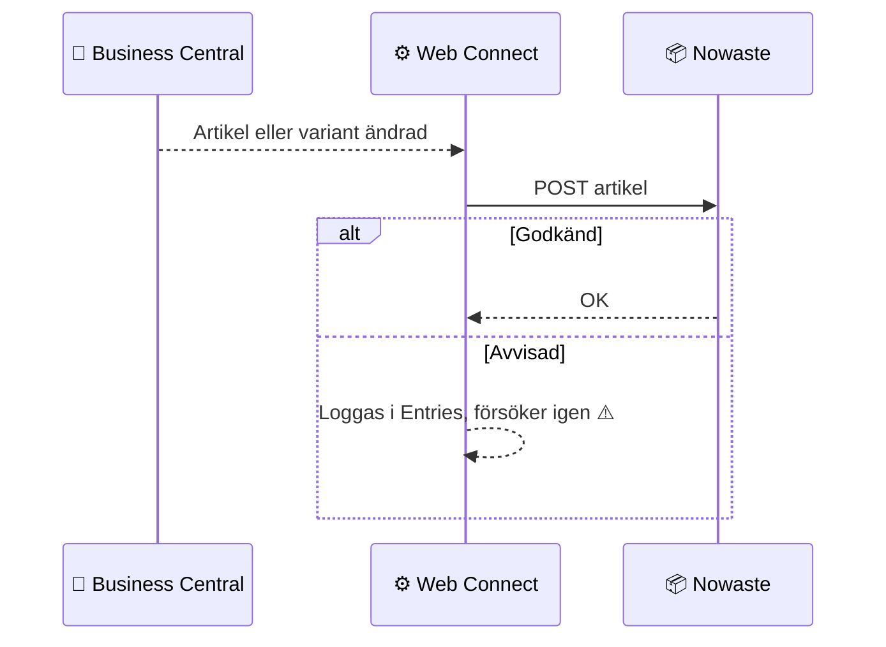

# Från Business Central till Nowaste: artiklar

När en artikel eller variant ändras i Business Central skickar Web Connect den till Nowaste som en artikel. Artikel-ID:t sätts ihop av artikelnumret och variantkoden, och artikeln har med sig streckkoder, vikt, ursprungsland, tullnummer, uppgifter om farligt gods och attribut som färg och storlek.

| | |
|---|---|
| **Riktning** | Business Central → Nowaste |
| **Startas av** | En ändring i något av triggerfälten på artikeln eller varianten i Business Central |
| **Resultat** | Artikeln finns i Nowaste med aktuella uppgifter, för varje lager hos Nowaste som du använder |
| **Del av** | [Business Central och Nowaste: integration](../overview.md) |

## Steg för steg

1. En artikel eller variant skapas eller ändras i Business Central (Business Central).
2. Ändringen fångas av en utgående synktrigger, och artikeln läggs i kö för lagret hos Nowaste (Web Connect).
3. Web Connect bygger upp artikeln med uppgifter, streckkoder och attribut och skickar den till Nowastes endpoint för artiklar (Web Connect).
4. Nowaste skapar artikeln, eller uppdaterar den om den redan finns (Nowaste).

## Mappning av data

| Fält i Business Central | Fält i Nowaste | Kommentar |
|---|---|---|
| Item No. och Variant Code | `ItemId` | Sätts ihop med avgränsningstecknet som anges i logistikinställningarna |
| Description | `Description`, `IntrastatDescription` | |
| Base Unit of Measure | `Unit` | |
| Gross Weight, Net Weight | `WeightGross`, `WeightNet` | |
| Country/Region of Origin Code | `CountryOfOrigin` | |
| Tariff No. | `Intrastat` | |
| Artikelreferenser (streckkoder) | `Aliases` | Ett alias per streckkod, med enhet och omräkningsfaktor |
| Artikelattribut | `Attributes` | Till exempel modellnummer, färg, storlek och säsong |
| Fält för farligt gods | `UnNumber`, `FlamePoint`, `Lq` | Hämtas från fält på artikeln eller varianten |
| | `WarehouseId` | Lagret hos Nowaste som artikelobjektet hör till |

## Objekt i Web Connect

| Objekt | Roll |
|---|---|
| `NW-ITEM_<warehouse>` | Skickar artikeln till Nowastes endpoint för artiklar. Ett objekt per lager hos Nowaste |
| `NW-ITIEM-DATA` | Artikeldata från artikelkortet |
| `NW-ALIAS` | Streckkoder från artikelreferenserna |
| `NW-ATTRIBUTES`, `NW-ITEMSKU` | Attribut per variant |

## Felhantering

| Situation | Vad som händer | Vad du gör |
|---|---|---|
| Nowaste avvisar artikeln | Nya försök görs upp till det högsta antalet fel | Läs svaret från Nowaste i [Entries](../../../general/entries.md), rätta artikeln och skicka om |
| En artikel saknas i Nowaste när en order kommer | Nowaste kan inte hantera orderraden eller inleveransraden | Skicka om artikeln och sedan ordern. Outgoing Sync Triggers kan ställas in så att artikeldata också skickas när en inköpsorder skickas till lagret |

## Vanliga frågor

### Skickas varianter till Nowaste som egna artiklar?

Ja. Varje variant skickas som en egen artikel i Nowaste. Artikel-ID:t är artikelnumret och variantkoden ihopsatta med ett avgränsningstecken som du väljer i logistikinställningarna.

## Relaterat

- [Business Central och Nowaste: integration](../overview.md)
- [Utgående order](order-outbound.md) · [Förväntade inleveranser](purchase-order.md)
- [Outgoing Sync Triggers](../../../general/outgoing-mapping/outgoing-sync-triggers.md) · [Logistics Setup](../../../general/logistics-setup.md)
