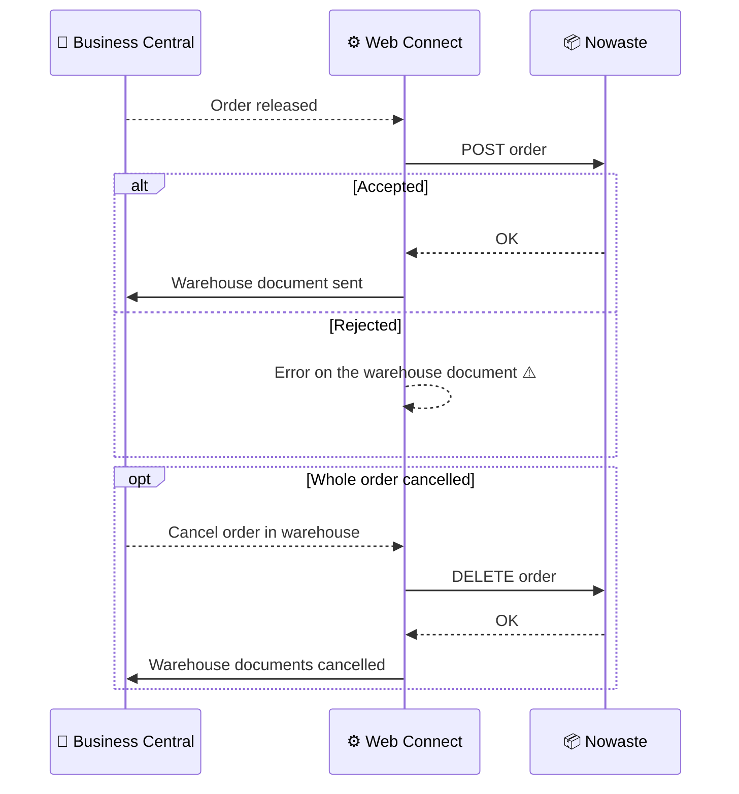

# Business Central to Nowaste: outbound orders

When a sales order or an outbound transfer order for the Nowaste location is released, Web Connect sends it to Nowaste as an order with recipient, delivery details and lines. A whole order that has been sent can be cancelled from Business Central, and Web Connect then deletes it in Nowaste.

| | |
|---|---|
| **Direction** | Business Central → Nowaste |
| **Trigger** | The order is released in Business Central. A cancellation is sent with the action to cancel the order in the warehouse |
| **Result** | An order in Nowaste, ready to be picked. After a cancellation, the order is deleted in Nowaste |
| **Part of** | [Business Central and Nowaste integration](../overview.md) |

## Step by step

1. A sales order or an outbound transfer order for the Nowaste location is released (Business Central).
2. A warehouse document is created for the order (Web Connect).
3. If the recipient needs to exist as a customer in Nowaste, the customer is sent to the Nowaste customer endpoint first (Web Connect).
4. The order is sent to the Nowaste order endpoint with header, recipient, haulier and lines (Web Connect).
5. Nowaste confirms the order, and the warehouse document is marked as sent (Nowaste, Web Connect).
6. To cancel, you send a cancellation to the warehouse from the sales order. Web Connect sends a delete request for the order, and when Nowaste confirms, the warehouse documents for the order are marked as cancelled (Business Central, Web Connect, Nowaste).

## Data mapping

| Business Central field | Nowaste field | Note |
|---|---|---|
| Order number | `OrderNr`, `Reference` | |
| External document number | `CustomerOrderNr` | Can be chosen per sales channel with a condition |
| Posting date on the order | `OrderDate`, `DeliveryDate` | |
| Ship-to name, address, city, postal code, country, email, mobile | `Customer` | |
| Shipping agent service | `Customer.Id`, `Haulier.Id` | Translated to the Nowaste ID in Text Mapping |
| Order type | `OrderType` | |
| Line no., item and variant, quantity, unit | `OrderLines` | Item ID combined in the same way as in the items flow |
| Unit price from the sales line | `OrderLines.Price` | Can be sent without VAT for a market, with a condition |
| Currency | `PriceCurrency` | Blank currency is translated to your local currency |
| Location | `OrderLines.WarehouseId` | Translated to the Nowaste warehouse ID |
| Ship-to country | `DeliveryCondition` | Translated to delivery terms for a carrier, with a condition |

## Web Connect objects

| Object | Role |
|---|---|
| `NW-GOODS-OUT` | Sends the order, and the delete request on a cancellation |
| `NW-CUSTOMER`, `NW-HAULIER`, `NW-HAULIERINFO` | Recipient and haulier on the order |
| `NW-ORDERLINES` | Order lines |
| `NW-CUSTOMERFORORDER` | Registers the recipient as a customer in Nowaste |

## Error handling

| Situation | What happens | What to do |
|---|---|---|
| Nowaste rejects the order, for example because an item is missing | The warehouse document gets an error and the message is retried up to the maximum error count | Fix the cause, for example send the item, and resend. See [WMS request not sent](../../../../../how-to/web-connect/wms-request-not-sent-error.md) |
| Picking has already started when a cancellation is sent | Nowaste does not cancel the order | Contact Nowaste about the order |
| A line needs to be cancelled | Not supported | Cancel the whole order and send a new one |

## Frequently asked questions

### Can an order that has already been sent to Nowaste be cancelled from Business Central?

Yes, for the whole order. When you send a cancellation to the warehouse, Web Connect sends a delete request for the order to Nowaste, and the warehouse documents for the order are marked as cancelled. Single lines cannot be cancelled this way.

## Related

- [Business Central and Nowaste integration](../overview.md)
- [Items](items.md) · [Shipments](shipment.md)
- [WMS documents](../../../general/wms-documents.md) · [Logistics Setup](../../../general/logistics-setup.md) · [Condition List](../../../general/condition-list.md)
