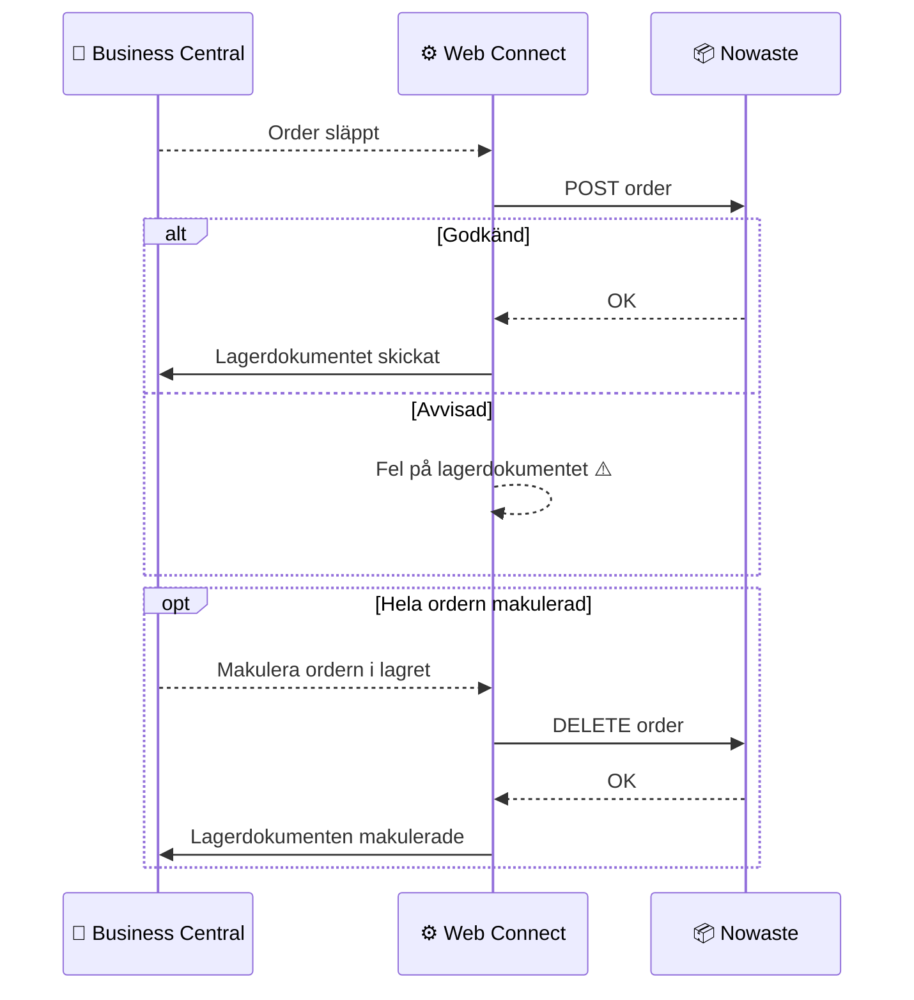

# Från Business Central till Nowaste: utgående order

När en försäljningsorder eller en utgående flyttorder för Nowastes lagerställe släpps skickar Web Connect den till Nowaste som en order med mottagare, leveransuppgifter och rader. En hel order som har skickats kan makuleras från Business Central, och Web Connect tar då bort den i Nowaste.

| | |
|---|---|
| **Riktning** | Business Central → Nowaste |
| **Startas av** | Ordern släpps i Business Central. En makulering skickas med åtgärden som makulerar ordern i lagret |
| **Resultat** | En order i Nowaste, klar att plockas. Efter en makulering tas ordern bort i Nowaste |
| **Del av** | [Business Central och Nowaste: integration](../overview.md) |

## Steg för steg

1. En försäljningsorder eller en utgående flyttorder för Nowastes lagerställe släpps (Business Central).
2. Ett lagerdokument skapas för ordern (Web Connect).
3. Om mottagaren behöver finnas som kund i Nowaste skickas kunden först till Nowastes endpoint för kunder (Web Connect).
4. Ordern skickas till Nowastes endpoint för order med huvud, mottagare, transportör och rader (Web Connect).
5. Nowaste bekräftar ordern, och lagerdokumentet markeras som skickat (Nowaste, Web Connect).
6. För att makulera skickar du en makulering till lagret från försäljningsordern. Web Connect skickar en begäran om att ta bort ordern, och när Nowaste bekräftar markeras orderns lagerdokument som makulerade (Business Central, Web Connect, Nowaste).

## Mappning av data

| Fält i Business Central | Fält i Nowaste | Kommentar |
|---|---|---|
| Ordernummer | `OrderNr`, `Reference` | |
| Externt dokumentnummer | `CustomerOrderNr` | Kan väljas per försäljningskanal med ett villkor |
| Bokföringsdatum på ordern | `OrderDate`, `DeliveryDate` | |
| Leveransadressens namn, adress, ort, postnummer, land, e-post, mobil | `Customer` | |
| Speditörstjänst | `Customer.Id`, `Haulier.Id` | Översätts till Nowastes ID i Text Mapping |
| Ordertyp | `OrderType` | |
| Radnummer, artikel och variant, antal, enhet | `OrderLines` | Artikel-ID:t sätts ihop på samma sätt som i flödet för artiklar |
| Enhetspris från försäljningsraden | `OrderLines.Price` | Kan skickas utan moms för en marknad, med ett villkor |
| Valuta | `PriceCurrency` | Tom valuta översätts till din lokala valuta |
| Lagerställe | `OrderLines.WarehouseId` | Översätts till Nowastes lager-ID |
| Leveransland | `DeliveryCondition` | Översätts till leveransvillkor för en transportör, med ett villkor |

## Objekt i Web Connect

| Objekt | Roll |
|---|---|
| `NW-GOODS-OUT` | Skickar ordern, och begäran om borttagning vid en makulering |
| `NW-CUSTOMER`, `NW-HAULIER`, `NW-HAULIERINFO` | Mottagare och transportör på ordern |
| `NW-ORDERLINES` | Orderrader |
| `NW-CUSTOMERFORORDER` | Registrerar mottagaren som kund i Nowaste |

## Felhantering

| Situation | Vad som händer | Vad du gör |
|---|---|---|
| Nowaste avvisar ordern, till exempel för att en artikel saknas | Lagerdokumentet får ett fel och nya försök görs upp till det högsta antalet fel | Rätta orsaken, till exempel genom att skicka artikeln, och skicka om. Se [WMS-anrop skickas inte](../../../../../how-to/web-connect/wms-request-not-sent-error.md) |
| Plockningen har redan börjat när en makulering skickas | Nowaste makulerar inte ordern | Kontakta Nowaste om ordern |
| En rad behöver makuleras | Stöds inte | Makulera hela ordern och skicka en ny |

## Vanliga frågor

### Kan en order som redan skickats till Nowaste makuleras från Business Central?

Ja, för hela ordern. När du skickar en makulering till lagret skickar Web Connect en begäran till Nowaste om att ta bort ordern, och orderns lagerdokument markeras som makulerade. Enskilda rader kan inte makuleras på det här sättet.

## Relaterat

- [Business Central och Nowaste: integration](../overview.md)
- [Artiklar](items.md) · [Leveranser](shipment.md)
- [WMS-dokument](../../../general/wms-documents.md) · [Logistics Setup](../../../general/logistics-setup.md) · [Condition List](../../../general/condition-list.md)
