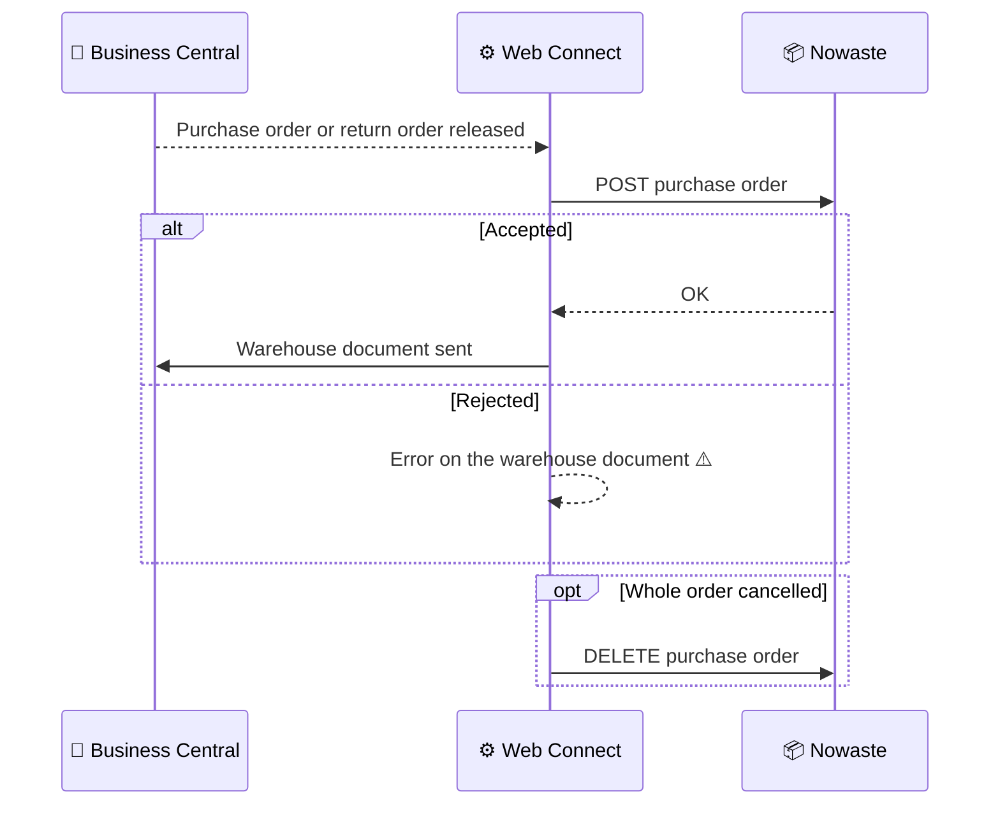

# Business Central to Nowaste: inbound deliveries

When a purchase order for the Nowaste location is released, Web Connect sends it to Nowaste as a purchase order with supplier, planned date and lines. Sales return orders can be sent the same way, as receipts the warehouse expects. A whole inbound delivery can be cancelled from Business Central.

| | |
|---|---|
| **Direction** | Business Central → Nowaste |
| **Trigger** | The purchase order or sales return order is released in Business Central, or sent with the action to send it to the warehouse |
| **Result** | A purchase order in Nowaste that the warehouse receives against |
| **Part of** | [Business Central and Nowaste integration](../overview.md) |

## Step by step

1. A purchase order or sales return order for the Nowaste location is released (Business Central).
2. A warehouse document is created for the order (Web Connect).
3. The order is sent to the Nowaste purchase order endpoint, with the order number in the address (Web Connect).
4. Nowaste confirms, and the warehouse document is marked as sent (Nowaste, Web Connect).
5. When the goods arrive, Nowaste reports the receipt, see [Receipts](receipt.md).
6. If the whole order is cancelled in Business Central, Web Connect sends a delete request for it instead (Web Connect).

## Data mapping

| Business Central field | Nowaste field | Note |
|---|---|---|
| Order number | `OrderNr`, `TransactionId` | Also part of the address |
| Planned receipt date on the warehouse document | `PlannedReceive` | |
| Vendor number, name, address, city, postal code, country | `Supplier` | |
| Line no., item and variant, quantity, price | `PurchaseOrderLines` | Item ID combined in the same way as in the items flow |
| Line date | `PurchaseOrderLines.DateTime` | |
| Location | `PurchaseOrderLines.WarehouseId` | Translated to the Nowaste warehouse ID |
| Cancelled | HTTP method | A cancelled order is sent as a delete request |

## Web Connect objects

| Object | Role |
|---|---|
| `NW-GOODS-IN` | Sends the purchase order, and the delete request on a cancellation |
| `NW-SUPPLIER` | Supplier on the purchase order |
| `NW-PURCHASEORDERLINES` | Purchase order lines |

## Error handling

| Situation | What happens | What to do |
|---|---|---|
| Nowaste rejects the purchase order, for example because an item is missing | The warehouse document gets an error and the message is retried up to the maximum error count | Send the missing item, then resend. See [WMS request not sent](../../../../../how-to/web-connect/wms-request-not-sent-error.md) |
| The purchase order changes after it was sent | [ATT FYLLA I: whether a changed purchase order is sent to Nowaste again, and how] | |

## Frequently asked questions

### Are customer returns sent to Nowaste?

They can be. With the setting to send return orders as receipts, a sales return order for the Nowaste location is sent to Nowaste in the same way as a purchase order, and the warehouse reports the receipt back.

## Related

- [Business Central and Nowaste integration](../overview.md)
- [Items](items.md) · [Receipts](receipt.md)
- [WMS documents](../../../general/wms-documents.md) · [Logistics Setup](../../../general/logistics-setup.md)
