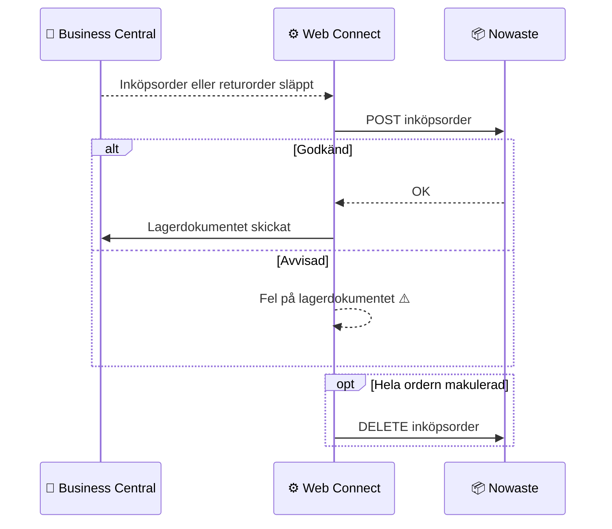

# Från Business Central till Nowaste: förväntade inleveranser

När en inköpsorder för Nowastes lagerställe släpps skickar Web Connect den till Nowaste som en inköpsorder med leverantör, planerat datum och rader. Returorder kan skickas på samma sätt, som inleveranser som lagret väntar sig. En hel förväntad inleverans kan makuleras från Business Central.

| | |
|---|---|
| **Riktning** | Business Central → Nowaste |
| **Startas av** | Inköpsordern eller returordern släpps i Business Central, eller skickas med åtgärden som skickar den till lagret |
| **Resultat** | En inköpsorder i Nowaste som lagret tar emot varor mot |
| **Del av** | [Business Central och Nowaste: integration](../overview.md) |

## Steg för steg

1. En inköpsorder eller returorder för Nowastes lagerställe släpps (Business Central).
2. Ett lagerdokument skapas för ordern (Web Connect).
3. Ordern skickas till Nowastes endpoint för inköpsorder, med ordernumret i adressen (Web Connect).
4. Nowaste bekräftar, och lagerdokumentet markeras som skickat (Nowaste, Web Connect).
5. När varorna kommer fram rapporterar Nowaste inleveransen, se [Inleveranser](receipt.md).
6. Makuleras hela ordern i Business Central skickar Web Connect i stället en begäran om att ta bort den (Web Connect).

## Mappning av data

| Fält i Business Central | Fält i Nowaste | Kommentar |
|---|---|---|
| Ordernummer | `OrderNr`, `TransactionId` | Ingår också i adressen |
| Planerat inleveransdatum på lagerdokumentet | `PlannedReceive` | |
| Leverantörens nummer, namn, adress, ort, postnummer, land | `Supplier` | |
| Radnummer, artikel och variant, antal, pris | `PurchaseOrderLines` | Artikel-ID:t sätts ihop på samma sätt som i flödet för artiklar |
| Radens datum | `PurchaseOrderLines.DateTime` | |
| Lagerställe | `PurchaseOrderLines.WarehouseId` | Översätts till Nowastes lager-ID |
| Makulerad | HTTP-metod | En makulerad order skickas som en begäran om borttagning |

## Objekt i Web Connect

| Objekt | Roll |
|---|---|
| `NW-GOODS-IN` | Skickar inköpsordern, och begäran om borttagning vid en makulering |
| `NW-SUPPLIER` | Leverantören på inköpsordern |
| `NW-PURCHASEORDERLINES` | Inköpsorderrader |

## Felhantering

| Situation | Vad som händer | Vad du gör |
|---|---|---|
| Nowaste avvisar inköpsordern, till exempel för att en artikel saknas | Lagerdokumentet får ett fel och nya försök görs upp till det högsta antalet fel | Skicka artikeln som saknas och skicka sedan om. Se [WMS-anrop skickas inte](../../../../../how-to/web-connect/wms-request-not-sent-error.md) |
| Inköpsordern ändras efter att den skickats | Nowaste har kvar den tidigare versionen | Skicka inköpsordern till lagret igen med åtgärden på ordern, så skickas den ändrade ordern till Nowaste |

## Vanliga frågor

### Skickas kundreturer till Nowaste?

Det kan de göra. Med inställningen som skickar returorder som inleveranser skickas en returorder för Nowastes lagerställe till Nowaste på samma sätt som en inköpsorder, och lagret rapporterar inleveransen tillbaka.

## Relaterat

- [Business Central och Nowaste: integration](../overview.md)
- [Artiklar](items.md) · [Inleveranser](receipt.md)
- [WMS-dokument](../../../general/wms-documents.md) · [Logistics Setup](../../../general/logistics-setup.md)
