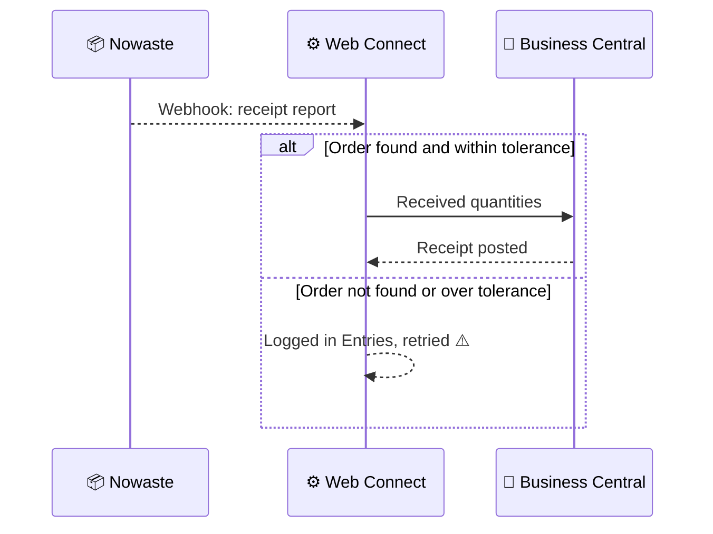

# Nowaste to Business Central: receipts

When Nowaste has received a purchase order or a customer return, it sends a receipt report to Web Connect with a webhook. The received quantity per line is written to the warehouse document in Business Central, and the receipt is posted with the work date as posting date.

| | |
|---|---|
| **Direction** | Nowaste → Business Central |
| **Trigger** | Webhook from Nowaste with a receipt report |
| **Result** | A posted receipt in Business Central with the received quantities |
| **Part of** | [Business Central and Nowaste integration](../overview.md) |

## Step by step

1. Nowaste receives the goods against the purchase order (Nowaste).
2. Nowaste sends a receipt report as a webhook. The Azure endpoint passes it on to Web Connect (Nowaste, Azure endpoint).
3. Web Connect reads the document type and hands the report to the receipt object (Web Connect).
4. The report is matched to the warehouse document by the order number, and the received quantity is written per line (Web Connect).
5. The receipt is posted with the work date as posting date (Business Central).

## Data mapping

| Nowaste field | Business Central field | Note |
|---|---|---|
| `OrderNum` | Order number | Matches the warehouse document |
| `ReceivedDate` | Date on the warehouse document | |
| `PurchaseOrderLines.WarehouseId` | Location | Translated from the Nowaste warehouse ID |
| `PurchaseOrderLines.LineNum` | Line no. | |
| `PurchaseOrderLines.ItemNum` | Item No. and Variant Code | |
| `PurchaseOrderLines.Quantity` | Received quantity | |

Pallet details in the receipt report are not stored.

## Web Connect objects

| Object | Role |
|---|---|
| `NW-INCOMING-WEBHOOK` | Receives every webhook from Nowaste and hands it on by document type |
| `NW-IN-RECEIPT` | Receipt header |
| `NW-PURCHASEORDERLINES1` | Received lines |

## Error handling

| Situation | What happens | What to do |
|---|---|---|
| More is received than ordered | Accepted within the over receipt tolerance, otherwise an error | Check the tolerance in the [Logistics Setup](../../../general/logistics-setup.md), or adjust the order |
| The posting fails | Retried up to the maximum error count | Fix the cause in Business Central and process the entry again in [Entries](../../../general/entries.md) |
| Nothing arrives | No webhook has reached Web Connect | Check the webhook in [Entries](../../../general/entries.md), and ask Nowaste to resend the report |

## Frequently asked questions

### What happens if Nowaste receives more than ordered?

That depends on the logistics setup. You can allow over receipts within a tolerance in percent. Above the tolerance, or if over receipts are not allowed, the receipt is not posted and shows up as an error.

## Related

- [Business Central and Nowaste integration](../overview.md)
- [Inbound deliveries](purchase-order.md) · [Shipments](shipment.md)
- [Webhooks](../../../general/webhooks.md) · [WMS documents](../../../general/wms-documents.md) · [Logistics Setup](../../../general/logistics-setup.md)
