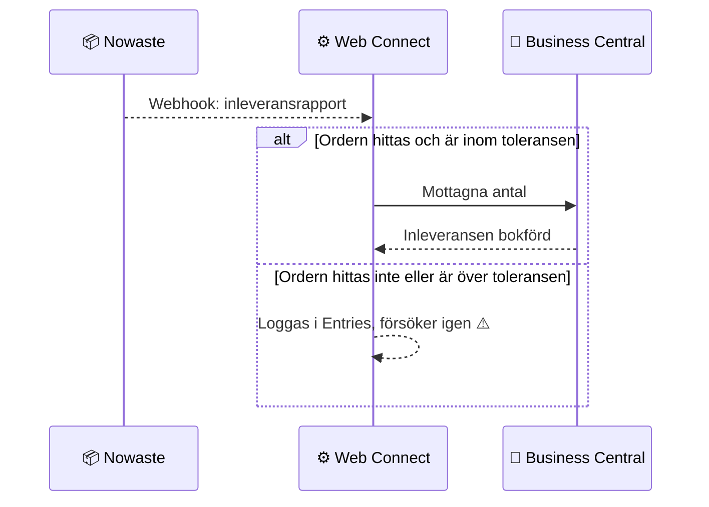

# Från Nowaste till Business Central: inleveranser

När Nowaste har tagit emot en inköpsorder eller en kundretur skickar Nowaste en inleveransrapport till Web Connect med en webhook. Mottaget antal per rad skrivs till lagerdokumentet i Business Central, och inleveransen bokförs med arbetsdatumet som bokföringsdatum.

| | |
|---|---|
| **Riktning** | Nowaste → Business Central |
| **Startas av** | Webhook från Nowaste med en inleveransrapport |
| **Resultat** | En bokförd inleverans i Business Central med de mottagna antalen |
| **Del av** | [Business Central och Nowaste: integration](../overview.md) |

## Steg för steg

1. Nowaste tar emot varorna mot inköpsordern (Nowaste).
2. Nowaste skickar en inleveransrapport som webhook. Azure-endpointen skickar den vidare till Web Connect (Nowaste, Azure-endpoint).
3. Web Connect läser dokumenttypen och lämnar rapporten till objektet för inleveranser (Web Connect).
4. Rapporten matchas mot lagerdokumentet med ordernumret, och mottaget antal skrivs per rad (Web Connect).
5. Inleveransen bokförs med arbetsdatumet som bokföringsdatum (Business Central).

## Mappning av data

| Fält i Nowaste | Fält i Business Central | Kommentar |
|---|---|---|
| `OrderNum` | Ordernummer | Matchar lagerdokumentet |
| `ReceivedDate` | Datum på lagerdokumentet | |
| `PurchaseOrderLines.WarehouseId` | Lagerställe | Översätts från Nowastes lager-ID |
| `PurchaseOrderLines.LineNum` | Radnummer | |
| `PurchaseOrderLines.ItemNum` | Item No. och Variant Code | |
| `PurchaseOrderLines.Quantity` | Mottaget antal | |

Pallinformation i inleveransrapporten sparas inte.

## Objekt i Web Connect

| Objekt | Roll |
|---|---|
| `NW-INCOMING-WEBHOOK` | Tar emot varje webhook från Nowaste och lämnar den vidare efter dokumenttyp |
| `NW-IN-RECEIPT` | Inleveranshuvud |
| `NW-PURCHASEORDERLINES1` | Mottagna rader |

## Felhantering

| Situation | Vad som händer | Vad du gör |
|---|---|---|
| Mer tas emot än vad som beställts | Godtas inom toleransen för överinleverans, annars blir det ett fel | Kontrollera toleransen i [Logistics Setup](../../../general/logistics-setup.md), eller justera ordern |
| Bokföringen misslyckas | Nya försök görs upp till det högsta antalet fel | Rätta orsaken i Business Central och bearbeta posten igen i [Entries](../../../general/entries.md) |
| Ingenting kommer in | Ingen webhook har nått Web Connect | Kontrollera webhooken i [Entries](../../../general/entries.md), och kontakta Nowaste om rapporten aldrig skickades |

## Vanliga frågor

### Vad händer om Nowaste tar emot mer än vad som beställts?

Det beror på logistikinställningarna. Du kan tillåta överinleverans inom en tolerans i procent. Över toleransen, eller om överinleverans inte är tillåten, bokförs inte inleveransen och den visas som ett fel.

## Relaterat

- [Business Central och Nowaste: integration](../overview.md)
- [Förväntade inleveranser](purchase-order.md) · [Leveranser](shipment.md)
- [Webhooks](../../../general/webhooks.md) · [WMS-dokument](../../../general/wms-documents.md) · [Logistics Setup](../../../general/logistics-setup.md)
