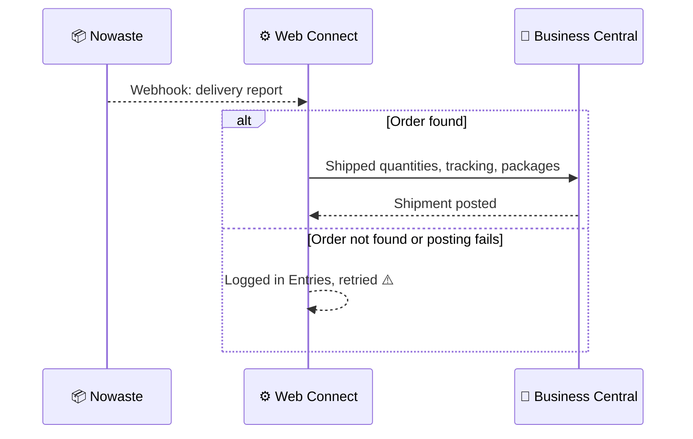

# Nowaste to Business Central: shipments

When Nowaste has shipped an order, it sends a delivery report to Web Connect with a webhook. Shipped quantities, tracking references and the SSCC of each package are written to the warehouse document in Business Central, and the shipment is posted. Status reports from Nowaste update the status of the warehouse document.

| | |
|---|---|
| **Direction** | Nowaste → Business Central |
| **Trigger** | Webhook from Nowaste with a delivery report or a delivery status |
| **Result** | A posted shipment in Business Central with shipped quantities, tracking references and package IDs |
| **Part of** | [Business Central and Nowaste integration](../overview.md) |

## Step by step

1. Nowaste picks, packs and ships the order (Nowaste).
2. Nowaste sends a delivery report as a webhook. The Azure endpoint passes it on to Web Connect (Nowaste, Azure endpoint).
3. Web Connect reads the document type and hands the report to the shipment object (Web Connect).
4. The report is matched to the warehouse document by the order number (Web Connect).
5. Requested and shipped quantity per line, the tracking reference, the return tracking reference and the SSCC per package are written to the warehouse document. The Nowaste status is translated to a warehouse document status (Web Connect).
6. The shipment is posted with the work date as posting date. Sales orders can be shipped and invoiced in the same posting (Business Central).

## Data mapping

| Nowaste field | Business Central field | Note |
|---|---|---|
| `OrderNum`, `OrderId`, `CustomOrderNum` | Order number | Matches the warehouse document |
| `DeliveryDate`, `Timestamp` | Date on the warehouse document | An empty date from Nowaste is ignored |
| `Status` | Warehouse document status | Translated in Text Mapping |
| `TrackingReference` | Tracking reference | |
| `ReturnTrackingReference` | Return tracking reference | |
| `WarehouseId` | Location | Translated from the Nowaste warehouse ID |
| `ShippedItems.LineNum` | Line no. | |
| `ShippedItems.ItemId` | Item No. and Variant Code | |
| `QuantityRequested`, `QuantityShipped` | Requested and shipped quantity | |
| `ShippedPackages.Sscc`, `Quantity` | Package SSCC and quantity | |

Weight and volume from the delivery report are not stored.

## Web Connect objects

| Object | Role |
|---|---|
| `NW-INCOMING-WEBHOOK` | Receives every webhook from Nowaste and hands it on by document type |
| `NW-OUT-SHIPMENT` | Delivery header |
| `NW-SHIPPEDITEMS` | Shipped lines |
| `NW-SHIPPEDPACKAGES` | Packages per line |

## Error handling

| Situation | What happens | What to do |
|---|---|---|
| The posting fails | Retried up to the maximum error count | Fix the cause in Business Central and process the entry again in [Entries](../../../general/entries.md) |
| More is shipped than ordered | Accepted within the over shipment tolerance in the logistics setup | Check the tolerance, or adjust the order |
| Nothing arrives | No webhook has reached Web Connect | Check the webhook in [Entries](../../../general/entries.md), and contact Nowaste if the report was never sent |

## Frequently asked questions

### What happens if Nowaste ships less than ordered?

Web Connect writes both the requested and the shipped quantity per line. The shipment is posted with the shipped quantity, and the rest of the order stays open in Business Central.

## Related

- [Business Central and Nowaste integration](../overview.md)
- [Outbound orders](order-outbound.md) · [Receipts](receipt.md)
- [Webhooks](../../../general/webhooks.md) · [WMS documents](../../../general/wms-documents.md) · [Logistics Setup](../../../general/logistics-setup.md)
