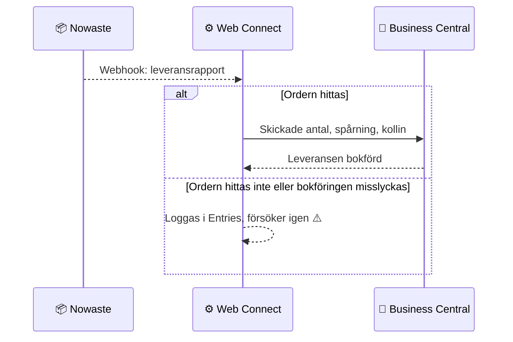

# Från Nowaste till Business Central: leveranser

När Nowaste har skickat en order skickar Nowaste en leveransrapport till Web Connect med en webhook. Skickade antal, spårningsreferenser och SSCC för varje kolli skrivs till lagerdokumentet i Business Central, och leveransen bokförs. Statusrapporter från Nowaste uppdaterar lagerdokumentets status.

| | |
|---|---|
| **Riktning** | Nowaste → Business Central |
| **Startas av** | Webhook från Nowaste med en leveransrapport eller en leveransstatus |
| **Resultat** | En bokförd leverans i Business Central med skickade antal, spårningsreferenser och kolli-ID |
| **Del av** | [Business Central och Nowaste: integration](../overview.md) |

## Steg för steg

1. Nowaste plockar, packar och skickar ordern (Nowaste).
2. Nowaste skickar en leveransrapport som webhook. Azure-endpointen skickar den vidare till Web Connect (Nowaste, Azure-endpoint).
3. Web Connect läser dokumenttypen och lämnar rapporten till objektet för leveranser (Web Connect).
4. Rapporten matchas mot lagerdokumentet med ordernumret (Web Connect).
5. Begärt och skickat antal per rad, spårningsreferensen, spårningsreferensen för retur och SSCC per kolli skrivs till lagerdokumentet. Statusen från Nowaste översätts till en status på lagerdokumentet (Web Connect).
6. Leveransen bokförs med arbetsdatumet som bokföringsdatum. Försäljningsorder kan levereras och faktureras i samma bokföring (Business Central).

## Mappning av data

| Fält i Nowaste | Fält i Business Central | Kommentar |
|---|---|---|
| `OrderNum`, `OrderId`, `CustomOrderNum` | Ordernummer | Matchar lagerdokumentet |
| `DeliveryDate`, `Timestamp` | Datum på lagerdokumentet | Ett tomt datum från Nowaste ignoreras |
| `Status` | Lagerdokumentets status | Översätts i Text Mapping |
| `TrackingReference` | Spårningsreferens | |
| `ReturnTrackingReference` | Spårningsreferens för retur | |
| `WarehouseId` | Lagerställe | Översätts från Nowastes lager-ID |
| `ShippedItems.LineNum` | Radnummer | |
| `ShippedItems.ItemId` | Item No. och Variant Code | |
| `QuantityRequested`, `QuantityShipped` | Begärt och skickat antal | |
| `ShippedPackages.Sscc`, `Quantity` | Kolliets SSCC och antal | |

Vikt och volym från leveransrapporten sparas inte.

## Objekt i Web Connect

| Objekt | Roll |
|---|---|
| `NW-INCOMING-WEBHOOK` | Tar emot varje webhook från Nowaste och lämnar den vidare efter dokumenttyp |
| `NW-OUT-SHIPMENT` | Leveranshuvud |
| `NW-SHIPPEDITEMS` | Skickade rader |
| `NW-SHIPPEDPACKAGES` | Kollin per rad |

## Felhantering

| Situation | Vad som händer | Vad du gör |
|---|---|---|
| Bokföringen misslyckas | Nya försök görs upp till det högsta antalet fel | Rätta orsaken i Business Central och bearbeta posten igen i [Entries](../../../general/entries.md) |
| Mer skickas än vad som beställts | Godtas inom toleransen för överleverans i logistikinställningarna | Kontrollera toleransen, eller justera ordern |
| Ingenting kommer in | Ingen webhook har nått Web Connect | Kontrollera webhooken i [Entries](../../../general/entries.md), och kontakta Nowaste om rapporten aldrig skickades |

## Vanliga frågor

### Vad händer om Nowaste skickar mindre än vad som beställts?

Web Connect skriver både begärt och skickat antal per rad. Leveransen bokförs med det skickade antalet, och resten av ordern står kvar som öppen i Business Central.

## Relaterat

- [Business Central och Nowaste: integration](../overview.md)
- [Utgående order](order-outbound.md) · [Inleveranser](receipt.md)
- [Webhooks](../../../general/webhooks.md) · [WMS-dokument](../../../general/wms-documents.md) · [Logistics Setup](../../../general/logistics-setup.md)
