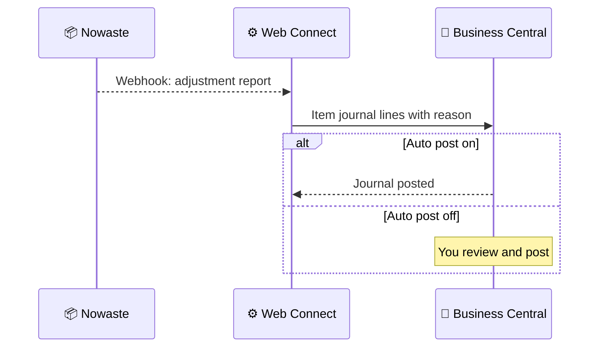

# Nowaste to Business Central: stock adjustments

When Nowaste adjusts the stock of an item, for example after damage or a count, it sends an adjustment report to Web Connect with a webhook. Each adjustment is written to an item journal in Business Central with the quantity, date and the warehouse's reason, and the journal can be posted automatically.

| | |
|---|---|
| **Direction** | Nowaste → Business Central |
| **Trigger** | Webhook from Nowaste with an adjustment report |
| **Result** | Item journal lines in Business Central, posted automatically if the logistics setup says so |
| **Part of** | [Business Central and Nowaste integration](../overview.md) |

## Step by step

1. Nowaste adjusts the stock of an item (Nowaste).
2. Nowaste sends an adjustment report as a webhook. The Azure endpoint passes it on to Web Connect (Nowaste, Azure endpoint).
3. Web Connect reads the document type and hands the report to the adjustment object (Web Connect).
4. Each transaction is written as a line in the item journal batch set in the logistics setup, with item, quantity, date and reason (Web Connect).
5. The journal is posted automatically, or by you (Business Central).

## Data mapping

| Nowaste field | Business Central field | Note |
|---|---|---|
| `TransactionId` | Document number | |
| `Date` | Posting date | |
| `WarehouseId` | Location | Translated from the Nowaste warehouse ID |
| `Transaction.ItemNum` | Item No. and Variant Code | |
| `Transaction.Quantity` | Quantity | |
| `Transaction.Reason` | Reason | |
| `Transaction.TransactionType` | Description | Translated to a readable text in Text Mapping |

## Web Connect objects

| Object | Role |
|---|---|
| `NW-INCOMING-WEBHOOK` | Receives every webhook from Nowaste and hands it on by document type |
| `NW-ADJUSTMENT` | Adjustment header |
| `NW-ADJUSTMENT-LINE` | One line per transaction |

## Error handling

| Situation | What happens | What to do |
|---|---|---|
| The item or variant does not exist in Business Central | The line cannot be created | Check the item number in [Entries](../../../general/entries.md) and process the entry again |
| The posting fails | The lines stay in the journal | Fix the cause and post the journal |

## Frequently asked questions

### Can we see why Nowaste adjusted the stock?

Yes. The reason and the transaction type from Nowaste are written to the journal line. The transaction type can be translated to a readable text in Text Mapping.

## Related

- [Business Central and Nowaste integration](../overview.md)
- [Stock reconciliation](stock-reconciliation.md)
- [Text Mapping](../../../general/text-mapping.md) · [Logistics Setup](../../../general/logistics-setup.md)
