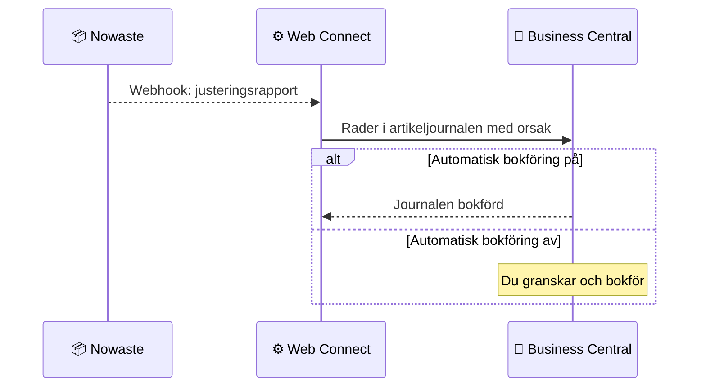

# Från Nowaste till Business Central: lagerjusteringar

När Nowaste justerar lagersaldot för en artikel, till exempel efter en skada eller en inventering, skickar Nowaste en justeringsrapport till Web Connect med en webhook. Varje justering skrivs till en artikeljournal i Business Central med antal, datum och lagrets orsak, och journalen kan bokföras automatiskt.

| | |
|---|---|
| **Riktning** | Nowaste → Business Central |
| **Startas av** | Webhook från Nowaste med en justeringsrapport |
| **Resultat** | Rader i artikeljournalen i Business Central, bokförda automatiskt om logistikinställningarna säger det |
| **Del av** | [Business Central och Nowaste: integration](../overview.md) |

## Steg för steg

1. Nowaste justerar lagersaldot för en artikel (Nowaste).
2. Nowaste skickar en justeringsrapport som webhook. Azure-endpointen skickar den vidare till Web Connect (Nowaste, Azure-endpoint).
3. Web Connect läser dokumenttypen och lämnar rapporten till objektet för justeringar (Web Connect).
4. Varje transaktion skrivs som en rad i den artikeljournalsats som anges i logistikinställningarna, med artikel, antal, datum och orsak (Web Connect).
5. Journalen bokförs automatiskt, eller av dig (Business Central).

## Mappning av data

| Fält i Nowaste | Fält i Business Central | Kommentar |
|---|---|---|
| `TransactionId` | Dokumentnummer | |
| `Date` | Bokföringsdatum | |
| `WarehouseId` | Lagerställe | Översätts från Nowastes lager-ID |
| `Transaction.ItemNum` | Item No. och Variant Code | |
| `Transaction.Quantity` | Antal | |
| `Transaction.Reason` | Orsak | |
| `Transaction.TransactionType` | Beskrivning | Översätts till en läsbar text i Text Mapping |

## Objekt i Web Connect

| Objekt | Roll |
|---|---|
| `NW-INCOMING-WEBHOOK` | Tar emot varje webhook från Nowaste och lämnar den vidare efter dokumenttyp |
| `NW-ADJUSTMENT` | Justeringens huvud |
| `NW-ADJUSTMENT-LINE` | En rad per transaktion |

## Felhantering

| Situation | Vad som händer | Vad du gör |
|---|---|---|
| Artikeln eller varianten finns inte i Business Central | Raden kan inte skapas | Kontrollera artikelnumret i [Entries](../../../general/entries.md) och bearbeta posten igen |
| Bokföringen misslyckas | Raderna ligger kvar i journalen | Rätta orsaken och bokför journalen |

## Vanliga frågor

### Kan vi se varför Nowaste justerade lagersaldot?

Ja. Orsaken och transaktionstypen från Nowaste skrivs till journalraden. Transaktionstypen kan översättas till en läsbar text i Text Mapping.

## Relaterat

- [Business Central och Nowaste: integration](../overview.md)
- [Lageravstämning](stock-reconciliation.md)
- [Text Mapping](../../../general/text-mapping.md) · [Logistics Setup](../../../general/logistics-setup.md)
