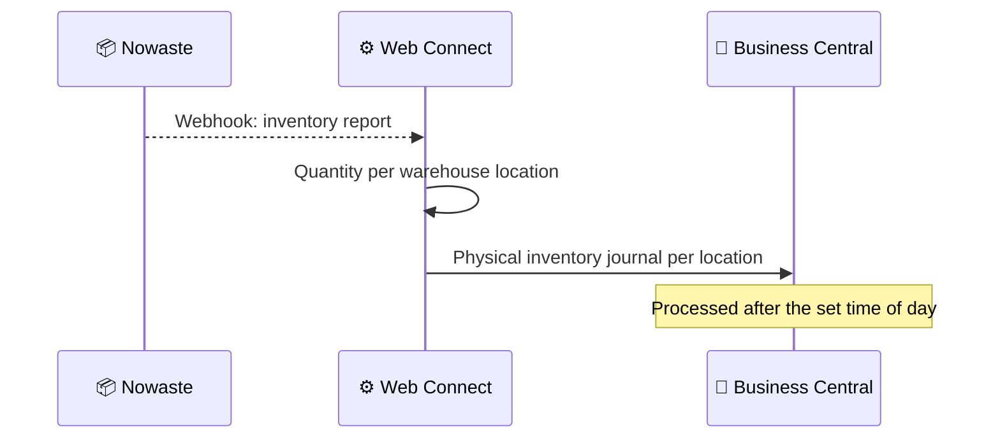

# Nowaste to Business Central: stock reconciliation

Nowaste sends an inventory report with the quantity per item and warehouse location to Web Connect with a webhook. Web Connect puts the quantities in the physical inventory journal for each Business Central location, and processes the journal no earlier than a time of day you set. It catches anything the other flows missed.

| | |
|---|---|
| **Direction** | Nowaste → Business Central |
| **Trigger** | Webhook from Nowaste with an inventory report. [ATT FYLLA I: how often Nowaste sends the inventory report] |
| **Result** | A physical inventory journal per location in Business Central with the quantities from Nowaste |
| **Part of** | [Business Central and Nowaste integration](../overview.md) |

## Step by step

1. Nowaste sends an inventory report as a webhook. The Azure endpoint passes it on to Web Connect (Nowaste, Azure endpoint).
2. Web Connect reads the document type and hands the report to the stock balance object (Web Connect).
3. For each item, the quantity for the Nowaste warehouse location is read. If the report holds more than one warehouse location, each one is read into its own Business Central location (Web Connect).
4. The quantities are written to the physical inventory journal batch set in the logistics setup, no earlier than the time of day set there. Lines without a difference can be removed (Business Central).
5. The journal is posted (Business Central). [ATT FYLLA I: whether the physical inventory journal is posted automatically or by you]

## Data mapping

| Nowaste field | Business Central field | Note |
|---|---|---|
| `Lines.ItemNo` | Item No. and Variant Code | |
| `Lines.Quantities.WarehouseLocation` | Location | Selects which quantity is read for each Business Central location |
| `Lines.Quantities.Value` | Physical quantity on the journal line | |
| `Date` | Date on the journal line | |

## Web Connect objects

| Object | Role |
|---|---|
| `NW-INCOMING-WEBHOOK` | Receives every webhook from Nowaste and hands it on by document type |
| `NW-BALANCE`, `NW-LINES` | Inventory report and quantity per item for the first warehouse location |
| `NW-BALANCE2`, `NW-LINES2` | The same report read for another warehouse location |

## Error handling

| Situation | What happens | What to do |
|---|---|---|
| No inventory report has arrived | No new quantities in the journal | Check the webhook in [Entries](../../../general/entries.md), and ask Nowaste to resend the report |
| Large differences in the journal | Shipments, receipts or adjustments may be missing | Check those flows in [Entries](../../../general/entries.md) before the journal is posted |

## Frequently asked questions

### Is the stock in Business Central overwritten with the stock in Nowaste?

No. The quantities are put in a physical inventory journal, and the stock changes only when that journal is posted.

## Related

- [Business Central and Nowaste integration](../overview.md)
- [Stock adjustments](stock-adjustment.md)
- [Item Inventory](../../../general/item-inventory.md) · [Logistics Setup](../../../general/logistics-setup.md)
