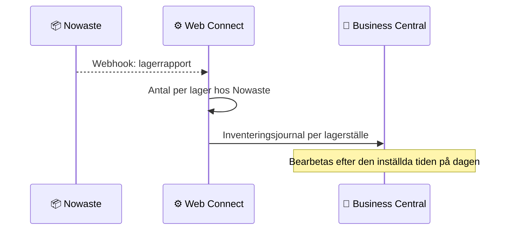

# Från Nowaste till Business Central: lageravstämning

Nowaste skickar en lagerrapport med antalet per artikel och lager till Web Connect med en webhook. Web Connect lägger antalen i inventeringsjournalen för varje lagerställe i Business Central och bearbetar journalen tidigast vid en tid på dagen som du bestämmer. Det fångar upp det som de andra flödena har missat.

| | |
|---|---|
| **Riktning** | Nowaste → Business Central |
| **Startas av** | Webhook från Nowaste med en lagerrapport, så ofta som det är uppsatt för varje kund |
| **Resultat** | En inventeringsjournal per lagerställe i Business Central med antalen från Nowaste |
| **Del av** | [Business Central och Nowaste: integration](../overview.md) |

## Steg för steg

1. Nowaste skickar en lagerrapport som webhook. Azure-endpointen skickar den vidare till Web Connect (Nowaste, Azure-endpoint).
2. Web Connect läser dokumenttypen och lämnar rapporten till objektet för lagersaldo (Web Connect).
3. För varje artikel läses antalet för lagret hos Nowaste. Innehåller rapporten mer än ett lager läses vart och ett in till ett eget lagerställe i Business Central (Web Connect).
4. Antalen skrivs till den inventeringsjournalsats som anges i logistikinställningarna, tidigast vid den tid på dagen som anges där. Rader utan skillnad kan tas bort (Business Central).
5. Journalen bokförs automatiskt eller av dig, enligt valet i logistikinställningarna (Business Central).

## Mappning av data

| Fält i Nowaste | Fält i Business Central | Kommentar |
|---|---|---|
| `Lines.ItemNo` | Item No. och Variant Code | |
| `Lines.Quantities.WarehouseLocation` | Lagerställe | Avgör vilket antal som läses för varje lagerställe i Business Central |
| `Lines.Quantities.Value` | Inventerat antal på journalraden | |
| `Date` | Datum på journalraden | |

## Objekt i Web Connect

| Objekt | Roll |
|---|---|
| `NW-INCOMING-WEBHOOK` | Tar emot varje webhook från Nowaste och lämnar den vidare efter dokumenttyp |
| `NW-BALANCE`, `NW-LINES` | Lagerrapporten och antal per artikel för det första lagret |
| `NW-BALANCE2`, `NW-LINES2` | Samma rapport inläst för ett annat lager |

## Felhantering

| Situation | Vad som händer | Vad du gör |
|---|---|---|
| Ingen lagerrapport har kommit | Inga nya antal i journalen | Kontrollera webhooken i [Entries](../../../general/entries.md), och kontakta Nowaste om rapporten aldrig skickades |
| Stora skillnader i journalen | Leveranser, inleveranser eller justeringar kan saknas | Kontrollera de flödena i [Entries](../../../general/entries.md) innan journalen bokförs |

## Vanliga frågor

### Skrivs lagersaldot i Business Central över med saldot i Nowaste?

Nej. Antalen läggs i en inventeringsjournal, och lagersaldot ändras först när journalen bokförs, automatiskt eller av dig, enligt valet i logistikinställningarna.

## Relaterat

- [Business Central och Nowaste: integration](../overview.md)
- [Lagerjusteringar](stock-adjustment.md)
- [Item Inventory](../../../general/item-inventory.md) · [Logistics Setup](../../../general/logistics-setup.md)
