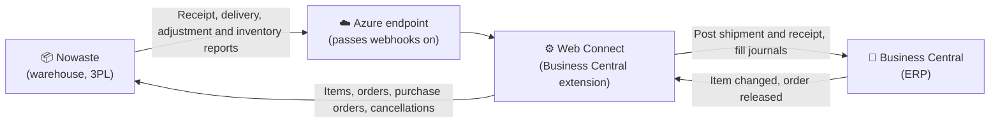
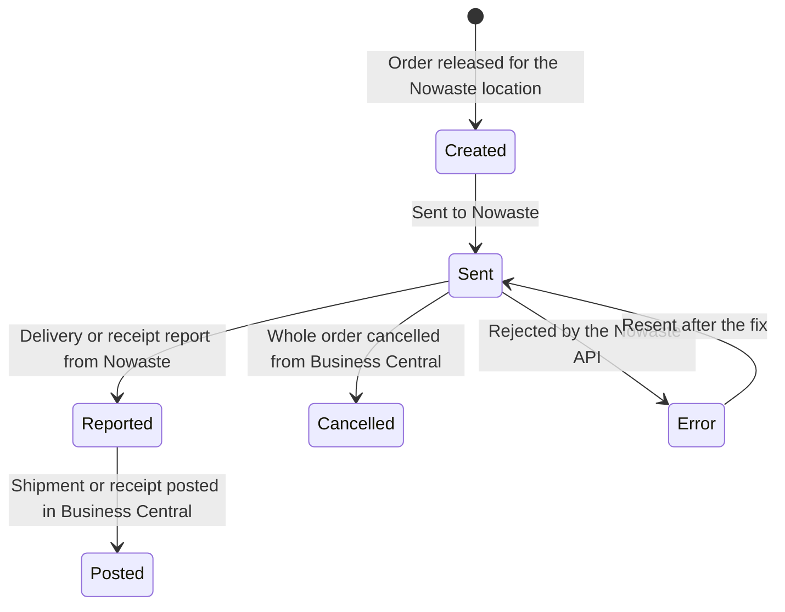
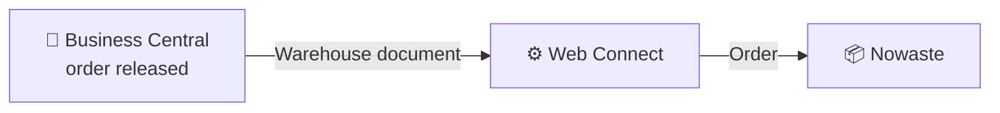
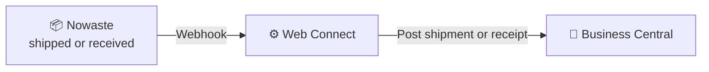
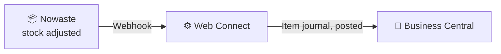
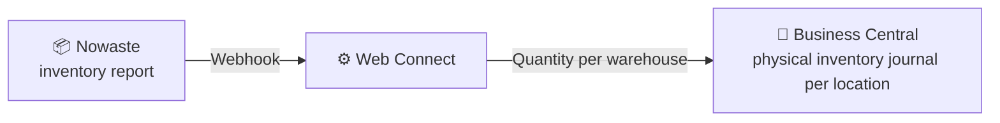
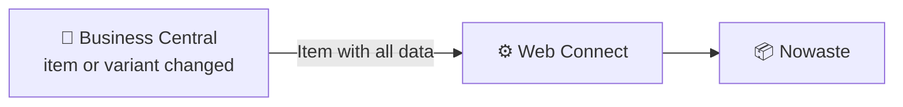

# Business Central and Nowaste integration

Web Connect by CombineIT connects Microsoft Dynamics 365 Business Central with Nowaste, the third party logistics (3PL) provider. Items, outbound orders and inbound deliveries are sent from Business Central to Nowaste, and shipments, receipts, stock adjustments and stock balances come back to Business Central. All mappings and rules live in your own Business Central, where you can see and change them yourself.

## At a glance

| | |
|---|---|
| **System** | Nowaste Logistics (warehouse, 3PL) |
| **Integration product** | Web Connect for Microsoft Dynamics 365 Business Central |
| **Runs in** | Your own Business Central environment, as an extension. Items are sent when they change, and orders are sent when they are released. Nowaste reports shipments, receipts, stock adjustments and stock balances with webhooks, which an Azure endpoint receives and passes on to Web Connect. All processing and configuration stays in Business Central. |
| **Configured by** | You, in Business Central: mappings, conditions, triggers and flows. You can do all of it yourself. If you want, CombineIT takes part in any step, as a sounding board or by doing the work. |
| **Connection** | REST API with JSON for calls to Nowaste, with a user ID and password in the request headers. Webhooks from Nowaste to Business Central |
| **Nowaste API** | [Nowaste order API (Swagger)](https://api.nowaste.se/NowasteOrder/swagger/index.html) |
| **Data flows** | 7: items, outbound orders, inbound deliveries, shipments, receipts, stock adjustments and stock reconciliation |
| **Business Central editions** | All editions, Essentials and Premium, including the latest version |
| **Available from** | [Web Connect on Microsoft AppSource](https://marketplace.microsoft.com/sv-se/product/PUBID.martitab1633951001710%7CAID.webconnect%7CPAPPID.9f3a7223-19db-4ac7-832f-cf8e4699186f?tab=Overview). The Nowaste integration is not part of the Web Connect Ready Integrations app. It is set up as a configuration in Web Connect |

## What can be synchronized

Web Connect has seven data flows between Business Central and Nowaste.

| Data | Direction | What happens |
|---|---|---|
| [Items](flows/items.md) | Business Central → Nowaste | Items and variants are created or updated in Nowaste, with barcodes, weight, country of origin, tariff number and dangerous goods data |
| [Outbound orders](flows/order-outbound.md) | Business Central → Nowaste | Released sales orders and outbound transfer orders are sent as orders, with the recipient and delivery details. A whole order can be cancelled |
| [Inbound deliveries](flows/purchase-order.md) | Business Central → Nowaste | Purchase orders, and sales return orders if you choose, are sent as purchase orders that the warehouse expects to receive |
| [Shipments](flows/shipment.md) | Nowaste → Business Central | Shipped quantities, tracking references and package IDs come back, and the shipment is posted |
| [Receipts](flows/receipt.md) | Nowaste → Business Central | Received quantities come back, and the receipt is posted |
| [Stock adjustments](flows/stock-adjustment.md) | Nowaste → Business Central | Stock changes in the warehouse, with the reason, are written to an item journal and can be posted automatically |
| [Stock reconciliation](flows/stock-reconciliation.md) | Nowaste → Business Central | The stock report from Nowaste is put in a physical inventory journal per warehouse location |

All seven flows are part of the one Nowaste integration in production today. See [Choose your setup](#choose-your-setup).

## How it works

Web Connect uses the [WMS documents](../../general/wms-documents.md) in Business Central: a released sales order, transfer order, purchase order or return order for the Nowaste location gets a warehouse document, which is sent to the Nowaste order API. Nowaste reports back with webhooks. Each webhook has a document type, such as receipt report, delivery report or inventory report, and Web Connect uses a text mapping to hand it to the right object. The data is then processed by the job queue in Business Central, which updates the warehouse documents, posts shipments and receipts and fills the journals. Every message in both directions is logged in Web Connect [Entries](../../general/entries.md), where it can be inspected and processed again.

### Warehouse document status in Business Central

## Choose your setup

Each flow has to fit how your business works: which system owns the data, where people do their work, and what the accounting needs. That is why the flows are decided together when a new integration is set up. The options below are the ones Web Connect customers use today. **Common setup** marks the option most Web Connect customers with Nowaste use. **Recommended** marks CombineIT's best practice, where there is one.

Only one Web Connect customer runs Nowaste today, so no option is marked as common setup. Each area below shows how that integration is set up. Other options in the [logistics setup](../../general/logistics-setup.md) work the same way as for other warehouse systems, but they have not been used with Nowaste yet.

### Outbound orders

| Option | How it works | When it fits |
|---|---|---|
| **Sent when the order is released** | When a sales order or an outbound transfer order for the Nowaste location is released, its warehouse document is sent to Nowaste as an order | Business Central is where orders are handled, and the warehouse should get them without a manual step |

#### Outbound orders sent when the order is released

### Shipments and receipts

| Option | How it works | When it fits |
|---|---|---|
| **Posted automatically** | When Nowaste reports a delivery or a receipt, the quantities are written to the warehouse document and the shipment or receipt is posted with the work date as posting date. Sales orders are shipped and invoiced in the same posting | The warehouse's quantities can be trusted without a manual check |

#### Shipments and receipts posted automatically

### Stock adjustments

| Option | How it works | When it fits |
|---|---|---|
| **Posted automatically** | Stock changes reported by Nowaste are written to an item journal batch for the warehouse and posted at once, with the warehouse's reason on each line | The warehouse's adjustments should be in Business Central without a manual step |

#### Stock adjustments posted automatically

### Stock reconciliation

| Option | How it works | When it fits |
|---|---|---|
| **One location per Nowaste warehouse** | The inventory report from Nowaste lists the quantity per warehouse location. Each Nowaste warehouse is read into its own Business Central location and physical inventory journal batch | Nowaste holds your stock in more than one warehouse |

#### Stock reconciliation with one location per Nowaste warehouse

### Item data

| Option | How it works | When it fits |
|---|---|---|
| **All item data from Business Central** | Item number with variant, description, unit, barcodes, weight, country of origin, tariff number, dangerous goods data and attributes are sent from Business Central when one of the trigger fields changes | Business Central owns the item data |

#### All item data from Business Central

Storage, picking, packing and carrier booking are always handled in Nowaste.

## What you need

- Microsoft Dynamics 365 Business Central, any edition (Essentials or Premium), including the latest version
- Web Connect installed from Microsoft AppSource, with an activated Web Connect license
- Your approval for Web Connect to be installed and to act in your Business Central environment
- An API user ID and password from Nowaste, created in Nowaste
- A location in Business Central for each Nowaste warehouse you use, a number series for warehouse documents, an item journal batch for stock adjustments and a physical inventory journal batch for the stock reconciliation
- Nowaste set up to send its receipt, delivery, adjustment and inventory reports as webhooks to your Web Connect endpoint

## Setting it up

1. Decide which flows to use and which option to choose for each, see [Choose your setup](#choose-your-setup).
2. Install Web Connect in Business Central, activate the license and give your approval.
3. Import the Nowaste configuration with the integration turned off, then set your locations, journal batches and the Nowaste warehouse ID for each location.
4. Store the user ID and password from Nowaste in [Secret Value Storage](../../general/secret-value-storage.md) and use them in the request headers.
5. Translate your codes to Nowaste's codes in [Text Mapping](../../general/text-mapping.md): customer and haulier IDs, delivery terms and order status.
6. Give Nowaste the webhook address, so that receipt, delivery, adjustment and inventory reports reach Web Connect.
7. Send the items to Nowaste, then test orders, purchase orders, returns and cancellations before going live.

## Configure it yourself in Business Central

All configuration and logic in the integration is visible and editable in Business Central. There is no external integration platform where the logic is hidden. The Azure endpoint that receives webhooks only passes the call on to Web Connect.

| What you can change | Where in Web Connect | Example |
|---|---|---|
| Which documents are integrated | [Logistics Setup](../../general/logistics-setup.md) | Send sales orders, outbound transfer orders, purchase orders and sales return orders for the Nowaste location |
| Whether shipments, receipts and adjustments are posted | [Logistics Setup](../../general/logistics-setup.md) | Post shipments and receipts automatically, with the work date as posting date, and allow over receipts within a tolerance |
| What is sent to the warehouse | [Outgoing Mapping](../../general/outgoing-mapping/README.md) | Add or remove a field on the item or the order |
| What triggers an item update | [Outgoing Sync Triggers](../../general/outgoing-mapping/outgoing-sync-triggers.md) | Resend the item when its description, weight or a variant field changes |
| Rules for the order content | [Condition List](../../general/condition-list.md) | Use the customer's order number as reference for one sales channel, or send prices without VAT for one market |
| How values are translated | [Text Mapping](../../general/text-mapping.md) | Translate a Business Central code to a Nowaste customer ID, or a Nowaste status to a warehouse document status |
| Which incoming report goes where | [Text Mapping](../../general/text-mapping.md) | Hand each Nowaste document type to the object that processes it |
| Monitoring and processing again | [Entries](../../general/entries.md) | See every order and report, and [resend a message](../../../../how-to/web-connect/resend-outgoing-message.md) |

## Configuration choices

- **Locations:** which Business Central location each Nowaste warehouse is, and which Nowaste warehouse ID it has. Only documents for those locations are sent.
- **Document types:** sales orders, outbound transfer orders, purchase orders and sales return orders are switched on one by one in the logistics setup.
- **Returns:** whether sales return orders are sent to Nowaste as receipts.
- **Posting rules:** whether shipments and receipts are posted automatically, which posting date is used, and whether sales orders are invoiced when they are shipped.
- **Tolerances:** whether more than ordered may be received or shipped, and by how many percent.
- **Cancellations:** whether a whole order sent to Nowaste may be cancelled from Business Central.
- **Stock adjustments:** which item journal batch is used, whether it is posted automatically, and how the warehouse's transaction types are translated to text.
- **Stock reconciliation:** which physical inventory journal batch is used, the earliest time of day it is processed, and whether lines without a difference are removed.
- **Item data:** which item fields are sent, and how the item number and variant code are combined into one Nowaste item ID.
- **Order details:** how delivery terms, haulier, the customer's order number and prices with or without VAT are set, with conditions per sales channel, market or carrier.
- **Error handling:** how many times a failed message is retried, and how long old transactions are kept.

## Limitations

- **Cancellations are for whole orders only.** Single lines on an order that has been sent cannot be cancelled from Business Central.
- **Items are sent per Nowaste warehouse.** If you use more than one Nowaste warehouse, there is one item object for each warehouse.
- **Pallet details are not stored.** Pallet IDs on receipts are not saved in Business Central, and weight and volume on deliveries are not saved either.
- **Reports depend on Nowaste's webhooks.** Web Connect does not ask Nowaste for shipments, receipts or stock. If a webhook does not arrive, the report has to be sent again from Nowaste. [ATT FYLLA I: confirm that Nowaste can resend a report, and how]
- **The stock balance is reconciled through a journal.** Differences in the inventory report are put in a physical inventory journal. [ATT FYLLA I: whether the physical inventory journal is posted automatically or by you]

## Frequently asked questions

### Can Business Central be integrated with Nowaste?

Yes. Web Connect connects Business Central with the Nowaste order API. Items, outbound orders and inbound deliveries are sent to Nowaste, and Nowaste reports shipments, receipts, stock adjustments and stock balances back to Business Central.

### Can an order that has already been sent to Nowaste be cancelled from Business Central?

Yes, for the whole order. When you send a cancellation to the warehouse from Business Central, Web Connect sends a delete request for the order to Nowaste. Single lines cannot be cancelled this way.

### Does an item have to exist in Nowaste before an order or purchase order is sent?

Yes. Nowaste needs the item to handle the order or the receipt. Web Connect sends item data to Nowaste when the item data in Business Central changes, so new items and variants reach Nowaste before they are ordered. [ATT FYLLA I: whether item data is also sent automatically right before a purchase order is sent]

### Is the stock in Business Central overwritten with the stock in Nowaste?

No. The stock balance from Nowaste is put in a physical inventory journal. Single stock adjustments from Nowaste are posted through an item journal with the warehouse's reason, so every change can be traced.

## Related

- Flows: [Items](flows/items.md) · [Outbound orders](flows/order-outbound.md) · [Inbound deliveries](flows/purchase-order.md) · [Shipments](flows/shipment.md) · [Receipts](flows/receipt.md) · [Stock adjustments](flows/stock-adjustment.md) · [Stock reconciliation](flows/stock-reconciliation.md)
- How-to: [WMS request not sent](../../../../how-to/web-connect/wms-request-not-sent-error.md) · [Resend an outgoing message](../../../../how-to/web-connect/resend-outgoing-message.md) · [Integrations not running](../../../../how-to/web-connect/integration-not-running.md)
- Web Connect: [Logistics Setup](../../general/logistics-setup.md) · [WMS documents](../../general/wms-documents.md) · [Webhooks](../../general/webhooks.md) · [Secret Value Storage](../../general/secret-value-storage.md)
- [Web Connect general documentation](../../general/README.md)
- [Nowaste Logistics](https://www.nowaste.se/)

## About Web Connect

Web Connect is an integration platform for Microsoft Dynamics 365 Business Central, developed by CombineIT. It is installed in your own Business Central and connects it with e-commerce platforms, warehouse systems, POS, returns, marketplaces and EDI. Every flow, mapping and rule is configured in Business Central, where you can see and change it yourself, without custom code for each integration. [Web Connect on Microsoft AppSource](https://marketplace.microsoft.com/sv-se/product/PUBID.martitab1633951001710%7CAID.webconnect%7CPAPPID.9f3a7223-19db-4ac7-832f-cf8e4699186f?tab=Overview) · [Contact CombineIT](https://www.combineit.se/contact/)
