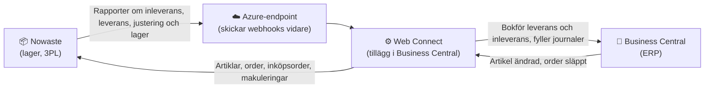
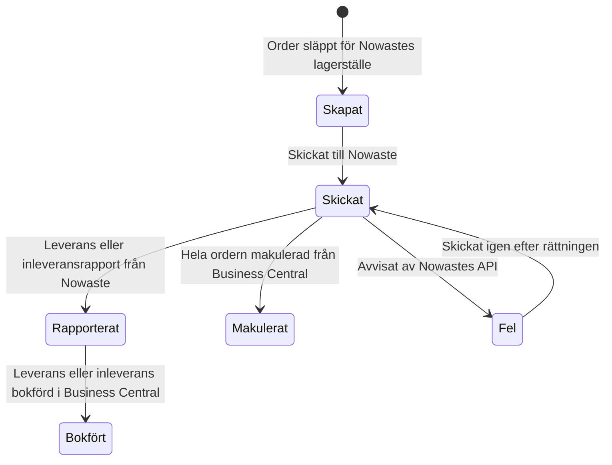
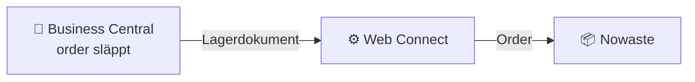
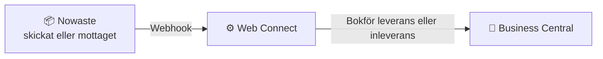
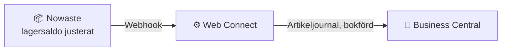
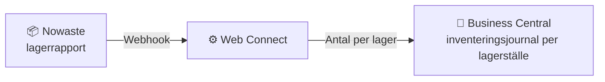
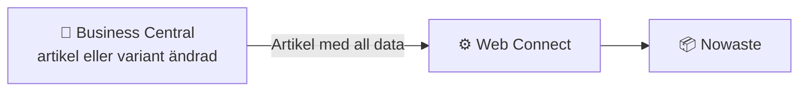

# Business Central och Nowaste: integration

Web Connect från CombineIT kopplar Microsoft Dynamics 365 Business Central till Nowaste, som är tredjepartslogistiker (3PL). Artiklar, utgående order och förväntade inleveranser skickas från Business Central till Nowaste, och leveranser, inleveranser, lagerjusteringar och lagersaldon kommer tillbaka till Business Central. Alla mappningar och regler finns i ditt eget Business Central, där du själv kan se och ändra dem.

## I korthet

| | |
|---|---|
| **System** | Nowaste Logistics (lager, 3PL) |
| **Integrationsprodukt** | Web Connect för Microsoft Dynamics 365 Business Central |
| **Körs i** | Din egen Business Central-miljö, som ett tillägg. Artiklar skickas när de ändras, och order skickas när de släpps. Nowaste rapporterar leveranser, inleveranser, lagerjusteringar och lagersaldon med webhooks, som en Azure-endpoint tar emot och skickar vidare till Web Connect. All bearbetning och konfiguration stannar i Business Central. |
| **Konfigureras av** | Dig, i Business Central: mappningar, villkor, triggers och flöden. Du kan göra allt själv. Vill du kan CombineIT vara med i vilket steg som helst, som bollplank eller genom att göra jobbet. |
| **Koppling** | REST API med JSON för anrop till Nowaste, med användar-ID och lösenord i anropets headers. Webhooks från Nowaste till Business Central |
| **API för Nowaste** | [Nowastes order-API (Swagger)](https://api.nowaste.se/NowasteOrder/swagger/index.html) |
| **Dataflöden** | 7: artiklar, utgående order, förväntade inleveranser, leveranser, inleveranser, lagerjusteringar och lageravstämning |
| **Business Central-utgåvor** | Alla utgåvor, Essentials och Premium, även den senaste versionen |
| **Finns på** | [Web Connect på Microsoft AppSource](https://marketplace.microsoft.com/sv-se/product/PUBID.martitab1633951001710%7CAID.webconnect%7CPAPPID.9f3a7223-19db-4ac7-832f-cf8e4699186f?tab=Overview). Integrationen med Nowaste ingår inte i appen Web Connect Ready Integrations. Den sätts upp som en konfiguration i Web Connect |

## Det här kan synkas

Web Connect har sju dataflöden mellan Business Central och Nowaste.

| Data | Riktning | Vad som händer |
|---|---|---|
| [Artiklar](flows/items.md) | Business Central → Nowaste | Artiklar och varianter skapas eller uppdateras i Nowaste, med streckkoder, vikt, ursprungsland, tullnummer och uppgifter om farligt gods |
| [Utgående order](flows/order-outbound.md) | Business Central → Nowaste | Släppta försäljningsorder och utgående flyttorder skickas som order, med mottagare och leveransuppgifter. En hel order kan makuleras |
| [Förväntade inleveranser](flows/purchase-order.md) | Business Central → Nowaste | Inköpsorder, och om du vill även returorder, skickas som inköpsorder som lagret väntar sig att ta emot |
| [Leveranser](flows/shipment.md) | Nowaste → Business Central | Skickade antal, spårningsreferenser och kolli-ID kommer tillbaka, och leveransen bokförs |
| [Inleveranser](flows/receipt.md) | Nowaste → Business Central | Mottagna antal kommer tillbaka, och inleveransen bokförs |
| [Lagerjusteringar](flows/stock-adjustment.md) | Nowaste → Business Central | Ändringar av lagersaldot i lagret, med orsak, skrivs till en artikeljournal och kan bokföras automatiskt |
| [Lageravstämning](flows/stock-reconciliation.md) | Nowaste → Business Central | Lagerrapporten från Nowaste läggs i en inventeringsjournal per lagerställe |

Alla sju flödena ingår i den enda integrationen med Nowaste som är i drift i dag. Se [Välj upplägg](#choose-your-setup).

## Så fungerar det

Web Connect använder [WMS-dokumenten](../../general/wms-documents.md) i Business Central: en släppt försäljningsorder, flyttorder, inköpsorder eller returorder för Nowastes lagerställe får ett lagerdokument, som skickas till Nowastes order-API. Nowaste rapporterar tillbaka med webhooks. Varje webhook har en dokumenttyp, till exempel inleveransrapport, leveransrapport eller lagerrapport, och Web Connect använder en textmappning för att lämna den till rätt objekt. Datan bearbetas sedan av jobbkön i Business Central, som uppdaterar lagerdokumenten, bokför leveranser och inleveranser och fyller journalerna. Varje meddelande i båda riktningarna loggas i Web Connect [Entries](../../general/entries.md), där det kan granskas och bearbetas igen.

### Lagerdokumentets status i Business Central

## Välj upplägg

Varje flöde måste passa hur ditt företag arbetar: vilket system som äger datan, var personalen gör sitt arbete och vad bokföringen behöver. Därför bestäms flödena tillsammans när en ny integration sätts upp. Alternativen nedan är de som Web Connect-kunder använder i dag. **Vanligt upplägg** markerar det alternativ som flest Web Connect-kunder med Nowaste använder. **Rekommenderas** markerar CombineIT:s bästa praxis, där det finns en.

Bara en Web Connect-kund kör Nowaste i dag, så inget alternativ är markerat som vanligt upplägg. Varje område nedan visar hur den integrationen är uppsatt. Andra alternativ i [logistikinställningarna](../../general/logistics-setup.md) fungerar på samma sätt som för andra lagersystem, men de har inte använts med Nowaste än.

### Utgående order

| Alternativ | Så fungerar det | När det passar |
|---|---|---|
| **Skickas när ordern släpps** | När en försäljningsorder eller en utgående flyttorder för Nowastes lagerställe släpps skickas dess lagerdokument till Nowaste som en order | Orderna hanteras i Business Central, och lagret ska få dem utan något manuellt steg |

#### Utgående order som skickas när ordern släpps

### Leveranser och inleveranser

| Alternativ | Så fungerar det | När det passar |
|---|---|---|
| **Bokförs automatiskt** | När Nowaste rapporterar en leverans eller en inleverans skrivs antalen till lagerdokumentet, och leveransen eller inleveransen bokförs med arbetsdatumet som bokföringsdatum. Försäljningsorder levereras och faktureras i samma bokföring | Lagrets antal går att lita på utan manuell kontroll |

#### Leveranser och inleveranser som bokförs automatiskt

### Lagerjusteringar

| Alternativ | Så fungerar det | När det passar |
|---|---|---|
| **Bokförs automatiskt** | Ändringar av lagersaldot som Nowaste rapporterar skrivs till en artikeljournalsats för lagret och bokförs direkt, med lagrets orsak på varje rad | Lagrets justeringar ska finnas i Business Central utan något manuellt steg |

#### Lagerjusteringar som bokförs automatiskt

### Lageravstämning

| Alternativ | Så fungerar det | När det passar |
|---|---|---|
| **Ett lagerställe per lager hos Nowaste** | Lagerrapporten från Nowaste visar antalet per lager. Varje lager hos Nowaste läses in till ett eget lagerställe och en egen inventeringsjournalsats i Business Central | Nowaste har ditt lager i mer än ett av sina lager |

#### Lageravstämning med ett lagerställe per lager hos Nowaste

### Artikeldata

| Alternativ | Så fungerar det | När det passar |
|---|---|---|
| **All artikeldata från Business Central** | Artikelnummer med variant, beskrivning, enhet, streckkoder, vikt, ursprungsland, tullnummer, uppgifter om farligt gods och attribut skickas från Business Central när något av triggerfälten ändras | Business Central äger artikeldatan |

#### All artikeldata från Business Central

Lagerhållning, plockning, packning och transportbokning sköts alltid i Nowaste.

## Det här behöver du

- Microsoft Dynamics 365 Business Central, valfri utgåva (Essentials eller Premium), även den senaste versionen
- Web Connect installerat från Microsoft AppSource, med en aktiverad Web Connect-licens
- Ditt godkännande av att Web Connect installeras och får agera i din Business Central-miljö
- Ett användar-ID och lösenord för API:et från Nowaste, skapat i Nowaste
- Ett lagerställe i Business Central för varje lager hos Nowaste som du använder, en nummerserie för lagerdokument, en artikeljournalsats för lagerjusteringar och en inventeringsjournalsats för lageravstämningen
- Nowaste uppsatt så att inleverans-, leverans-, justerings- och lagerrapporter skickas som webhooks till din endpoint i Web Connect

## Så kommer du igång

1. Bestäm vilka flöden du ska använda och vilket alternativ du väljer för varje, se [Välj upplägg](#choose-your-setup).
2. Installera Web Connect i Business Central, aktivera licensen och ge ditt godkännande.
3. Importera konfigurationen för Nowaste med integrationen avstängd, och ställ sedan in lagerställen, journalsatser och Nowastes lager-ID för varje lagerställe.
4. Spara användar-ID:t och lösenordet från Nowaste i [Secret Value Storage](../../general/secret-value-storage.md) och använd dem i anropets headers.
5. Översätt dina koder till Nowastes koder i [Text Mapping](../../general/text-mapping.md): kund-ID och transportörs-ID, leveransvillkor och orderstatus.
6. Ge Nowaste adressen för webhooks, så att inleverans-, leverans-, justerings- och lagerrapporter når Web Connect.
7. Skicka artiklarna till Nowaste och testa sedan order, inköpsorder, returer och makuleringar innan ni går live.

## Konfigurera själv i Business Central

All konfiguration och logik i integrationen syns och kan ändras i Business Central. Det finns ingen extern integrationsplattform där logiken är dold. Azure-endpointen som tar emot webhooks skickar bara vidare anropet till Web Connect.

| Det här kan du ändra | Var i Web Connect | Exempel |
|---|---|---|
| Vilka dokument som integreras | [Logistics Setup](../../general/logistics-setup.md) | Skicka försäljningsorder, utgående flyttorder, inköpsorder och returorder för Nowastes lagerställe |
| Om leveranser, inleveranser och justeringar bokförs | [Logistics Setup](../../general/logistics-setup.md) | Bokför leveranser och inleveranser automatiskt, med arbetsdatumet som bokföringsdatum, och tillåt överinleverans inom en tolerans |
| Vad som skickas till lagret | [Outgoing Mapping](../../general/outgoing-mapping/README.md) | Lägg till eller ta bort ett fält på artikeln eller ordern |
| Vad som startar en artikeluppdatering | [Outgoing Sync Triggers](../../general/outgoing-mapping/outgoing-sync-triggers.md) | Skicka artikeln igen när beskrivningen, vikten eller ett variantfält ändras |
| Regler för orderns innehåll | [Condition List](../../general/condition-list.md) | Använd kundens ordernummer som referens för en försäljningskanal, eller skicka priser utan moms för en marknad |
| Hur värden översätts | [Text Mapping](../../general/text-mapping.md) | Översätt en kod i Business Central till ett kund-ID hos Nowaste, eller en status från Nowaste till en status på lagerdokumentet |
| Vart varje inkommande rapport går | [Text Mapping](../../general/text-mapping.md) | Lämna varje dokumenttyp från Nowaste till objektet som bearbetar den |
| Bevakning och ny bearbetning | [Entries](../../general/entries.md) | Se varje order och rapport, och [skicka om ett meddelande](../../../../how-to/web-connect/resend-outgoing-message.md) |

## Val i konfigurationen

- **Lagerställen:** vilket lagerställe i Business Central varje lager hos Nowaste är, och vilket lager-ID det har hos Nowaste. Bara dokument för de lagerställena skickas.
- **Dokumenttyper:** försäljningsorder, utgående flyttorder, inköpsorder och returorder slås på var för sig i logistikinställningarna.
- **Returer:** om returorder skickas till Nowaste som inleveranser.
- **Regler för bokföring:** om leveranser och inleveranser bokförs automatiskt, vilket bokföringsdatum som används och om försäljningsorder faktureras när de levereras.
- **Toleranser:** om mer än beställt får tas emot eller levereras, och med hur många procent.
- **Makuleringar:** om en hel order som skickats till Nowaste får makuleras från Business Central.
- **Lagerjusteringar:** vilken artikeljournalsats som används, om den bokförs automatiskt och hur lagrets transaktionstyper översätts till text.
- **Lageravstämning:** vilken inventeringsjournalsats som används, den tidigaste tiden på dagen den bearbetas, om rader utan skillnad tas bort och om journalen bokförs automatiskt.
- **Artikeldata:** vilka artikelfält som skickas, vilka händelser som skickar dem (till exempel en ändrad variant, eller en inköpsorder som skickas till lagret) och hur artikelnummer och variantkod sätts ihop till ett artikel-ID hos Nowaste.
- **Orderuppgifter:** hur leveransvillkor, transportör, kundens ordernummer och priser med eller utan moms sätts, med villkor per försäljningskanal, marknad eller transportör.
- **Felhantering:** hur många gånger ett misslyckat meddelande försöks igen, och hur länge gamla transaktioner sparas.

## Begränsningar

- **Makuleringar gäller bara hela order.** Enskilda rader på en order som har skickats kan inte makuleras från Business Central.
- **Artiklar skickas per lager hos Nowaste.** Använder du mer än ett lager hos Nowaste finns ett artikelobjekt för varje lager.
- **Pallinformation sparas inte.** Pall-ID på inleveranser sparas inte i Business Central, och inte heller vikt och volym på leveranser.
- **Rapporterna är beroende av Nowastes webhooks.** Web Connect frågar inte Nowaste efter leveranser, inleveranser eller lagersaldo. Kommer en rapport inte fram: kontakta Nowaste.
- **Lagersaldot stäms av via en journal.** Skillnader i lagerrapporten läggs i en inventeringsjournal. Om journalen bokförs automatiskt eller av dig väljer du i logistikinställningarna.

## Vanliga frågor

### Går det att integrera Business Central med Nowaste?

Ja. Web Connect kopplar Business Central till Nowastes order-API. Artiklar, utgående order och förväntade inleveranser skickas till Nowaste, och Nowaste rapporterar leveranser, inleveranser, lagerjusteringar och lagersaldon tillbaka till Business Central.

### Kan en order som redan skickats till Nowaste makuleras från Business Central?

Ja, för hela ordern. När du skickar en makulering till lagret från Business Central skickar Web Connect en begäran till Nowaste om att ta bort ordern. Enskilda rader kan inte makuleras på det här sättet.

### Måste en artikel finnas i Nowaste innan en order eller inköpsorder skickas?

Ja. Nowaste behöver artikeln för att kunna hantera ordern eller inleveransen. Web Connect skickar artikeldata till Nowaste när artikeldatan i Business Central ändras, så nya artiklar och varianter når Nowaste innan de beställs. Vilka händelser som skickar artikeldata ställs in i Outgoing Sync Triggers, så artikeldata kan också skickas när en inköpsorder skickas till lagret.

### Skrivs lagersaldot i Business Central över med saldot i Nowaste?

Nej. Lagersaldot från Nowaste läggs i en inventeringsjournal. Enskilda lagerjusteringar från Nowaste bokförs via en artikeljournal med lagrets orsak, så att varje ändring går att spåra.

## Relaterat

- Flöden: [Artiklar](flows/items.md) · [Utgående order](flows/order-outbound.md) · [Förväntade inleveranser](flows/purchase-order.md) · [Leveranser](flows/shipment.md) · [Inleveranser](flows/receipt.md) · [Lagerjusteringar](flows/stock-adjustment.md) · [Lageravstämning](flows/stock-reconciliation.md)
- Instruktioner: [WMS-anrop skickas inte](../../../../how-to/web-connect/wms-request-not-sent-error.md) · [Skicka om ett utgående meddelande](../../../../how-to/web-connect/resend-outgoing-message.md) · [Integrationer körs inte](../../../../how-to/web-connect/integration-not-running.md)
- Web Connect: [Logistics Setup](../../general/logistics-setup.md) · [WMS-dokument](../../general/wms-documents.md) · [Webhooks](../../general/webhooks.md) · [Secret Value Storage](../../general/secret-value-storage.md)
- [Allmän dokumentation för Web Connect](../../general/README.md)
- [Nowaste Logistics](https://www.nowaste.se/)

## Om Web Connect

Web Connect är en integrationsplattform för Microsoft Dynamics 365 Business Central, utvecklad av CombineIT. Den installeras i ditt eget Business Central och kopplar det till e-handelsplattformar, lagersystem, kassasystem, returlösningar, marknadsplatser och EDI. Varje flöde, mappning och regel konfigureras i Business Central, där du själv kan se och ändra den, utan specialkod för varje integration. [Web Connect på Microsoft AppSource](https://marketplace.microsoft.com/sv-se/product/PUBID.martitab1633951001710%7CAID.webconnect%7CPAPPID.9f3a7223-19db-4ac7-832f-cf8e4699186f?tab=Overview) · [Kontakta CombineIT](https://www.combineit.se/contact/)
