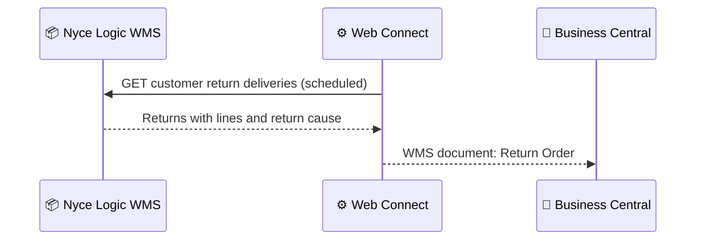

# Nyce Logic WMS to Business Central: customer returns

When the warehouse registers a customer return, usually from the original customer order or delivery, Web Connect fetches it from Nyce Logic WMS on a schedule. The return is logged in Business Central as a WMS document of type Return Order, with the returned item, quantity, the original order and the return cause.

| | |
|---|---|
| **Direction** | Nyce → Business Central |
| **Trigger** | Schedule in the Business Central job queue |
| **Result** | A WMS document of type Return Order in Business Central. [ATT FYLLA I: whether a sales return order is created and the return receipt posted automatically] |
| **Part of** | [Business Central and Nyce Logic WMS integration](../overview.md) |

## Step by step

1. Web Connect calls the Nyce customer return delivery API.
2. For each return in `Data.CustomerReturnDelivery`, Web Connect creates a WMS document of type Return Order, numbered with the Nyce document number.
3. The original customer order number is stored on the document.
4. Each line gets the returned item, quantity and return cause code.
5. [ATT FYLLA I: what Business Central does with the return after that]

## Data mapping

| Nyce field | Business Central field | Note |
|---|---|---|
| `DocumentNumber` | WMS document number | |
| `CustomerOrder.Number` | Original order number | |
| `Lines...Position` | Line No. | |
| `OriginalItem.Sku` | Item No. | |
| `Quantity` | Quantity | |
| `ReturnedQuantities...ReturnCause.Code` | Return reason code | See [WMS return reason codes](../../../general/wms-return-reason-codes.md) |

## Web Connect objects

| Object | Role |
|---|---|
| `NYCE-CUSTOMER-RETURN` | Fetches returns and creates the WMS document |
| `NYCE-CUSTOMERRETURNLINEDELIVERY` | Returned lines with item, quantity and return cause |

## Error handling

| Situation | What happens | What to do |
|---|---|---|
| The return cannot be processed | The WMS document gets an error | Read the error on the WMS document and correct the cause |

## Frequently asked questions

### Is the return cause from Nyce kept?

Yes. The return cause code registered in Nyce is written to each return line in Business Central.

## Related

- [Business Central and Nyce Logic WMS integration](../overview.md)
- [WMS Documents](../../../general/wms-documents.md)
