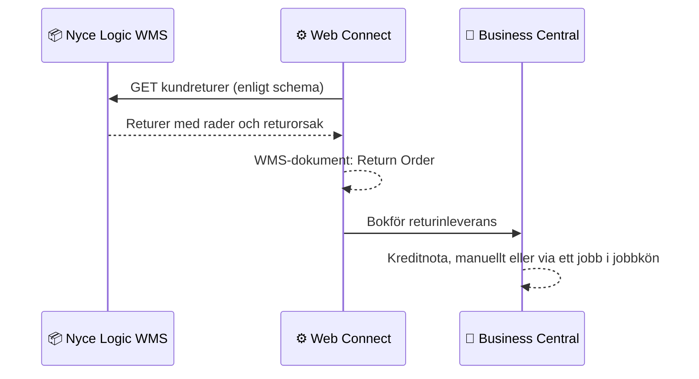

# Från Nyce Logic WMS till Business Central: kundreturer

När lagret registrerar en kundretur, oftast utifrån den ursprungliga kundordern eller leveransen, hämtar Web Connect den från Nyce Logic WMS enligt schema. Returen loggas som ett WMS-dokument av typen Return Order, med returnerad artikel, antal, ursprunglig order och returorsak, och returinleveransen bokförs i Business Central.

| | |
|---|---|
| **Riktning** | Nyce → Business Central |
| **Startas av** | Schema i jobbkön i Business Central |
| **Resultat** | En bokförd returinleverans i Business Central, följd av en kreditnota, och ett WMS-dokument av typen Return Order |
| **Del av** | [Business Central och Nyce Logic WMS: integration](../overview.md) |

## Steg för steg

1. Web Connect anropar Nyces API för kundreturer.
2. För varje retur i `Data.CustomerReturnDelivery` skapar Web Connect ett WMS-dokument av typen Return Order, numrerat med Nyces dokumentnummer.
3. Numret på den ursprungliga kundordern sparas på dokumentet.
4. Varje rad får returnerad artikel, antal och kod för returorsak.
5. Web Connect bokför returinleveransen, om det är påslaget. Det är det vanliga upplägget.
6. Kreditnotan bokförs efteråt. Den kan bokföras automatiskt av ett jobb i jobbkön i Business Central.

## Mappning av data

| Fält i Nyce | Fält i Business Central | Kommentar |
|---|---|---|
| `DocumentNumber` | WMS-dokumentets nummer | |
| `CustomerOrder.Number` | Ursprungligt ordernummer | |
| `Lines...Position` | Line No. | |
| `OriginalItem.Sku` | Item No. | |
| `Quantity` | Antal | |
| `ReturnedQuantities...ReturnCause.Code` | Kod för returorsak | Se [WMS return reason codes](../../../general/wms-return-reason-codes.md) |

## Objekt i Web Connect

| Objekt | Roll |
|---|---|
| `NYCE-CUSTOMER-RETURN` | Hämtar returer och skapar WMS-dokumentet |
| `NYCE-CUSTOMERRETURNLINEDELIVERY` | Returnerade rader med artikel, antal och returorsak |

## Felhantering

| Situation | Vad som händer | Vad du gör |
|---|---|---|
| Returen går inte att behandla | WMS-dokumentet får ett fel | Läs felet på WMS-dokumentet och rätta orsaken |

## Vanliga frågor

### Följer returorsaken från Nyce med?

Ja. Koden för returorsak som registrerats i Nyce skrivs till varje returrad i Business Central.

## Relaterat

- [Business Central och Nyce Logic WMS: integration](../overview.md)
- [WMS Documents](../../../general/wms-documents.md)
