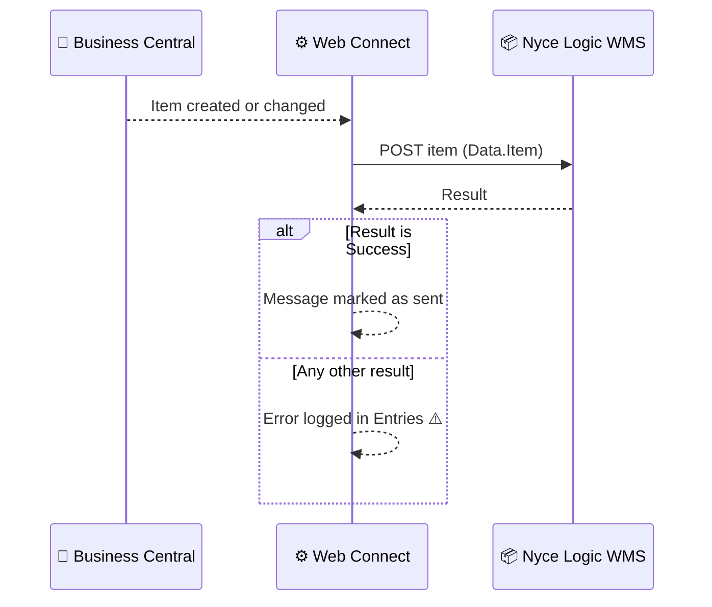

# Business Central to Nyce Logic WMS: items

When an inventory item is created or changed in Business Central, Web Connect sends it to Nyce Logic WMS. The item arrives with its SKU, barcodes, base unit, item category, supplier item code, country of origin and customs tariff number, so the warehouse can receive and pick it.

| | |
|---|---|
| **Direction** | Business Central → Nyce |
| **Trigger** | Outgoing sync trigger when an item changes in Business Central. Only inventory items are sent |
| **Result** | The item exists in Nyce with the same SKU as in Business Central |
| **Part of** | [Business Central and Nyce Logic WMS integration](../overview.md) |

## Step by step

1. An item is created or changed in Business Central.
2. The outgoing sync trigger creates an item message in Web Connect. Items are sent in batches of a few per message.
3. Web Connect wraps the items in the Nyce envelope under `Data.Item` and posts them to the Nyce item API.
4. Nyce answers with a result. Only `Success` marks the message as sent. Any other result is logged as an error.

## Data mapping

| Nyce field | Business Central field | Note |
|---|---|---|
| `Sku` | No. | Variants: item number and variant code with a delimiter |
| `ItemBase.Code`, `Name`, `Description` | No., Description | |
| `BarCodes.ItemBarCode` | GTIN | Sent as type EAN. Additional barcodes can be sent from item references |
| `Unit` | Base Unit of Measure | Translated with a value mapping |
| `ItemGroups.ItemGroup` | Item Category Code | |
| `SupplierItemCodes` | Vendor No., Vendor Item No. | Sent as preferred supplier with the vendor's currency |
| `CountryOfOrigin` | Country/Region of Origin Code | |
| `Commodity`, `CustomProperties` | Tariff No. | Customs data. More custom properties can be added |
| `PriceExcludingVat` | Unit Price | |
| `StandardCost` | Unit Cost | |
| `ItemStatus`, `WarehouseStatus`, `ItemType`, `ItemValuationType` | Fixed values | Set in the mapping |

## Web Connect objects

| Object | Role |
|---|---|
| `NYCE-ENVELOPE` | The envelope around every message to Nyce |
| `NYCE-DATA` | Puts the content under `Data`, with one condition per kind of content |
| `NYCE-ITEM` | The item, posted to the Nyce item API |
| `NYCE-BARCODES`, `NYCE-ITEMBARCODE` | Barcodes on the item |
| `NYCE-SUPPLIERITEMCODES` | Supplier and supplier item code |

## Error handling

| Situation | What happens | What to do |
|---|---|---|
| Nyce does not answer `Success` | The message is logged with the response from Nyce | Read the response in Entries, correct the item and [resend](../../../../../how-to/web-connect/resend-outgoing-message.md) |
| A new top level object is added without updating the condition on `NYCE-DATA` | The message is sent with an empty `Data` | Add the new object to the matching condition on `NYCE-DATA` |

## Frequently asked questions

### How are item variants sent to Nyce?

Each variant is sent as its own SKU, made of the item number and the variant code joined by a delimiter set in the Logistics Setup.

## Related

- [Business Central and Nyce Logic WMS integration](../overview.md)
- [Item dimensions and weights](item-dimensions.md)
- [Outgoing Sync Triggers](../../../general/outgoing-mapping/outgoing-sync-triggers.md)
