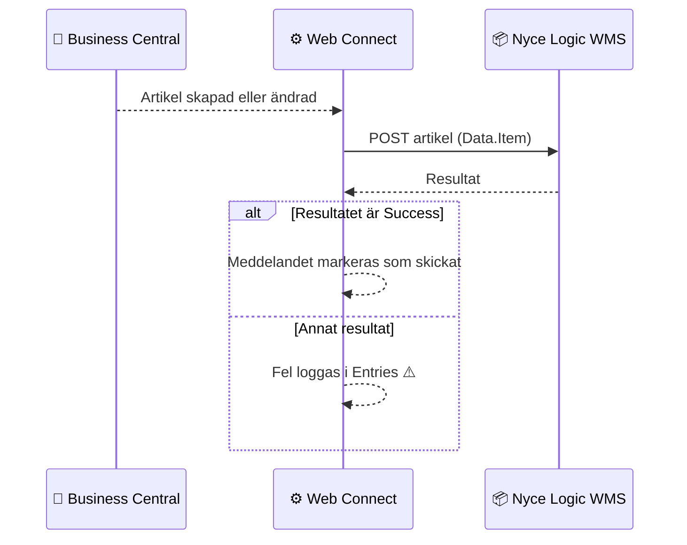

# Från Business Central till Nyce Logic WMS: artiklar

När en lagerartikel skapas eller ändras i Business Central skickar Web Connect den till Nyce Logic WMS. Artikeln kommer fram med SKU, streckkoder, basenhet, artikelkategori, leverantörens artikelkod, ursprungsland och statistiskt nummer (tulltaxenummer), så att lagret kan ta emot och plocka den.

| | |
|---|---|
| **Riktning** | Business Central → Nyce |
| **Startas av** | En utgående synktrigger när en artikel ändras i Business Central. Bara lagerartiklar skickas |
| **Resultat** | Artikeln finns i Nyce med samma SKU som i Business Central |
| **Del av** | [Business Central och Nyce Logic WMS: integration](../overview.md) |

## Steg för steg

1. En artikel skapas eller ändras i Business Central.
2. Den utgående synktriggern skapar ett artikelmeddelande i Web Connect. Artiklar skickas i omgångar om några stycken per meddelande.
3. Web Connect lägger artiklarna i Nyce-kuvertet under `Data.Item` och skickar dem till Nyces artikel-API.
4. Nyce svarar med ett resultat. Bara `Success` markerar meddelandet som skickat. Alla andra resultat loggas som fel.

## Mappning av data

| Fält i Nyce | Fält i Business Central | Kommentar |
|---|---|---|
| `Sku` | No. | Varianter: artikelnummer och variantkod med ett skiljetecken |
| `ItemBase.Code`, `Name`, `Description` | No., Description | |
| `BarCodes.ItemBarCode` | GTIN | Skickas som typen EAN. Fler streckkoder kan skickas från artikelreferenser |
| `Unit` | Base Unit of Measure | Översätts med en värdemappning |
| `ItemGroups.ItemGroup` | Item Category Code | |
| `SupplierItemCodes` | Vendor No., Vendor Item No. | Skickas som förvald leverantör med leverantörens valuta |
| `CountryOfOrigin` | Country/Region of Origin Code | |
| `Commodity`, `CustomProperties` | Tariff No. | Tulldata. Fler egna egenskaper kan läggas till |
| `PriceExcludingVat` | Unit Price | |
| `StandardCost` | Unit Cost | |
| `ItemStatus`, `WarehouseStatus`, `ItemType`, `ItemValuationType` | Fasta värden | Sätts i mappningen |

## Objekt i Web Connect

| Objekt | Roll |
|---|---|
| `NYCE-ENVELOPE` | Kuvertet runt varje meddelande till Nyce |
| `NYCE-DATA` | Lägger innehållet under `Data`, med ett villkor per sorts innehåll |
| `NYCE-ITEM` | Artikeln, som skickas till Nyces artikel-API |
| `NYCE-BARCODES`, `NYCE-ITEMBARCODE` | Streckkoder på artikeln |
| `NYCE-SUPPLIERITEMCODES` | Leverantör och leverantörens artikelkod |

## Felhantering

| Situation | Vad som händer | Vad du gör |
|---|---|---|
| Nyce svarar inte `Success` | Meddelandet loggas med svaret från Nyce | Läs svaret i Entries, rätta artikeln och [skicka om](../../../../../how-to/web-connect/resend-outgoing-message.md) |
| Ett nytt objekt på toppnivå läggs till utan att villkoret på `NYCE-DATA` uppdateras | Meddelandet skickas med en tom `Data` | Lägg till det nya objektet i rätt villkor på `NYCE-DATA` |

## Vanliga frågor

### Hur skickas artikelvarianter till Nyce?

Varje variant skickas som en egen SKU, som består av artikelnumret och variantkoden ihopsatta med ett skiljetecken som ställs in i Logistics Setup.

## Relaterat

- [Business Central och Nyce Logic WMS: integration](../overview.md)
- [Artikelmått och vikter](item-dimensions.md)
- [Outgoing Sync Triggers](../../../general/outgoing-mapping/outgoing-sync-triggers.md)
