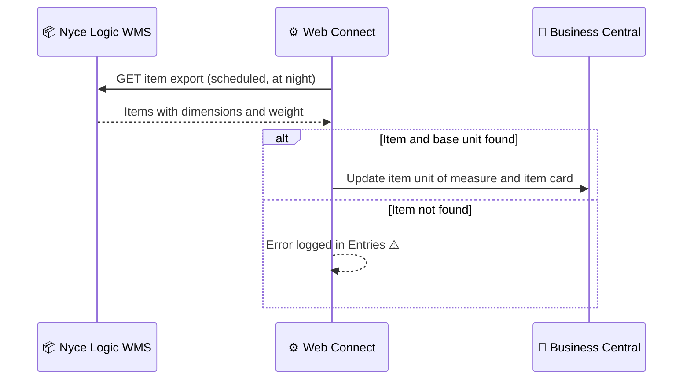

# Nyce Logic WMS to Business Central: item dimensions and weights

When items are measured and weighed in the warehouse, Web Connect fetches the figures from Nyce Logic WMS every night. Length, width, height, volume and weight are written to the item's base unit of measure, and the weight is also written to the item card.

This flow is used when the warehouse measures the items. When dimensions are maintained in Business Central, they are sent to Nyce with the [item](item-data.md) instead, see [Choose your setup](../overview.md#choose-your-setup).

| | |
|---|---|
| **Direction** | Nyce → Business Central |
| **Trigger** | Schedule in the Business Central job queue, in a time window at night |
| **Result** | Dimensions, volume and weight on the base unit of measure, and weight on the item card |
| **Part of** | [Business Central and Nyce Logic WMS integration](../overview.md) |

## Step by step

1. In the scheduled time window, Web Connect calls the Nyce item export.
2. For each item in `Data.Item`, Web Connect finds the item and its base unit of measure by SKU.
3. Length, width, height, volume and weight are written to the item unit of measure.
4. The weight is written to the gross and net weight on the item card.

## Data mapping

| Nyce field | Business Central field | Note |
|---|---|---|
| `Sku` | Item No. and base unit of measure | The base unit of measure is looked up on the item |
| `Length` | Length (Item Unit of Measure) | |
| `Width` | Width (Item Unit of Measure) | |
| `Height` | Height (Item Unit of Measure) | |
| `Volume` | Cubage (Item Unit of Measure) | |
| `Weight` | Weight (Item Unit of Measure), Gross Weight and Net Weight (Item) | |

## Web Connect objects

| Object | Role |
|---|---|
| `NYCE-ITEM-UNIT-DATA` | Fetches the item export and updates the item unit of measure |
| `NYCE-ITEM-UNIT-ITEM` | Updates the weight on the item card |

## Error handling

| Situation | What happens | What to do |
|---|---|---|
| The SKU does not exist in Business Central | The record is logged with an error | Check that the item exists, or that the SKU format matches |
| Nothing is fetched | No updates are made | See [Nothing downloads to Business Central](../../../../../how-to/web-connect/nothing-downloads-to-business-central.md) |

## Frequently asked questions

### Which weight fields are updated on the item card?

The weight from Nyce is written to both gross weight and net weight on the item card, in addition to the weight on the base unit of measure.

## Related

- [Business Central and Nyce Logic WMS integration](../overview.md)
- [Items](item-data.md)
