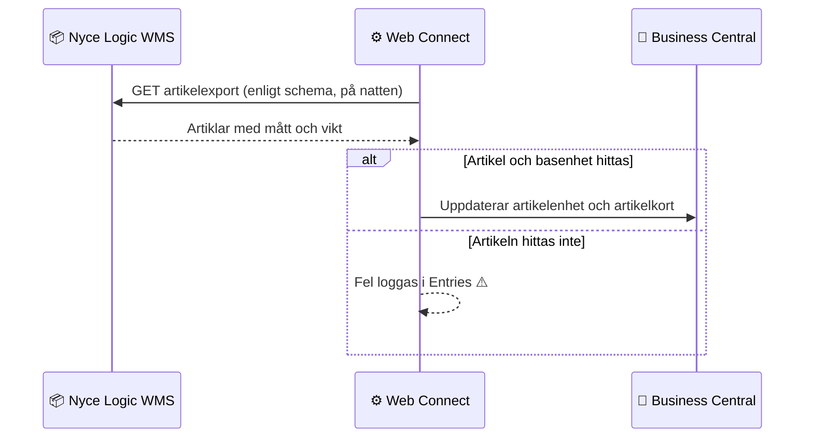

# Från Nyce Logic WMS till Business Central: artikelmått och vikter

När artiklar mäts och vägs i lagret hämtar Web Connect siffrorna från Nyce Logic WMS varje natt. Längd, bredd, höjd, volym och vikt skrivs till artikelns basenhet, och vikten skrivs också till artikelkortet.

Flödet används när lagret mäter artiklarna. När måtten underhålls i Business Central skickas de i stället till Nyce med [artikeln](item-data.md), se [Välj upplägg](../overview.md#choose-your-setup).

| | |
|---|---|
| **Riktning** | Nyce → Business Central |
| **Startas av** | Schema i jobbkön i Business Central, i ett tidsfönster på natten |
| **Resultat** | Mått, volym och vikt på basenheten, och vikt på artikelkortet |
| **Del av** | [Business Central och Nyce Logic WMS: integration](../overview.md) |

## Steg för steg

1. I det schemalagda tidsfönstret anropar Web Connect Nyces artikelexport.
2. För varje artikel i `Data.Item` letar Web Connect upp artikeln och dess basenhet utifrån SKU.
3. Längd, bredd, höjd, volym och vikt skrivs till artikelenheten.
4. Vikten skrivs till brutto- och nettovikten på artikelkortet.

## Mappning av data

| Fält i Nyce | Fält i Business Central | Kommentar |
|---|---|---|
| `Sku` | Item No. och basenhet | Basenheten slås upp på artikeln |
| `Length` | Length (Item Unit of Measure) | |
| `Width` | Width (Item Unit of Measure) | |
| `Height` | Height (Item Unit of Measure) | |
| `Volume` | Cubage (Item Unit of Measure) | |
| `Weight` | Weight (Item Unit of Measure), Gross Weight och Net Weight (Item) | |

## Objekt i Web Connect

| Objekt | Roll |
|---|---|
| `NYCE-ITEM-UNIT-DATA` | Hämtar artikelexporten och uppdaterar artikelenheten |
| `NYCE-ITEM-UNIT-ITEM` | Uppdaterar vikten på artikelkortet |

## Felhantering

| Situation | Vad som händer | Vad du gör |
|---|---|---|
| SKU:n finns inte i Business Central | Posten loggas med ett fel | Kontrollera att artikeln finns, eller att SKU-formatet stämmer |
| Inget hämtas | Inga uppdateringar görs | Se [Inget hämtas till Business Central](../../../../../how-to/web-connect/nothing-downloads-to-business-central.md) |

## Vanliga frågor

### Vilka viktfält uppdateras på artikelkortet?

Vikten från Nyce skrivs till både bruttovikt och nettovikt på artikelkortet, utöver vikten på basenheten.

## Relaterat

- [Business Central och Nyce Logic WMS: integration](../overview.md)
- [Artiklar](item-data.md)
