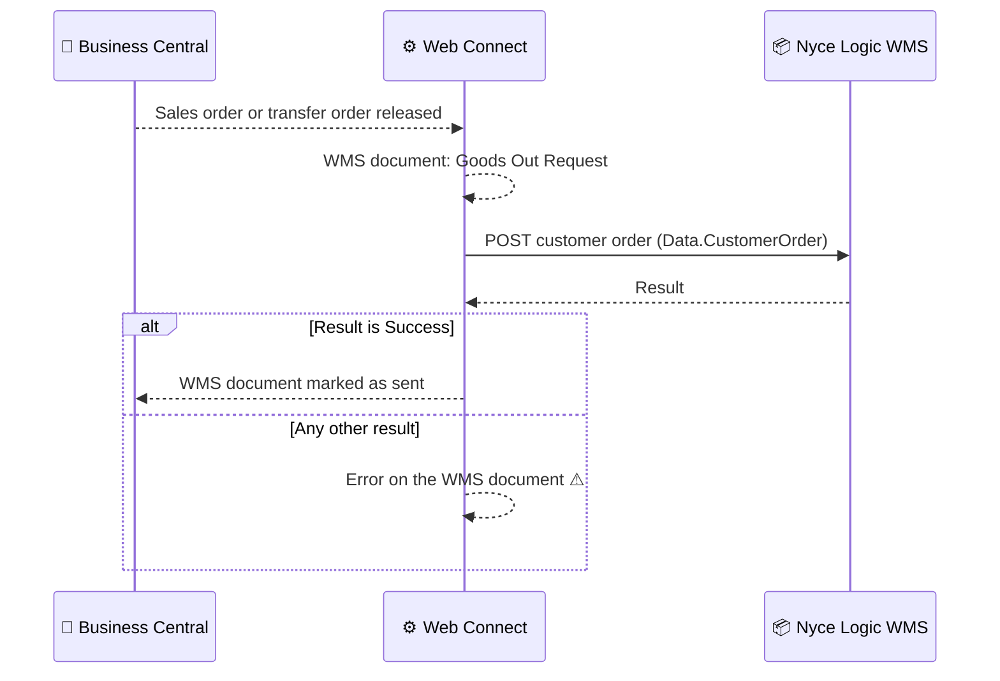

# Business Central to Nyce Logic WMS: outbound orders

When a sales order or an outgoing transfer order is released in Business Central, Web Connect sends it to Nyce Logic WMS as a customer order. The order carries the customer, delivery address, contact details, lines and the Nyce codes for order type and delivery method, so the warehouse can pick, pack and ship it.

| | |
|---|---|
| **Direction** | Business Central → Nyce |
| **Trigger** | The sales order or transfer order is released in Business Central |
| **Result** | A customer order in Nyce, and a WMS document of type Goods Out Request in Business Central |
| **Part of** | [Business Central and Nyce Logic WMS integration](../overview.md) |

## Step by step

1. A sales order or an outgoing transfer order for the Nyce location is released in Business Central.
2. Web Connect creates a WMS document of type Goods Out Request with the order lines.
3. Web Connect builds the customer order, wraps it in the Nyce envelope under `Data.CustomerOrder` and posts it to Nyce.
4. Nyce answers with a result. Only `Success` marks the WMS document as sent.
5. When the warehouse has shipped the order, the [shipment](shipment.md) comes back.

## Data mapping

| Nyce field | Business Central field | Note |
|---|---|---|
| `Number`, `DocumentNumber`, `DocumentCode` | Document No. | Used to match the shipment that comes back |
| `OrderDate` | Order date | |
| `RequestedDeliveryDate`, `ShipDate` | Shipment date | Left out when blank |
| `OrderCustomer` | Sell-to customer number, name, address and contact | |
| `DeliveryCustomer`, `DeliveryCustomerAddress` | Ship-to name and address | |
| `MainContact` | Ship-to e-mail and phone | When the ship-to phone is blank, the contact's mobile phone is sent instead |
| `YourReference`, `OrderReference` | Your Reference, order reference | |
| `Currency` | Currency code | |
| `OrderType`, `DeliveryWay`, `DeliveryTerm`, `Priority` | Nyce codes | Set with conditions, for example per sales order or transfer order |
| `CustomProperties` | Optional values | For example a transport booking reference, left out when blank |
| `Lines.CustomerOrderLine.Position` | Line No. | Used to match delivered lines |
| `Lines.CustomerOrderLine.Item` | Item No. (SKU) | |
| `Quantity`, `OriginalQuantity` | Quantity | Outstanding quantity if set in the Logistics Setup |
| `GrossPrice`, `NetPrice` | Unit price | |
| `ItemDescription` | Description | |
| `AllowPartialDelivery` | Fixed value | |

## Web Connect objects

| Object | Role |
|---|---|
| `NYCE-CUSTOMER-ORDER` | The customer order, posted to the Nyce customer order API |
| `NYCE-ORDERCUSTOMER`, `NYCE-DELIVERYCUSTOMER` | Customer and delivery address |
| `NYCE-LINES`, `NYCE-CUSTOMERORDERLINE` | Order lines |
| `NYCE-ORDERTYPE`, `NYCE-DELIVERYWAY` | Order type and delivery method, with conditions |

## Error handling

| Situation | What happens | What to do |
|---|---|---|
| Nyce does not answer `Success` | The WMS document gets the error from Nyce | Correct the order and send it again, see [A WMS request is not sent](../../../../../how-to/web-connect/wms-request-not-sent-error.md) |
| The item does not exist in Nyce | Nyce rejects the order | Check that the [item](item-data.md) has been sent |

## Frequently asked questions

### Can transfer orders be sent to Nyce differently from sales orders?

Yes. Conditions in Web Connect set the order type and delivery method per kind of document, so a transfer order to a store can get its own order type in Nyce.

## Related

- [Business Central and Nyce Logic WMS integration](../overview.md)
- [Shipments](shipment.md)
- [WMS Documents](../../../general/wms-documents.md)
