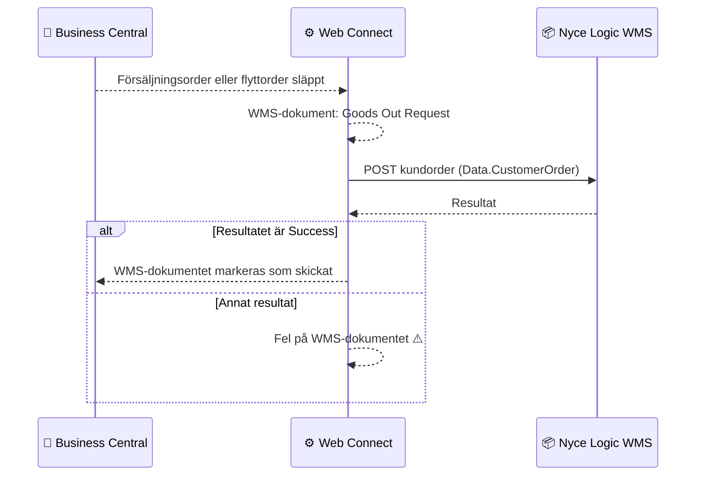

# Från Business Central till Nyce Logic WMS: utgående order

När en försäljningsorder eller en utgående flyttorder släpps i Business Central skickar Web Connect den till Nyce Logic WMS som en kundorder. Ordern har med sig kund, leveransadress, kontaktuppgifter, rader och Nyces koder för ordertyp och leveransmetod, så att lagret kan plocka, packa och skicka den.

| | |
|---|---|
| **Riktning** | Business Central → Nyce |
| **Startas av** | Försäljningsordern eller flyttordern släpps i Business Central |
| **Resultat** | En kundorder i Nyce, och ett WMS-dokument av typen Goods Out Request i Business Central |
| **Del av** | [Business Central och Nyce Logic WMS: integration](../overview.md) |

## Steg för steg

1. En försäljningsorder eller en utgående flyttorder för Nyce-lagerstället släpps i Business Central.
2. Web Connect skapar ett WMS-dokument av typen Goods Out Request med orderraderna.
3. Web Connect bygger kundordern, lägger den i Nyce-kuvertet under `Data.CustomerOrder` och skickar den till Nyce.
4. Nyce svarar med ett resultat. Bara `Success` markerar WMS-dokumentet som skickat.
5. När lagret har skickat ordern kommer [leveransen](shipment.md) tillbaka.

## Mappning av data

| Fält i Nyce | Fält i Business Central | Kommentar |
|---|---|---|
| `Number`, `DocumentNumber`, `DocumentCode` | Document No. | Används för att matcha leveransen som kommer tillbaka |
| `OrderDate` | Orderdatum | |
| `RequestedDeliveryDate`, `ShipDate` | Leveransdatum | Utelämnas när det är tomt |
| `OrderCustomer` | Försäljningskundens nummer, namn, adress och kontakt | |
| `DeliveryCustomer`, `DeliveryCustomerAddress` | Leveransnamn och leveransadress | |
| `MainContact` | E-post och telefon för leveransadressen | När telefonnumret för leveransadressen är tomt skickas kontaktens mobilnummer i stället |
| `YourReference`, `OrderReference` | Your Reference, orderreferens | |
| `Currency` | Valutakod | |
| `OrderType`, `DeliveryWay`, `DeliveryTerm`, `Priority` | Nyces koder | Sätts med villkor, till exempel per försäljningsorder eller flyttorder |
| `CustomProperties` | Valfria värden | Till exempel en referens till transportbokningen, utelämnas när den är tom |
| `Lines.CustomerOrderLine.Position` | Line No. | Används för att matcha levererade rader |
| `Lines.CustomerOrderLine.Item` | Item No. (SKU) | |
| `Quantity`, `OriginalQuantity` | Antal | Kvarvarande antal om det är inställt i Logistics Setup |
| `GrossPrice`, `NetPrice` | Enhetspris | |
| `ItemDescription` | Beskrivning | |
| `AllowPartialDelivery` | Fast värde | |

## Objekt i Web Connect

| Objekt | Roll |
|---|---|
| `NYCE-CUSTOMER-ORDER` | Kundordern, som skickas till Nyces API för kundorder |
| `NYCE-ORDERCUSTOMER`, `NYCE-DELIVERYCUSTOMER` | Kund och leveransadress |
| `NYCE-LINES`, `NYCE-CUSTOMERORDERLINE` | Orderrader |
| `NYCE-ORDERTYPE`, `NYCE-DELIVERYWAY` | Ordertyp och leveransmetod, med villkor |

## Felhantering

| Situation | Vad som händer | Vad du gör |
|---|---|---|
| Nyce svarar inte `Success` | WMS-dokumentet får felet från Nyce | Rätta ordern och skicka den igen, se [En WMS-förfrågan skickas inte](../../../../../how-to/web-connect/wms-request-not-sent-error.md) |
| Artikeln finns inte i Nyce | Nyce avvisar ordern | Kontrollera att [artikeln](item-data.md) har skickats |

## Vanliga frågor

### Kan flyttorder skickas till Nyce på ett annat sätt än försäljningsorder?

Ja. Villkor i Web Connect styr ordertyp och leveransmetod per sorts dokument, så en flyttorder till en butik kan få en egen ordertyp i Nyce.

## Relaterat

- [Business Central och Nyce Logic WMS: integration](../overview.md)
- [Leveranser](shipment.md)
- [WMS Documents](../../../general/wms-documents.md)
