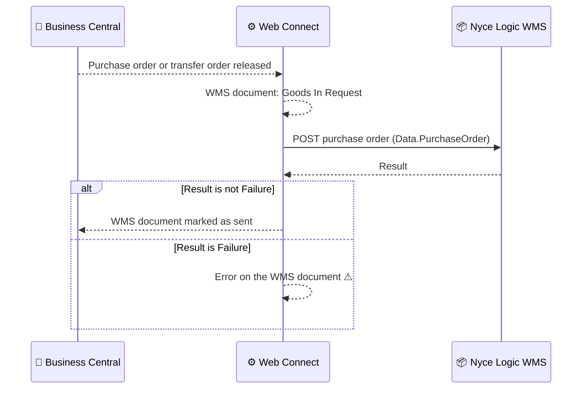

# Business Central to Nyce Logic WMS: inbound orders

When a purchase order or an incoming transfer order is released in Business Central, Web Connect sends it to Nyce Logic WMS as a purchase order. The warehouse then knows which items, quantities and supplier to expect, and reports the [receipt](receipt.md) back when the goods arrive.

| | |
|---|---|
| **Direction** | Business Central → Nyce |
| **Trigger** | The purchase order or transfer order is released in Business Central |
| **Result** | A purchase order in Nyce, and a WMS document of type Goods In Request in Business Central |
| **Part of** | [Business Central and Nyce Logic WMS integration](../overview.md) |

## Step by step

1. A purchase order or an incoming transfer order for the Nyce location is released in Business Central.
2. Web Connect creates a WMS document of type Goods In Request with the lines.
3. Web Connect wraps the order in the Nyce envelope under `Data.PurchaseOrder` and posts it to Nyce.
4. Nyce answers with a result. A `Failure` result is logged as an error on the WMS document.

## Data mapping

| Nyce field | Business Central field | Note |
|---|---|---|
| `Number` | Document No. | Used to match the receipt that comes back |
| `OrderDate` | Order date | |
| `RequestedDeliveryDate`, `ShipmentDate` | Expected receipt date | Left out when blank |
| `Supplier.Code`, `Supplier.Name` | Vendor number and name | With the vendor's address |
| `Currency` | Currency code | |
| `OrderType` | Nyce code | |
| `Lines.PurchaseOrderLine.Position` | Line No. | |
| `Lines.PurchaseOrderLine.Item` | Item No. (SKU) | |
| `Quantity` | Quantity | |
| `GrossPrice` | Direct unit cost | |

## Web Connect objects

| Object | Role |
|---|---|
| `NYCE-PURCHASE-ORDER` | The purchase order, posted to the Nyce purchase order API |
| `NYCE-PURCHASE-SUPPLIER` | Supplier and address |
| `NYCE-PURCHASELINES`, `NYCE-PURCHASEORDERLINE` | Order lines |

## Error handling

| Situation | What happens | What to do |
|---|---|---|
| Nyce answers `Failure` | The WMS document gets the error from Nyce | Correct the order and send it again, see [A WMS request is not sent](../../../../../how-to/web-connect/wms-request-not-sent-error.md) |

## Frequently asked questions

### When is a purchase order sent to Nyce?

When it is released in Business Central, if sending on release is switched on in the Logistics Setup.

## Related

- [Business Central and Nyce Logic WMS integration](../overview.md)
- [Receipts](receipt.md)
