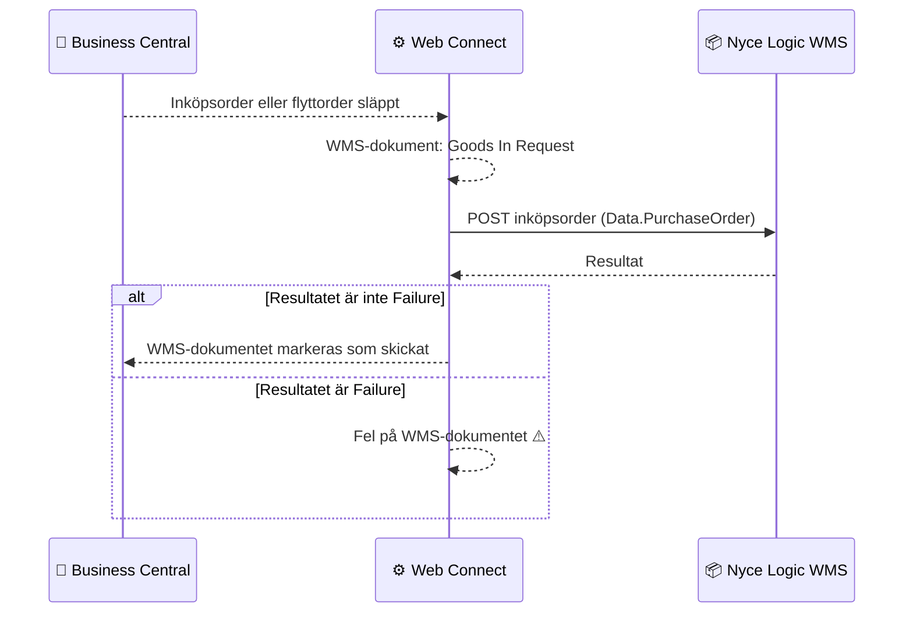

# Från Business Central till Nyce Logic WMS: inkommande order

När en inköpsorder eller en inkommande flyttorder släpps i Business Central skickar Web Connect den till Nyce Logic WMS som en inköpsorder. Lagret vet då vilka artiklar, antal och vilken leverantör som väntas, och rapporterar tillbaka [inleveransen](receipt.md) när varorna kommer.

| | |
|---|---|
| **Riktning** | Business Central → Nyce |
| **Startas av** | Inköpsordern eller flyttordern släpps i Business Central |
| **Resultat** | En inköpsorder i Nyce, och ett WMS-dokument av typen Goods In Request i Business Central |
| **Del av** | [Business Central och Nyce Logic WMS: integration](../overview.md) |

## Steg för steg

1. En inköpsorder eller en inkommande flyttorder för Nyce-lagerstället släpps i Business Central.
2. Web Connect skapar ett WMS-dokument av typen Goods In Request med raderna.
3. Web Connect lägger ordern i Nyce-kuvertet under `Data.PurchaseOrder` och skickar den till Nyce.
4. Nyce svarar med ett resultat. Resultatet `Failure` loggas som ett fel på WMS-dokumentet.

## Mappning av data

| Fält i Nyce | Fält i Business Central | Kommentar |
|---|---|---|
| `Number` | Document No. | Används för att matcha inleveransen som kommer tillbaka |
| `OrderDate` | Orderdatum | |
| `RequestedDeliveryDate`, `ShipmentDate` | Förväntat inleveransdatum | Utelämnas när det är tomt |
| `Supplier.Code`, `Supplier.Name` | Leverantörsnummer och namn | Med leverantörens adress |
| `Currency` | Valutakod | |
| `OrderType` | Nyces kod | |
| `Lines.PurchaseOrderLine.Position` | Line No. | |
| `Lines.PurchaseOrderLine.Item` | Item No. (SKU) | |
| `Quantity` | Antal | |
| `GrossPrice` | Direkt inköpspris | |

## Objekt i Web Connect

| Objekt | Roll |
|---|---|
| `NYCE-PURCHASE-ORDER` | Inköpsordern, som skickas till Nyces API för inköpsorder |
| `NYCE-PURCHASE-SUPPLIER` | Leverantör och adress |
| `NYCE-PURCHASELINES`, `NYCE-PURCHASEORDERLINE` | Orderrader |

## Felhantering

| Situation | Vad som händer | Vad du gör |
|---|---|---|
| Nyce svarar `Failure` | WMS-dokumentet får felet från Nyce | Rätta ordern och skicka den igen, se [En WMS-förfrågan skickas inte](../../../../../how-to/web-connect/wms-request-not-sent-error.md) |

## Vanliga frågor

### När skickas en inköpsorder till Nyce?

När den släpps i Business Central, om sändning vid släpp är påslaget i Logistics Setup.

## Relaterat

- [Business Central och Nyce Logic WMS: integration](../overview.md)
- [Inleveranser](receipt.md)
