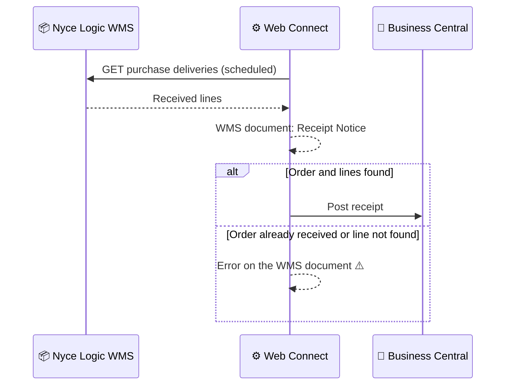

# Nyce Logic WMS to Business Central: receipts

When goods are received in the warehouse, Web Connect fetches the receipt from Nyce Logic WMS on a schedule. The received quantity per line is registered on a WMS document, and the receipt is posted on the purchase order or transfer order in Business Central.

| | |
|---|---|
| **Direction** | Nyce → Business Central |
| **Trigger** | Schedule in the Business Central job queue |
| **Result** | A posted purchase receipt or transfer receipt in Business Central, and a WMS document of type Receipt Notice |
| **Part of** | [Business Central and Nyce Logic WMS integration](../overview.md) |

## Step by step

1. Web Connect calls the Nyce purchase delivery API.
2. For each delivery in `Data.PurchaseDelivery`, Web Connect creates a WMS document of type Receipt Notice.
3. The delivery is matched to the Business Central order by the order number, and each line by its position.
4. If automatic posting is on in the Logistics Setup, the receipt is posted with the work date as posting date. For transfer orders, the Logistics Setup decides what happens when less or more is received than was shipped.

## Data mapping

| Nyce field | Business Central field | Note |
|---|---|---|
| `Number` | WMS document number | Identifies the delivery |
| `Lines...PurchaseOrderLine.PurchaseOrder.Number` | Document No. | Links the receipt to the order |
| `PurchaseOrderLine.Position` | Line No. | |
| `PurchaseOrderLine.Item.Sku` | Item No. | |
| `DeliveredQuantity` | Quantity to receive | |

## Web Connect objects

| Object | Role |
|---|---|
| `NYCE-PURCHASE-DELIVERY` | Fetches receipts and creates the WMS document |
| `NYCE-PURCHASEDELIVERYLINE` | Received lines |

## Error handling

| Situation | What happens | What to do |
|---|---|---|
| A receipt was reversed and posted again in Nyce | The new receipt stops with an error, for example that no more can be received | Correct it manually in Business Central, following Business Central standard, before the order is invoiced |
| The receipt cannot be posted | The WMS document gets an error and is retried up to the max count in the Logistics Setup | Correct the cause in Business Central |

## Frequently asked questions

### What happens if a receipt is reversed in Nyce?

Reversals are not integrated. A receipt that is reversed and posted again in Nyce stops with an error in Business Central, because the order is already received. The correction is made manually in Business Central.

## Related

- [Business Central and Nyce Logic WMS integration](../overview.md)
- [Inbound orders](purchase-order.md)
