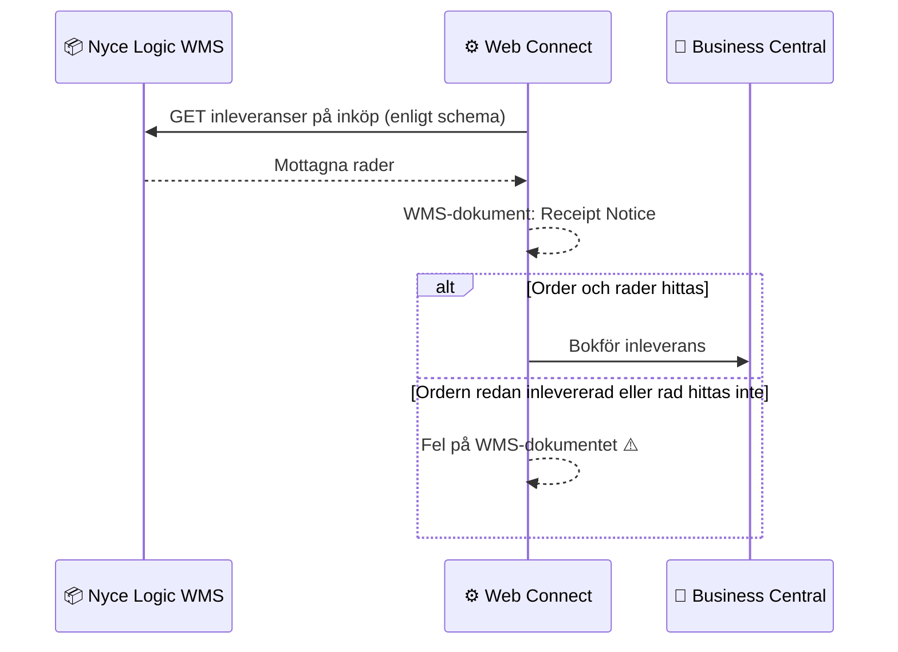

# Från Nyce Logic WMS till Business Central: inleveranser

När varor tas emot i lagret hämtar Web Connect inleveransen från Nyce Logic WMS enligt schema. Mottaget antal per rad registreras på ett WMS-dokument, och inleveransen bokförs på inköpsordern eller flyttordern i Business Central.

| | |
|---|---|
| **Riktning** | Nyce → Business Central |
| **Startas av** | Schema i jobbkön i Business Central |
| **Resultat** | En bokförd inköpsinleverans eller flyttinleverans i Business Central, och ett WMS-dokument av typen Receipt Notice |
| **Del av** | [Business Central och Nyce Logic WMS: integration](../overview.md) |

## Steg för steg

1. Web Connect anropar Nyces API för inleveranser på inköp.
2. För varje inleverans i `Data.PurchaseDelivery` skapar Web Connect ett WMS-dokument av typen Receipt Notice.
3. Inleveransen matchas mot ordern i Business Central med ordernumret, och varje rad med sin position.
4. Är automatisk bokföring påslagen i Logistics Setup bokförs inleveransen med arbetsdatumet som bokföringsdatum. För flyttorder avgör Logistics Setup vad som händer när mindre eller mer tas emot än vad som skickades.

## Mappning av data

| Fält i Nyce | Fält i Business Central | Kommentar |
|---|---|---|
| `Number` | WMS-dokumentets nummer | Identifierar inleveransen |
| `Lines...PurchaseOrderLine.PurchaseOrder.Number` | Document No. | Kopplar inleveransen till ordern |
| `PurchaseOrderLine.Position` | Line No. | |
| `PurchaseOrderLine.Item.Sku` | Item No. | |
| `DeliveredQuantity` | Antal att ta emot | |

## Objekt i Web Connect

| Objekt | Roll |
|---|---|
| `NYCE-PURCHASE-DELIVERY` | Hämtar inleveranser och skapar WMS-dokumentet |
| `NYCE-PURCHASEDELIVERYLINE` | Mottagna rader |

## Felhantering

| Situation | Vad som händer | Vad du gör |
|---|---|---|
| En inleverans backades och bokfördes igen i Nyce | Den nya inleveransen stoppas med ett fel, till exempel att inget mer kan tas emot | Rätta det manuellt i Business Central, enligt standard i Business Central, innan ordern faktureras |
| Inleveransen går inte att bokföra | WMS-dokumentet får ett fel och försöks igen upp till maxantalet i Logistics Setup | Rätta orsaken i Business Central |

## Vanliga frågor

### Vad händer om en inleverans backas i Nyce?

Backningar är inte integrerade. En inleverans som backas och bokförs igen i Nyce stoppas med ett fel i Business Central, eftersom ordern redan är inlevererad. Rättelsen görs manuellt i Business Central.

## Relaterat

- [Business Central och Nyce Logic WMS: integration](../overview.md)
- [Inkommande order](purchase-order.md)
