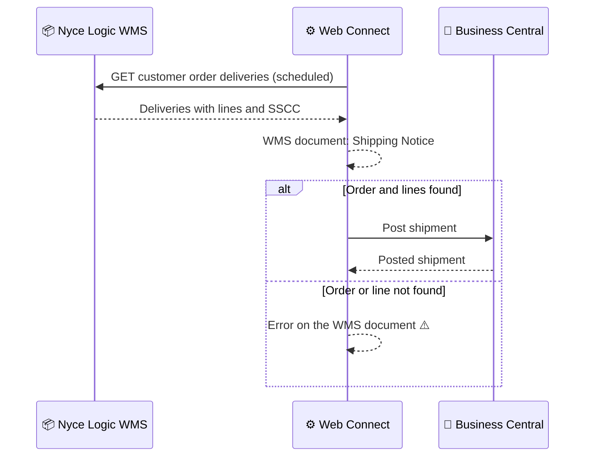

# Nyce Logic WMS to Business Central: shipments

When the warehouse has shipped a customer order, Web Connect fetches the delivery from Nyce Logic WMS on a schedule. The delivered quantity per line and the SSCC are registered on a WMS document, and the shipment is posted in Business Central.

| | |
|---|---|
| **Direction** | Nyce → Business Central |
| **Trigger** | Schedule in the Business Central job queue |
| **Result** | A posted sales shipment or transfer shipment in Business Central, and a WMS document of type Shipping Notice |
| **Part of** | [Business Central and Nyce Logic WMS integration](../overview.md) |

## Step by step

1. Web Connect calls the Nyce customer order delivery API.
2. For each delivery in `Data.CustomerOrderDelivery`, Web Connect creates a WMS document of type Shipping Notice, numbered with the Nyce delivery number.
3. The delivery is matched to the Business Central order by the order number, and each line by its position.
4. The delivered quantity and the SSCC are written to the WMS document.
5. If automatic posting is on in the Logistics Setup, the shipment is posted with the work date as posting date.

## Data mapping

| Nyce field | Business Central field | Note |
|---|---|---|
| `Number` | WMS document number | Identifies the delivery |
| `Lines...OrderLine.CustomerOrder.Number` | Document No. | Links the delivery to the order |
| `OrderLine.Position` | Line No. | |
| `Item.Sku` | Item No. | |
| `DeliveredQuantity` | Quantity to ship | |
| `ShipmentReferences.ShipmentReference.SequenceNumberSSCC` | SSCC on the WMS document | |

## Web Connect objects

| Object | Role |
|---|---|
| `NYCE-CUSTOMER-ORDER-DELIVERY` | Fetches deliveries and creates the WMS document |
| `NYCE-CUSTOMERORDERLINEDELIVERY` | Delivered lines |
| `NYCE-SHIPMENTREFERENCES` | SSCC from the shipment |

## Error handling

| Situation | What happens | What to do |
|---|---|---|
| The order cannot be posted, for example a missing setup in Business Central | The WMS document gets an error and is retried up to the max count in the Logistics Setup | Correct the cause in Business Central. The WMS document is then posted on the next run |
| A delivery is not fetched | Nothing is posted | See [Nothing downloads to Business Central](../../../../../how-to/web-connect/nothing-downloads-to-business-central.md) |

## Frequently asked questions

### Are partial deliveries supported?

Yes. Each delivery from Nyce carries the delivered quantity per order line, and Business Central posts what was delivered. The rest of the order stays open.

## Related

- [Business Central and Nyce Logic WMS integration](../overview.md)
- [Outbound orders](order-outbound.md)
- [WMS Documents](../../../general/wms-documents.md)
