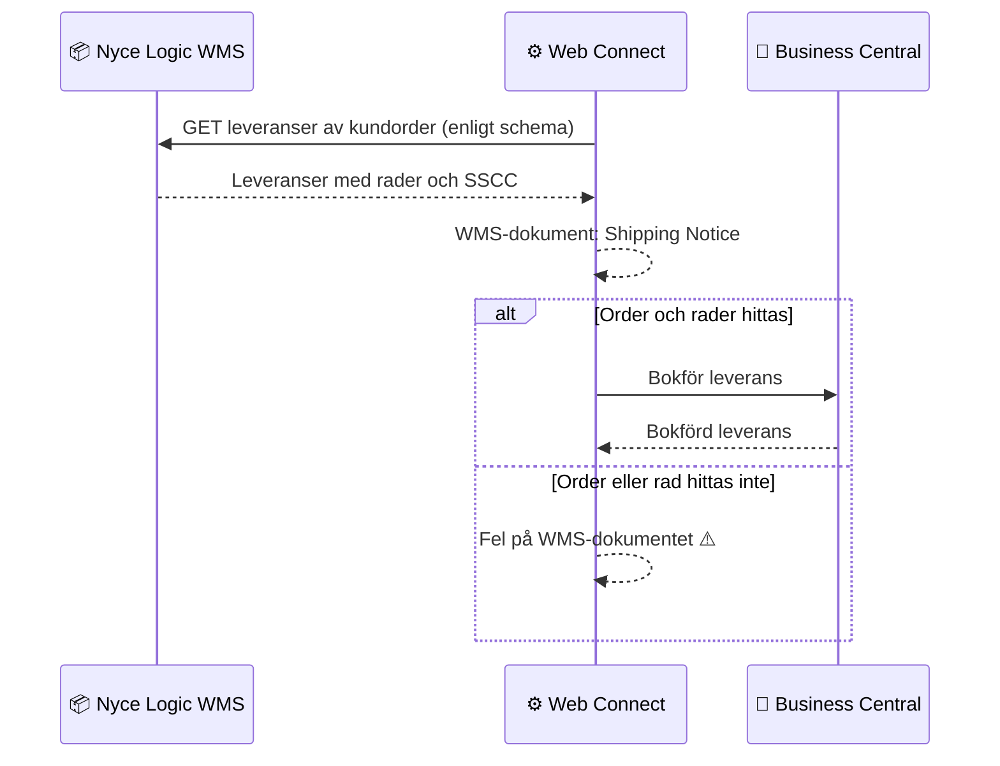

# Från Nyce Logic WMS till Business Central: leveranser

När lagret har skickat en kundorder hämtar Web Connect leveransen från Nyce Logic WMS enligt schema. Levererat antal per rad och SSCC registreras på ett WMS-dokument, och leveransen bokförs i Business Central.

| | |
|---|---|
| **Riktning** | Nyce → Business Central |
| **Startas av** | Schema i jobbkön i Business Central |
| **Resultat** | En bokförd försäljningsleverans eller flyttleverans i Business Central, och ett WMS-dokument av typen Shipping Notice |
| **Del av** | [Business Central och Nyce Logic WMS: integration](../overview.md) |

## Steg för steg

1. Web Connect anropar Nyces API för leveranser av kundorder.
2. För varje leverans i `Data.CustomerOrderDelivery` skapar Web Connect ett WMS-dokument av typen Shipping Notice, numrerat med Nyces leveransnummer.
3. Leveransen matchas mot ordern i Business Central med ordernumret, och varje rad med sin position.
4. Levererat antal och SSCC skrivs till WMS-dokumentet.
5. Är automatisk bokföring påslagen i Logistics Setup bokförs leveransen med arbetsdatumet som bokföringsdatum.

## Mappning av data

| Fält i Nyce | Fält i Business Central | Kommentar |
|---|---|---|
| `Number` | WMS-dokumentets nummer | Identifierar leveransen |
| `Lines...OrderLine.CustomerOrder.Number` | Document No. | Kopplar leveransen till ordern |
| `OrderLine.Position` | Line No. | |
| `Item.Sku` | Item No. | |
| `DeliveredQuantity` | Antal att leverera | |
| `ShipmentReferences.ShipmentReference.SequenceNumberSSCC` | SSCC på WMS-dokumentet | |

## Objekt i Web Connect

| Objekt | Roll |
|---|---|
| `NYCE-CUSTOMER-ORDER-DELIVERY` | Hämtar leveranser och skapar WMS-dokumentet |
| `NYCE-CUSTOMERORDERLINEDELIVERY` | Levererade rader |
| `NYCE-SHIPMENTREFERENCES` | SSCC från leveransen |

## Felhantering

| Situation | Vad som händer | Vad du gör |
|---|---|---|
| Ordern går inte att bokföra, till exempel för att en inställning saknas i Business Central | WMS-dokumentet får ett fel och försöks igen upp till maxantalet i Logistics Setup | Rätta orsaken i Business Central. WMS-dokumentet bokförs då vid nästa körning |
| En leverans hämtas inte | Inget bokförs | Se [Inget hämtas till Business Central](../../../../../how-to/web-connect/nothing-downloads-to-business-central.md) |

## Vanliga frågor

### Fungerar delleveranser?

Ja. Varje leverans från Nyce har med sig levererat antal per orderrad, och Business Central bokför det som levererats. Resten av ordern ligger kvar öppen.

## Relaterat

- [Business Central och Nyce Logic WMS: integration](../overview.md)
- [Utgående order](order-outbound.md)
- [WMS Documents](../../../general/wms-documents.md)
