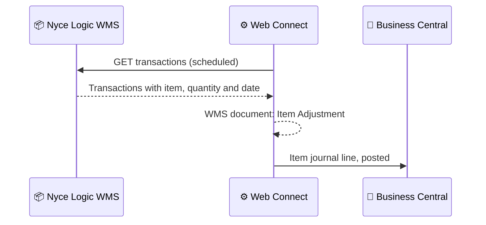

# Nyce Logic WMS to Business Central: stock adjustments

When stock is corrected in the warehouse, for example after a count or when goods are scrapped, Web Connect fetches the transaction from Nyce Logic WMS on a schedule. Each transaction is logged as a WMS document of type Item Adjustment and posted through an item journal in Business Central.

| | |
|---|---|
| **Direction** | Nyce → Business Central |
| **Trigger** | Schedule in the Business Central job queue |
| **Result** | A posted item journal line per transaction in Business Central |
| **Part of** | [Business Central and Nyce Logic WMS integration](../overview.md) |

## Step by step

1. Web Connect calls the Nyce transaction API.
2. For each transaction in `Data.Transaction`, Web Connect creates a WMS document of type Item Adjustment with the item and quantity.
3. A line is created in the adjustment item journal set in the Logistics Setup, with the date of the transaction in Nyce.
4. If automatic posting is on, the journal is posted.

## Data mapping

| Nyce field | Business Central field | Note |
|---|---|---|
| `Item.Sku` | Item No. | |
| `Quantity` | Quantity | Positive or negative adjustment |
| `DateAdded` | Posting date on the WMS document | |
| `TransactionType` | Read, not stored | Not used to filter transactions |

## Web Connect objects

| Object | Role |
|---|---|
| `NYCE-TRANSACTION` | Fetches transactions and creates the WMS document |
| `NYCE-TRANSACTION-ITEM` | Item and quantity of the transaction |

## Error handling

| Situation | What happens | What to do |
|---|---|---|
| The journal line cannot be posted, for example missing setup on the item | The WMS document gets an error | Correct the cause in Business Central |

## Frequently asked questions

### Which journal are adjustments posted in?

In the adjustment item journal template and batch set in the Logistics Setup. Posting can be automatic, or the journal can be reviewed and posted by hand.

## Related

- [Business Central and Nyce Logic WMS integration](../overview.md)
- [Stock balance](stock-balance.md)
