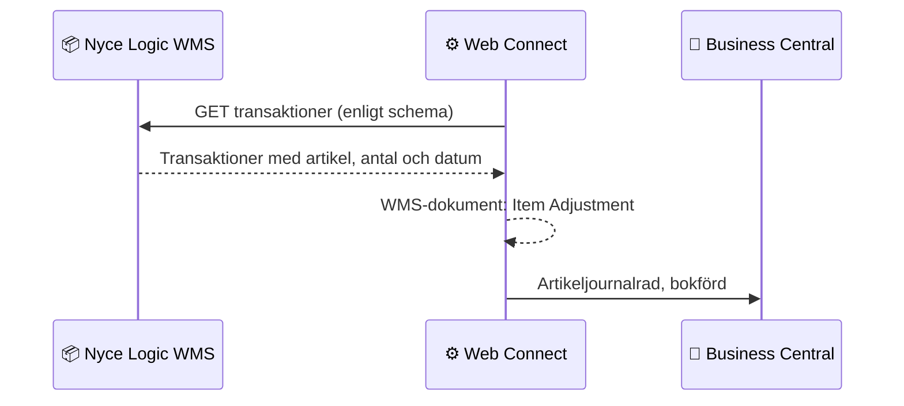

# Från Nyce Logic WMS till Business Central: lagerjusteringar

När lagersaldot rättas i lagret, till exempel efter en inventering eller när varor kasseras, hämtar Web Connect transaktionen från Nyce Logic WMS enligt schema. Varje transaktion loggas som ett WMS-dokument av typen Item Adjustment och bokförs via en artikeljournal i Business Central.

| | |
|---|---|
| **Riktning** | Nyce → Business Central |
| **Startas av** | Schema i jobbkön i Business Central |
| **Resultat** | En bokförd artikeljournalrad per transaktion i Business Central |
| **Del av** | [Business Central och Nyce Logic WMS: integration](../overview.md) |

## Steg för steg

1. Web Connect anropar Nyces API för transaktioner.
2. För varje transaktion i `Data.Transaction` skapar Web Connect ett WMS-dokument av typen Item Adjustment med artikel och antal.
3. En rad skapas i artikeljournalen för justeringar som ställts in i Logistics Setup, med transaktionens datum i Nyce.
4. Är automatisk bokföring påslagen bokförs journalen.

## Mappning av data

| Fält i Nyce | Fält i Business Central | Kommentar |
|---|---|---|
| `Item.Sku` | Item No. | |
| `Quantity` | Antal | Positiv eller negativ justering |
| `DateAdded` | Bokföringsdatum på WMS-dokumentet | |
| `TransactionType` | Läses, sparas inte | Används inte för att filtrera transaktioner |

## Objekt i Web Connect

| Objekt | Roll |
|---|---|
| `NYCE-TRANSACTION` | Hämtar transaktioner och skapar WMS-dokumentet |
| `NYCE-TRANSACTION-ITEM` | Transaktionens artikel och antal |

## Felhantering

| Situation | Vad som händer | Vad du gör |
|---|---|---|
| Journalraden går inte att bokföra, till exempel för att en inställning saknas på artikeln | WMS-dokumentet får ett fel | Rätta orsaken i Business Central |

## Vanliga frågor

### I vilken journal bokförs justeringarna?

I den journalmall och det journalnamn för justeringar som ställts in i Logistics Setup. Bokföringen kan ske automatiskt, eller så granskas journalen och bokförs manuellt.

## Relaterat

- [Business Central och Nyce Logic WMS: integration](../overview.md)
- [Lagersaldo](stock-balance.md)
