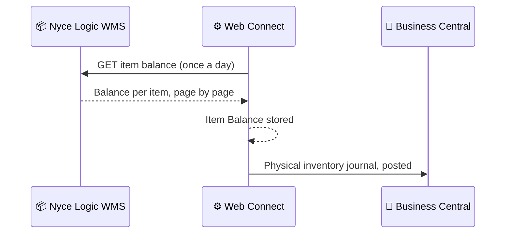

# Nyce Logic WMS to Business Central: stock balance

Once a day, in a time window you choose, Web Connect fetches the full stock balance from Nyce Logic WMS. The balance is compared with Business Central and differences are posted through a physical inventory journal, so both systems agree on stock.

| | |
|---|---|
| **Direction** | Nyce → Business Central |
| **Trigger** | Schedule in the Business Central job queue, once a day in a set time window |
| **Result** | Stock in Business Central matches the physical stock in Nyce |
| **Part of** | [Business Central and Nyce Logic WMS integration](../overview.md) |

## Step by step

1. In the time window, Web Connect calls the Nyce item balance API. The balance is returned page by page.
2. The balance per item is stored as Item Balance in Web Connect.
3. A physical inventory journal is created with the balance from Nyce for each item.
4. If automatic posting is on in the Logistics Setup, the journal is posted and the differences are adjusted in Business Central.

## Data mapping

| Nyce field | Business Central field | Note |
|---|---|---|
| `Sku` | Item No. | |
| `PhysicalBalance` | Physical inventory quantity | Everything physically in the warehouse |
| `Balance` | Not used for the reconciliation | Excludes locked locations |
| `InboundAllocatedQuantity`, `OutboundAllocatedQuantity`, `QuantityInOrders` | Not used for the reconciliation | |

The balance object only reads these fields. It has no field mapping of its own: the Logistics Setup turns the balance into Item Balance and the physical inventory journal.

## Web Connect objects

| Object | Role |
|---|---|
| `NYCE-ITEM-BALANCE` | Fetches the stock balance in the scheduled time window |

## Error handling

| Situation | What happens | What to do |
|---|---|---|
| The journal cannot be posted | The journal stays unposted | Open the physical inventory journal, correct the cause and post it |

## Frequently asked questions

### What is the difference between Balance and PhysicalBalance in Nyce?

Balance excludes stock on locked locations, for example inbound, returns and repacking. PhysicalBalance is everything physically in the warehouse. The physical balance is the one that matches the stock in Business Central.

## Related

- [Business Central and Nyce Logic WMS integration](../overview.md)
- [Stock adjustments](stock-adjustment.md)
- [Item Inventory](../../../general/item-inventory.md)
