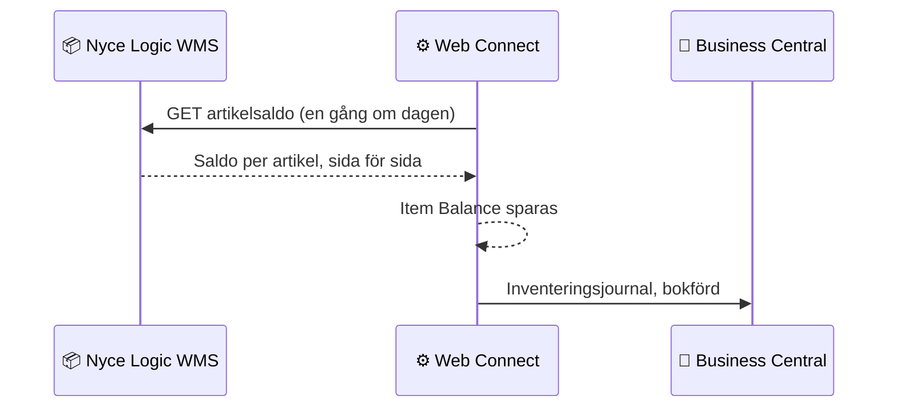

# Från Nyce Logic WMS till Business Central: lagersaldo

En gång om dagen, i ett tidsfönster du väljer, hämtar Web Connect hela lagersaldot från Nyce Logic WMS. Saldot jämförs med Business Central och skillnader bokförs via en inventeringsjournal, så att båda systemen visar samma lager.

| | |
|---|---|
| **Riktning** | Nyce → Business Central |
| **Startas av** | Schema i jobbkön i Business Central, en gång om dagen i ett bestämt tidsfönster |
| **Resultat** | Lagret i Business Central stämmer med det fysiska lagret i Nyce |
| **Del av** | [Business Central och Nyce Logic WMS: integration](../overview.md) |

## Steg för steg

1. I tidsfönstret anropar Web Connect Nyces API för artikelsaldon. Saldot kommer sida för sida.
2. Saldot per artikel sparas som Item Balance i Web Connect.
3. En inventeringsjournal skapas med saldot från Nyce för varje artikel.
4. Är automatisk bokföring påslagen i Logistics Setup bokförs journalen och skillnaderna justeras i Business Central.

## Mappning av data

| Fält i Nyce | Fält i Business Central | Kommentar |
|---|---|---|
| `Sku` | Item No. | |
| `PhysicalBalance` | Inventerat antal | Allt som fysiskt finns i lagret |
| `Balance` | Används inte i avstämningen | Räknar inte med spärrade lagerplatser |
| `InboundAllocatedQuantity`, `OutboundAllocatedQuantity`, `QuantityInOrders` | Används inte i avstämningen | |

Saldoobjektet läser bara de här fälten. Det har ingen egen fältmappning: Logistics Setup gör om saldot till Item Balance och inventeringsjournalen.

## Objekt i Web Connect

| Objekt | Roll |
|---|---|
| `NYCE-ITEM-BALANCE` | Hämtar lagersaldot i det schemalagda tidsfönstret |

## Felhantering

| Situation | Vad som händer | Vad du gör |
|---|---|---|
| Journalen går inte att bokföra | Journalen ligger kvar obokförd | Öppna inventeringsjournalen, rätta orsaken och bokför den |

## Vanliga frågor

### Vad är skillnaden mellan Balance och PhysicalBalance i Nyce?

Balance räknar inte med saldo på spärrade lagerplatser, till exempel inleverans, returer och ompackning. PhysicalBalance är allt som fysiskt finns i lagret. Det är det fysiska saldot som motsvarar lagret i Business Central.

## Relaterat

- [Business Central och Nyce Logic WMS: integration](../overview.md)
- [Lagerjusteringar](stock-adjustment.md)
- [Item Inventory](../../../general/item-inventory.md)
