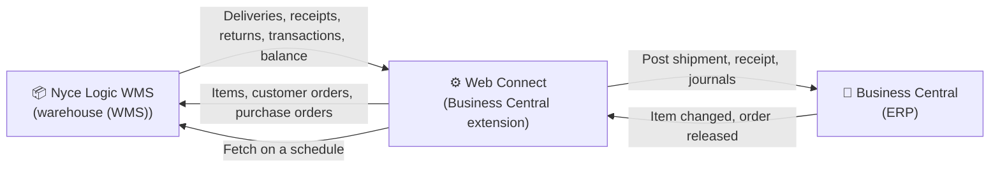
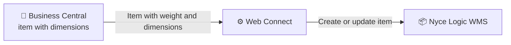
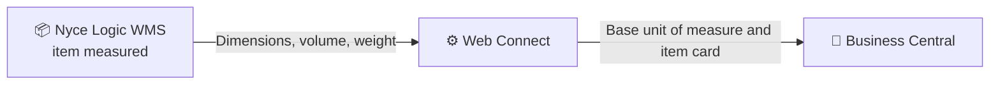
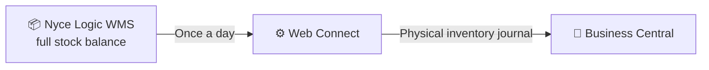

# Business Central and Nyce Logic WMS integration

Web Connect by CombineIT connects Microsoft Dynamics 365 Business Central with Nyce Logic WMS, the warehouse management system. Items, sales orders, transfer orders and purchase orders are sent to Nyce, and shipments, receipts, returns, stock adjustments and stock balances come back and are posted in Business Central. All mappings and rules live in your own Business Central, where you can see and change them yourself.

## At a glance

| | |
|---|---|
| **System** | Nyce Logic WMS (warehouse (WMS)) |
| **Integration product** | Web Connect for Microsoft Dynamics 365 Business Central |
| **Runs in** | Your own Business Central environment, as an extension. Web Connect sends items when they change and orders when they are released in Business Central. Shipments, receipts, returns, stock adjustments and stock balances are fetched from Nyce on a schedule in the Business Central job queue. No webhooks and no external integration platform are involved. |
| **Configured by** | You, in Business Central: mappings, conditions, triggers and flows. You can do all of it yourself. If you want, CombineIT takes part in any step, as a sounding board or by doing the work. |
| **Connection** | Nyce REST API (JSON), with a token from the Nyce authenticate endpoint |
| **Nyce API** | Nyce REST API. The API documentation is not public: your Nyce supplier gives access to it once you are a customer |
| **Data flows** | 9: items, item dimensions and weights, outbound orders, shipments, inbound orders, receipts, customer returns, stock adjustments and stock balance |
| **Business Central editions** | All editions, Essentials and Premium, including the latest version |
| **Available from** | [Web Connect on Microsoft AppSource](https://marketplace.microsoft.com/sv-se/product/PUBID.martitab1633951001710%7CAID.webconnect%7CPAPPID.9f3a7223-19db-4ac7-832f-cf8e4699186f?tab=Overview). The Nyce integration is not part of the Web Connect Ready Integrations app. It is set up in your Web Connect during the project |

## What can be synchronized

Web Connect has nine data flows between Business Central and Nyce Logic WMS.

| Data | Direction | What happens |
|---|---|---|
| [Items](flows/item-data.md) | Business Central → Nyce | Items are created or updated in Nyce with barcodes, unit, item category, supplier item code and customs data |
| [Item dimensions and weights](flows/item-dimensions.md) | Nyce → Business Central | Dimensions, volume and weight measured in the warehouse are written to the item's base unit of measure and to the item card |
| [Outbound orders](flows/order-outbound.md) | Business Central → Nyce | Released sales orders and outgoing transfer orders are sent to Nyce as customer orders to pick and ship |
| [Shipments](flows/shipment.md) | Nyce → Business Central | Delivered quantities are fetched and the shipment is posted in Business Central |
| [Inbound orders](flows/purchase-order.md) | Business Central → Nyce | Released purchase orders and incoming transfer orders are sent to Nyce as expected receipts |
| [Receipts](flows/receipt.md) | Nyce → Business Central | Received quantities are fetched and the receipt is posted in Business Central |
| [Customer returns](flows/customer-return.md) | Nyce → Business Central | Returns registered in the warehouse are fetched, the return receipt is posted and a credit memo follows |
| [Stock adjustments](flows/stock-adjustment.md) | Nyce → Business Central | Stock corrections made in Nyce are posted through an item journal |
| [Stock balance](flows/stock-balance.md) | Nyce → Business Central | The full stock balance is fetched once a day and differences are posted through a physical inventory journal |

Items, outbound orders and shipments are the core of every warehouse integration. The other flows are chosen when the integration is set up, see [Choose your setup](#choose-your-setup).

## How it works

Everything Web Connect sends to Nyce is wrapped in the same envelope, where the content (items, customer orders or purchase orders) sits under `Data`. Web Connect reads the result in Nyce's response, and only a successful result marks the message as sent. Every message in both directions is logged as a [WMS document](../../general/wms-documents.md) in Business Central, with its type, status and any error, and is linked to the sales order, purchase order or transfer order it belongs to. Messages from Nyce are fetched on a schedule from the job queue, and shipments, receipts and adjustments are posted automatically when that is switched on in the [Logistics Setup](../../general/logistics-setup.md).

## Choose your setup

Each flow has to fit how your business works: which system owns the data, where people do their work, and what the accounting needs. That is why the flows are decided together when a new integration is set up. The options below are the ones Web Connect customers use today. **Common setup** marks the option most Web Connect customers with Nyce Logic WMS use. **Recommended** marks CombineIT's best practice, where there is one.

No option is marked as common setup yet, because the options have not yet been compared across enough Nyce customers.

### Item dimensions and weights

| Option | How it works | When it fits |
|---|---|---|
| **Maintained in Business Central** | Length, width, height and weight are maintained on the item in Business Central and sent to Nyce with the item | Dimensions are known when the item is created, for example from the supplier |
| **Measured in Nyce** | The warehouse measures the item. Web Connect fetches dimensions, volume and weight from Nyce every night and updates the base unit of measure and the weight on the item card | The warehouse is where items are measured and weighed |

#### Item dimensions maintained in Business Central

#### Item dimensions measured in Nyce

### Stock balance

| Option | How it works | When it fits |
|---|---|---|
| **Daily reconciliation in Business Central** | Shipments, receipts and adjustments keep the stock up to date during the day. Once a day the full balance from Nyce is fetched and differences are posted through a physical inventory journal | Business Central owns the stock figure and passes it on to other channels |

#### Stock balance reconciled daily in Business Central

Picking, packing, carrier booking and the warehouse locations are always handled in Nyce.

## What you need

- Microsoft Dynamics 365 Business Central, any edition (Essentials or Premium), including the latest version
- Web Connect installed from Microsoft AppSource, with an activated Web Connect license
- Your approval for Web Connect to be installed and to act in your Business Central environment
- An API user in Nyce, and the client, warehouse and client group that the user logs in to. These are created by your Nyce supplier
- Network access from Business Central to the Nyce API. Nyce can run on the supplier's servers or on your own, and Web Connect supports both. Where Nyce runs decides how it is reached
- A location in Business Central that represents the Nyce warehouse

## Setting it up

1. Decide which flows to use and which option to choose for each, see [Choose your setup](#choose-your-setup).
2. Install Web Connect in Business Central, activate the license and give your approval. The Nyce integration is not part of the Ready Integrations app, so its objects and mappings are set up in your Web Connect.
3. Store the Nyce password in Web Connect [Secret Value Storage](../../general/secret-value-storage.md) and set up the authentication with user name, client, warehouse and client group.
4. Set up the [Logistics Setup](../../general/logistics-setup.md) for Nyce: the location, which documents are sent on release, automatic posting and the item journals.
5. Set up the configuration choices below.
6. Test items, orders, shipments and receipts against a Nyce test environment and a Business Central sandbox before going live.

## Configure it yourself in Business Central

All configuration and logic in the integration is visible and editable in Business Central. There is no external integration platform where the logic is hidden.

| What you can change | Where in Web Connect | Example |
|---|---|---|
| Field mapping to Nyce | [Outgoing Data](../../general/outgoing-mapping/outgoing-data-web.md) | Send another Business Central field as the order reference, or add a custom property on the order |
| Field mapping from Nyce | [Incoming Data mapping](../../general/incoming-data/mapping.md) | Write the SSCC from the shipment to another field |
| Conditions | [Condition List](../../general/condition-list.md) | Send transfer orders with a different order type and delivery method than sales orders |
| Value mapping | [Text Mapping](../../general/text-mapping.md) | Translate Nyce unit codes to Business Central units of measure |
| What triggers item updates | [Outgoing Sync Triggers](../../general/outgoing-mapping/outgoing-sync-triggers.md) | Send the item to Nyce when it changes, for inventory items only |
| What is sent and posted | [Logistics Setup](../../general/logistics-setup.md) | Send orders on release, post shipments and receipts automatically, choose journal templates |
| Monitoring and resending | [WMS Documents](../../general/wms-documents.md) and [Entries](../../general/entries.md) | See every message and its error, and [resend a message](../../../../how-to/web-connect/resend-outgoing-message.md) |

## Configuration choices

- **Location:** which Business Central location is the Nyce warehouse.
- **Documents sent to Nyce:** sales orders, purchase orders, outgoing and incoming transfer orders and sales returns can each be switched on. Orders are sent when they are released.
- **Returns:** whether Web Connect posts the return receipt, which is the usual choice, and whether the credit memo is posted automatically. Automatic credit memos run as a job in the Business Central job queue, which CombineIT can help you set up.
- **Quantity sent:** whether the outstanding quantity or the full ordered quantity is sent on sales orders.
- **Rest orders:** whether Nyce may accept an order for handling even when not every line has stock. If not, Nyce cancels the lines that have no stock. The value is sent from Business Central on each order.
- **Units of measure:** whether quantities are converted to the base unit of measure, and how Nyce unit codes map to Business Central units.
- **Variants:** item variants are sent as one SKU, made of the item number and the variant code with a delimiter you choose.
- **Barcodes:** the item's GTIN is sent as EAN. Additional barcodes can be sent from item references.
- **Order type and delivery method:** Nyce codes for order type, delivery method, delivery terms and priority, set per kind of order with conditions.
- **Posting:** whether shipments, receipts, adjustments and the daily balance are posted automatically, with the posting date set to the work date.
- **Item journals:** which journal template and batch adjustments and the daily balance are posted in.
- **Error handling:** how many retries before a WMS document is marked as failed, and how long old WMS documents and balance entries are kept.

## Limitations

- **The Nyce API varies between installations.** Nyce is configured per customer, and the API can differ between Nyce customers. Expect to verify the API against your own Nyce installation during setup.
- **Reversals in Nyce are not integrated.** A receipt that is reversed and posted again in Nyce stops with an error in Business Central, because the purchase order is already received. It is corrected manually in Business Central.
- **The full stock balance is fetched once a day.** During the day, stock in Business Central follows shipments, receipts and adjustments from Nyce.
- **Cancelling an order that has been sent to Nyce depends on how far it has come.** In Nyce, an order can be cancelled until it has been allocated, and changes are not normally accepted after picking orders have been created. Cancellation is manual by default. It can be set up so that customer service sends a cancellation to the warehouse from the order in Business Central, and Nyce cancels the order if its status allows it.
- **Customer returns are registered in Nyce.** The warehouse registers the return when it arrives, usually from the original customer order or delivery. Nyce can also receive returns announced in advance from the ERP, but that is not part of the standard setup.

## Frequently asked questions

### Can Business Central be integrated with Nyce Logic WMS?

Yes. Web Connect connects Business Central with Nyce Logic WMS through the Nyce REST API. Items, sales orders, transfer orders and purchase orders are sent to Nyce, and shipments, receipts, returns, stock adjustments and stock balances are fetched back and posted in Business Central.

### Does the stock balance from Nyce include stock on locked locations?

Nyce reports two figures per item. Balance excludes locked locations, for example inbound, returns and repacking. PhysicalBalance is everything physically in the warehouse. Which figure is used for what is decided in the setup, so the same stock is not deducted twice.

### How often is stock reconciled between Nyce and Business Central?

Shipments, receipts and stock adjustments are fetched on a schedule from the Business Central job queue, so stock moves as the warehouse works. In addition, a full stock balance is fetched once a day in a time window you set, and differences are posted through a physical inventory journal.

### Can an order be cancelled after it has been sent to Nyce?

Yes, until Nyce has allocated it. Cancellation is manual by default. It can be set up so that customer service sends a cancellation to the warehouse from the order in Business Central, and Nyce cancels the order if its status allows it.

### What happens if a receipt is reversed in Nyce?

Reversals in the WMS are not integrated. If a receipt is reversed and posted again in Nyce, the new receipt stops with an error in Business Central because the purchase order is already received. The correction is made manually in Business Central, following Business Central standard.

## Related

- Flows: [Items](flows/item-data.md) · [Item dimensions and weights](flows/item-dimensions.md) · [Outbound orders](flows/order-outbound.md) · [Shipments](flows/shipment.md) · [Inbound orders](flows/purchase-order.md) · [Receipts](flows/receipt.md) · [Customer returns](flows/customer-return.md) · [Stock adjustments](flows/stock-adjustment.md) · [Stock balance](flows/stock-balance.md)
- How-to: [A WMS request is not sent](../../../../how-to/web-connect/wms-request-not-sent-error.md) · [Resend an outgoing message](../../../../how-to/web-connect/resend-outgoing-message.md) · [Nothing downloads to Business Central](../../../../how-to/web-connect/nothing-downloads-to-business-central.md) · [Integrations not running](../../../../how-to/web-connect/integration-not-running.md)
- [Web Connect general documentation](../../general/README.md)

## About Web Connect

Web Connect is an integration platform for Microsoft Dynamics 365 Business Central, developed by CombineIT. It is installed in your own Business Central and connects it with e-commerce platforms, warehouse systems, POS, returns, marketplaces and EDI. Every flow, mapping and rule is configured in Business Central, where you can see and change it yourself, without custom code for each integration. [Web Connect on Microsoft AppSource](https://marketplace.microsoft.com/sv-se/product/PUBID.martitab1633951001710%7CAID.webconnect%7CPAPPID.9f3a7223-19db-4ac7-832f-cf8e4699186f?tab=Overview) · [Contact CombineIT](https://www.combineit.se/contact/)
