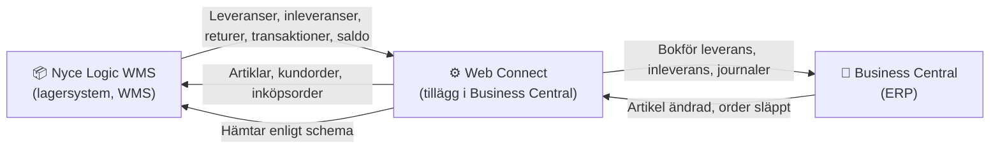
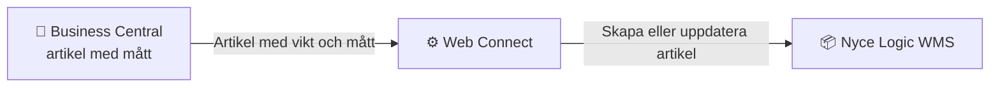
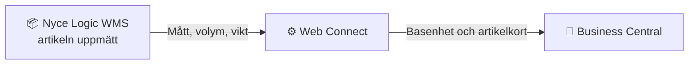
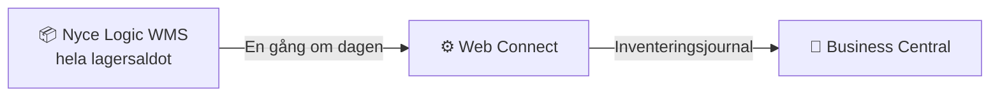

# Business Central och Nyce Logic WMS: integration

Web Connect från CombineIT kopplar ihop Microsoft Dynamics 365 Business Central med lagersystemet Nyce Logic WMS. Artiklar, försäljningsorder, flyttorder och inköpsorder skickas till Nyce, och leveranser, inleveranser, returer, lagerjusteringar och lagersaldon kommer tillbaka och bokförs i Business Central. Alla mappningar och regler finns i ditt eget Business Central, där du själv kan se och ändra dem.

## I korthet

| | |
|---|---|
| **System** | Nyce Logic WMS (lagersystem, WMS) |
| **Integrationsprodukt** | Web Connect för Microsoft Dynamics 365 Business Central |
| **Körs i** | Din egen Business Central-miljö, som ett tillägg. Web Connect skickar artiklar när de ändras och order när de släpps i Business Central. Leveranser, inleveranser, returer, lagerjusteringar och lagersaldon hämtas från Nyce enligt schema i jobbkön i Business Central. Inga webhooks och ingen extern integrationsplattform är inblandade. |
| **Konfigureras av** | Dig, i Business Central: mappningar, villkor, triggers och flöden. Du kan göra allt själv. Om du vill är CombineIT med i vilket steg som helst, som bollplank eller genom att göra jobbet. |
| **Koppling** | Nyces REST API (JSON), med en token från Nyces authenticate-endpoint |
| **Nyces API** | Nyces REST API. API-dokumentationen är inte publik: din Nyce-leverantör ger dig tillgång när du är kund |
| **Dataflöden** | 9: artiklar, artikelmått och vikter, utgående order, leveranser, inkommande order, inleveranser, kundreturer, lagerjusteringar och lagersaldo |
| **Business Central-utgåvor** | Alla utgåvor, Essentials och Premium, även den senaste versionen |
| **Finns på** | [Web Connect på Microsoft AppSource](https://marketplace.microsoft.com/sv-se/product/PUBID.martitab1633951001710%7CAID.webconnect%7CPAPPID.9f3a7223-19db-4ac7-832f-cf8e4699186f?tab=Overview). Nyce-integrationen ingår inte i appen Web Connect Ready Integrations. Den sätts upp i ditt Web Connect under projektet |

## Det här kan synkas

Web Connect har nio dataflöden mellan Business Central och Nyce Logic WMS.

| Data | Riktning | Vad som händer |
|---|---|---|
| [Artiklar](flows/item-data.md) | Business Central → Nyce | Artiklar skapas eller uppdateras i Nyce med streckkoder, enhet, artikelkategori, leverantörens artikelkod och tulluppgifter |
| [Artikelmått och vikter](flows/item-dimensions.md) | Nyce → Business Central | Mått, volym och vikt som mätts upp i lagret skrivs till artikelns basenhet och till artikelkortet |
| [Utgående order](flows/order-outbound.md) | Business Central → Nyce | Släppta försäljningsorder och utgående flyttorder skickas till Nyce som kundorder att plocka och skicka |
| [Leveranser](flows/shipment.md) | Nyce → Business Central | Levererade antal hämtas och leveransen bokförs i Business Central |
| [Inkommande order](flows/purchase-order.md) | Business Central → Nyce | Släppta inköpsorder och inkommande flyttorder skickas till Nyce som förväntade inleveranser |
| [Inleveranser](flows/receipt.md) | Nyce → Business Central | Inlevererade antal hämtas och inleveransen bokförs i Business Central |
| [Kundreturer](flows/customer-return.md) | Nyce → Business Central | Returer som registrerats i lagret hämtas, returinleveransen bokförs och en kreditnota följer |
| [Lagerjusteringar](flows/stock-adjustment.md) | Nyce → Business Central | Lagerrättelser som görs i Nyce bokförs via en artikeljournal |
| [Lagersaldo](flows/stock-balance.md) | Nyce → Business Central | Hela lagersaldot hämtas en gång om dagen och skillnader bokförs via en inventeringsjournal |

Artiklar, utgående order och leveranser är kärnan i varje lagerintegration. De andra flödena väljs när integrationen sätts upp, se [Välj upplägg](#choose-your-setup).

## Så fungerar det

Allt Web Connect skickar till Nyce läggs i samma kuvert, där innehållet (artiklar, kundorder eller inköpsorder) ligger under `Data`. Web Connect läser resultatet i Nyces svar, och bara ett lyckat resultat markerar meddelandet som skickat. Varje meddelande åt båda hållen loggas som ett [WMS-dokument](../../general/wms-documents.md) i Business Central, med typ, status och eventuellt fel, och kopplas till den försäljningsorder, inköpsorder eller flyttorder det hör till. Meddelanden från Nyce hämtas enligt schema från jobbkön, och leveranser, inleveranser och justeringar bokförs automatiskt när det är påslaget i [Logistics Setup](../../general/logistics-setup.md).

## Välj upplägg

Varje flöde måste passa hur ditt företag arbetar: vilket system som äger datat, var personalen gör sitt jobb och vad redovisningen kräver. Därför bestäms flödena tillsammans när en ny integration sätts upp. Alternativen nedan är de som Web Connect-kunder använder i dag. **Vanligast** markerar det alternativ som flest Web Connect-kunder med Nyce Logic WMS använder. **Rekommenderas** markerar CombineIT:s bästa praxis, där det finns en.

Inget alternativ är markerat som vanligast än, eftersom alternativen ännu inte har jämförts hos tillräckligt många Nyce-kunder.

### Artikelmått och vikter

| Alternativ | Så fungerar det | När det passar |
|---|---|---|
| **Underhålls i Business Central** | Längd, bredd, höjd och vikt underhålls på artikeln i Business Central och skickas till Nyce med artikeln | Måtten är kända när artikeln skapas, till exempel från leverantören |
| **Mäts i Nyce** | Lagret mäter artikeln. Web Connect hämtar mått, volym och vikt från Nyce varje natt och uppdaterar basenheten och vikten på artikelkortet | Det är i lagret som artiklarna mäts och vägs |

#### Artikelmått som underhålls i Business Central

#### Artikelmått som mäts i Nyce

### Lagersaldo

| Alternativ | Så fungerar det | När det passar |
|---|---|---|
| **Daglig avstämning i Business Central** | Leveranser, inleveranser och justeringar håller lagret aktuellt under dagen. En gång om dagen hämtas hela saldot från Nyce och skillnader bokförs via en inventeringsjournal | Business Central äger lagersiffran och för den vidare till andra kanaler |

#### Lagersaldo som stäms av dagligen i Business Central

Plock, packning, bokning av transportör och lagerplatserna hanteras alltid i Nyce.

## Det här behöver du

- Microsoft Dynamics 365 Business Central, valfri utgåva (Essentials eller Premium), även den senaste versionen
- Web Connect installerat från Microsoft AppSource, med en aktiverad Web Connect-licens
- Ditt godkännande av att Web Connect installeras och får agera i din Business Central-miljö
- En API-användare i Nyce, och den klient, det lager och den klientgrupp som användaren loggar in på. De skapas av din Nyce-leverantör
- Nätverksåtkomst från Business Central till Nyces API. Nyce kan köras på leverantörens servrar eller på dina egna, och Web Connect stöder båda. Var Nyce körs avgör hur det nås
- Ett lagerställe i Business Central som motsvarar Nyce-lagret

## Så kommer du igång

1. Bestäm vilka flöden som ska användas och vilket alternativ som väljs för vart och ett, se [Välj upplägg](#choose-your-setup).
2. Installera Web Connect i Business Central, aktivera licensen och ge ditt godkännande. Nyce-integrationen ingår inte i appen Ready Integrations, så dess objekt och mappningar sätts upp i ditt Web Connect.
3. Spara Nyce-lösenordet i Web Connects [Secret Value Storage](../../general/secret-value-storage.md) och ställ in autentiseringen med användarnamn, klient, lager och klientgrupp.
4. Ställ in [Logistics Setup](../../general/logistics-setup.md) för Nyce: lagerstället, vilka dokument som skickas när de släpps, automatisk bokföring och artikeljournalerna.
5. Gör valen i konfigurationen nedan.
6. Testa artiklar, order, leveranser och inleveranser mot en testmiljö i Nyce och en sandlåda i Business Central innan ni går live.

## Konfigurera själv i Business Central

All konfiguration och logik i integrationen syns och går att ändra i Business Central. Det finns ingen extern integrationsplattform där logiken är dold.

| Det här kan du ändra | Var i Web Connect | Exempel |
|---|---|---|
| Fältmappning till Nyce | [Outgoing Data](../../general/outgoing-mapping/outgoing-data-web.md) | Skicka ett annat fält i Business Central som orderreferens, eller lägg till en egen egenskap på ordern |
| Fältmappning från Nyce | [Incoming Data mapping](../../general/incoming-data/mapping.md) | Skriv SSCC från leveransen till ett annat fält |
| Villkor | [Condition List](../../general/condition-list.md) | Skicka flyttorder med en annan ordertyp och leveransmetod än försäljningsorder |
| Värdemappning | [Text Mapping](../../general/text-mapping.md) | Översätt Nyces enhetskoder till enheter i Business Central |
| Vad som startar artikeluppdateringar | [Outgoing Sync Triggers](../../general/outgoing-mapping/outgoing-sync-triggers.md) | Skicka artikeln till Nyce när den ändras, bara för lagerartiklar |
| Vad som skickas och bokförs | [Logistics Setup](../../general/logistics-setup.md) | Skicka order när de släpps, bokför leveranser och inleveranser automatiskt, välj journalmallar |
| Bevakning och omsändning | [WMS Documents](../../general/wms-documents.md) och [Entries](../../general/entries.md) | Se varje meddelande och dess fel, och [skicka om ett meddelande](../../../../how-to/web-connect/resend-outgoing-message.md) |

## Val i konfigurationen

- **Lagerställe:** vilket lagerställe i Business Central som är Nyce-lagret.
- **Dokument som skickas till Nyce:** försäljningsorder, inköpsorder, utgående och inkommande flyttorder och försäljningsreturer kan slås på var för sig. Order skickas när de släpps.
- **Returer:** om Web Connect bokför returinleveransen, vilket är det vanliga valet, och om kreditnotan bokförs automatiskt. Automatiska kreditnotor körs som ett jobb i jobbkön i Business Central, och CombineIT kan hjälpa dig att sätta upp det.
- **Antal som skickas:** om det kvarvarande antalet eller hela det beställda antalet skickas på försäljningsorder.
- **Restorder:** om Nyce får ta emot en order för hantering även när alla rader inte har lagersaldo. Annars makulerar Nyce raderna som saknar saldo. Värdet skickas från Business Central på varje order.
- **Enheter:** om antal räknas om till basenheten, och hur Nyces enhetskoder mappas till enheter i Business Central.
- **Varianter:** artikelvarianter skickas som en SKU, som består av artikelnumret och variantkoden med ett skiljetecken som du väljer.
- **Streckkoder:** artikelns GTIN skickas som EAN. Fler streckkoder kan skickas från artikelreferenser.
- **Ordertyp och leveransmetod:** Nyces koder för ordertyp, leveransmetod, leveransvillkor och prioritet, som ställs in per sorts order med villkor.
- **Bokföring:** om leveranser, inleveranser, justeringar och det dagliga saldot bokförs automatiskt, med arbetsdatumet som bokföringsdatum.
- **Artikeljournaler:** vilken journalmall och vilket journalnamn justeringar och det dagliga saldot bokförs i.
- **Felhantering:** hur många gånger det ska försökas igen innan ett WMS-dokument markeras som misslyckat, och hur länge gamla WMS-dokument och saldoposter sparas.

## Begränsningar

- **Nyces API skiljer sig mellan installationer.** Nyce konfigureras per kund, och API:t kan se olika ut hos olika Nyce-kunder. Räkna med att API:t behöver stämmas av mot din egen Nyce-installation under uppsättningen.
- **Backningar i Nyce är inte integrerade.** En inleverans som backas och bokförs igen i Nyce stoppas med ett fel i Business Central, eftersom inköpsordern redan är inlevererad. Det rättas manuellt i Business Central.
- **Hela lagersaldot hämtas en gång om dagen.** Under dagen följer saldot i Business Central leveranser, inleveranser och justeringar från Nyce.
- **Om en order som skickats till Nyce går att makulera beror på hur långt den har kommit.** I Nyce kan en order makuleras tills den har allokerats, och ändringar tas normalt inte emot efter att plockorder har skapats. Makulering görs manuellt som standard. Det går att ställa in så att kundtjänst skickar en makulering till lagret från ordern i Business Central, och Nyce makulerar ordern om statusen tillåter det.
- **Kundreturer registreras i Nyce.** Lagret registrerar returen när den kommer in, oftast utifrån den ursprungliga kundordern eller leveransen. Nyce kan också ta emot returer som aviserats i förväg från affärssystemet, men det ingår inte i standardupplägget.

## Vanliga frågor

### Går det att integrera Business Central med Nyce Logic WMS?

Ja. Web Connect kopplar ihop Business Central med Nyce Logic WMS via Nyces REST API. Artiklar, försäljningsorder, flyttorder och inköpsorder skickas till Nyce, och leveranser, inleveranser, returer, lagerjusteringar och lagersaldon hämtas tillbaka och bokförs i Business Central.

### Räknas saldo på spärrade lagerplatser med i lagersaldot från Nyce?

Nyce rapporterar två siffror per artikel. Balance räknar inte med spärrade platser, till exempel inleverans, returer och ompackning. PhysicalBalance är allt som fysiskt finns i lagret. Vilken siffra som används till vad bestäms i inställningarna, så att samma lager inte dras två gånger.

### Hur ofta stäms lagret av mellan Nyce och Business Central?

Leveranser, inleveranser och lagerjusteringar hämtas enligt schema från jobbkön i Business Central, så saldot rör sig i takt med att lagret arbetar. Dessutom hämtas hela lagersaldot en gång om dagen i ett tidsfönster du väljer, och skillnader bokförs via en inventeringsjournal.

### Kan en order makuleras efter att den skickats till Nyce?

Ja, tills Nyce har allokerat den. Makulering görs manuellt som standard. Det går att ställa in så att kundtjänst skickar en makulering till lagret från ordern i Business Central, och Nyce makulerar ordern om statusen tillåter det.

### Vad händer om en inleverans backas i Nyce?

Backningar i lagersystemet är inte integrerade. Om en inleverans backas och bokförs igen i Nyce stoppas den nya inleveransen med ett fel i Business Central, eftersom inköpsordern redan är inlevererad. Rättelsen görs manuellt i Business Central enligt standard i Business Central.

## Relaterat

- Flöden: [Artiklar](flows/item-data.md) · [Artikelmått och vikter](flows/item-dimensions.md) · [Utgående order](flows/order-outbound.md) · [Leveranser](flows/shipment.md) · [Inkommande order](flows/purchase-order.md) · [Inleveranser](flows/receipt.md) · [Kundreturer](flows/customer-return.md) · [Lagerjusteringar](flows/stock-adjustment.md) · [Lagersaldo](flows/stock-balance.md)
- Instruktioner: [En WMS-förfrågan skickas inte](../../../../how-to/web-connect/wms-request-not-sent-error.md) · [Skicka om ett utgående meddelande](../../../../how-to/web-connect/resend-outgoing-message.md) · [Inget hämtas till Business Central](../../../../how-to/web-connect/nothing-downloads-to-business-central.md) · [Integrationerna körs inte](../../../../how-to/web-connect/integration-not-running.md)
- [Allmän dokumentation för Web Connect](../../general/README.md)

## Om Web Connect

Web Connect är en integrationsplattform för Microsoft Dynamics 365 Business Central, utvecklad av CombineIT. Den installeras i ditt eget Business Central och kopplar ihop det med e-handelsplattformar, lagersystem, kassasystem, returer, marknadsplatser och EDI. Varje flöde, mappning och regel konfigureras i Business Central, där du själv kan se och ändra det, utan specialkod för varje integration. [Web Connect på Microsoft AppSource](https://marketplace.microsoft.com/sv-se/product/PUBID.martitab1633951001710%7CAID.webconnect%7CPAPPID.9f3a7223-19db-4ac7-832f-cf8e4699186f?tab=Overview) · [Kontakta CombineIT](https://www.combineit.se/contact/)
