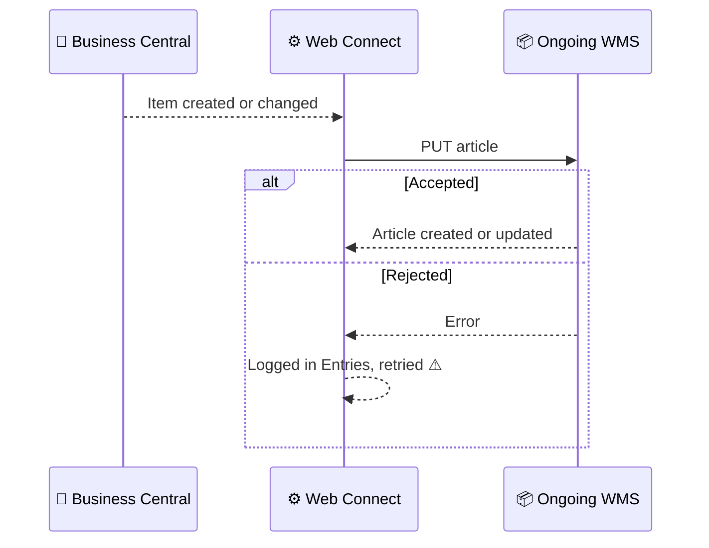

# Business Central to Ongoing WMS: items

Web Connect creates and updates items from Business Central as articles in Ongoing WMS. The article number is the Business Central item number, so every order and purchase order line refers to an article the warehouse already knows. Which fields are sent, and which changes send the item again, is set in Business Central.

| | |
|---|---|
| **Direction** | Business Central → Ongoing WMS |
| **Trigger** | Change on the item or its item references in Business Central, for the fields you choose. [ATT FYLLA I: hur artikeln skickas i konfigurationer som saknar trigger på artikeltabellen] |
| **Result** | The article exists in Ongoing with the same number as the item in Business Central |
| **Part of** | [Business Central and Ongoing WMS integration](../overview.md) |

## Step by step

1. An item is created or changed in Business Central (Business Central).
2. An outgoing sync trigger detects the change, optionally only for items with a given status (Web Connect).
3. Web Connect builds the article from the item and its units of measure, and sends it to `articles/{article number}` (Web Connect).
4. Ongoing creates or updates the article for your goods owner (Ongoing).

## Data mapping

| Ongoing field | Business Central field | Note |
|---|---|---|
| `articleNumber` | Item No. | Key between the systems |
| `articleName`, `description` | Description | |
| `purchasePrice` | Unit Cost | |
| `purcaseCurrencyCode` | Fixed value | The currency the purchase price is shown in |
| `countryOfOriginCode` | Country/Region of Origin Code | |
| `statisticsNumber` | Tariff No. | |
| `barCodeInfo.barCode` | GTIN | Leave out if a PIM owns barcodes |
| `weight`, `length`, `width`, `height`, `volume`, `quantityPerPackage` | Item unit of measure | Leave out if a PIM owns them |
| `isActive` | Fixed value `true` | |

## Web Connect objects

| Object | Role |
|---|---|
| `ONGOING-ITEM` | Sends the article to Ongoing |
| `ONGOING-BARCODEINFO` | Barcodes on the article |
| `ONGOING-IUOM` | Units of measure with dimensions and quantity per package |
| `ONGOING-ARTICLENAMETRANSLATIONS` | Translated article names |

## Error handling

| Situation | What happens | What to do |
|---|---|---|
| Ongoing rejects the article | The message is logged with the error in Entries | Correct the item and [resend the message](../../../../../how-to/web-connect/resend-outgoing-message.md) |
| An order line refers to an article that is missing in Ongoing | The outbound order is rejected | Send the item, then resend the order |

## Frequently asked questions

### Can we keep dimensions and barcodes in a PIM instead of Business Central?

Yes. Remove the dimension, weight, barcode and translation fields from the article mapping in Web Connect. Business Central then sends only the item number, name and trade data, and does not overwrite what the PIM loads into Ongoing.

## Related

- [Business Central and Ongoing WMS integration](../overview.md)
- [Outbound orders](order-outbound.md) · [Purchase orders](purchase-order.md)
- [Outgoing Sync Triggers](../../../general/outgoing-mapping/outgoing-sync-triggers.md)
