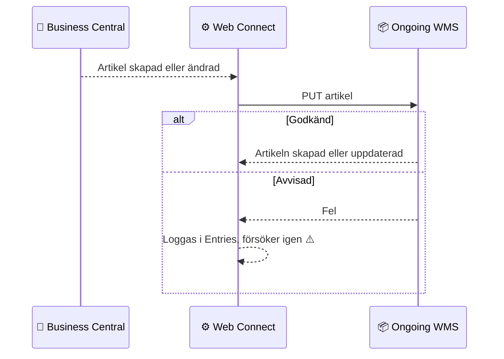

# Från Business Central till Ongoing WMS: artiklar

Web Connect skapar och uppdaterar artiklarna från Business Central i Ongoing WMS. Artikelnumret i Ongoing är artikelnumret i Business Central, så varje orderrad och inköpsorderrad pekar på en artikel som lagret redan känner till. Vilka fält som skickas, och vilka ändringar som skickar artikeln igen, ställs in i Business Central.

| | |
|---|---|
| **Riktning** | Business Central → Ongoing WMS |
| **Startas av** | En ändring på artikeln eller dess artikelreferenser i Business Central, för de fält du väljer. Utan trigger skickas artikeln med åtgärden Send Item to External System på artikelkortet |
| **Resultat** | Artikeln finns i Ongoing med samma nummer som i Business Central |
| **Del av** | [Business Central och Ongoing WMS: integration](../overview.md) |

## Steg för steg

1. En artikel skapas eller ändras i Business Central (Business Central).
2. En utgående synktrigger upptäcker ändringen, om du vill bara för artiklar med en viss status. Eller så väljer någon Send Item to External System på artikelkortet (Web Connect).
3. Web Connect bygger Ongoing-artikeln från artikeln i Business Central och dess enheter och skickar den till `articles/{article number}` (Web Connect).
4. Ongoing skapar eller uppdaterar artikeln för er varuägare (Ongoing).

## Mappning av data

| Fält i Ongoing | Fält i Business Central | Kommentar |
|---|---|---|
| `articleNumber` | Item No. | Nyckel mellan systemen |
| `articleName`, `description` | Description | |
| `purchasePrice` | Unit Cost | |
| `purcaseCurrencyCode` | Fast värde | Valutan som inköpspriset visas i |
| `countryOfOriginCode` | Country/Region of Origin Code | |
| `statisticsNumber` | Tariff No. | |
| `barCodeInfo.barCode` | GTIN | Utelämnas om en PIM äger streckkoderna |
| `weight`, `length`, `width`, `height`, `volume`, `quantityPerPackage` | Artikelns enhet | Utelämnas om en PIM äger dem |
| `isActive` | Fast värde `true` | |

## Objekt i Web Connect

| Objekt | Roll |
|---|---|
| `ONGOING-ITEM` | Skickar artikeln till Ongoing |
| `ONGOING-BARCODEINFO` | Streckkoder på artikeln |
| `ONGOING-IUOM` | Enheter med mått och antal per förpackning |
| `ONGOING-ARTICLENAMETRANSLATIONS` | Översatta artikelnamn |

## Felhantering

| Situation | Vad som händer | Gör så här |
|---|---|---|
| Ongoing avvisar artikeln | Meddelandet loggas med felet i Entries | Rätta artikeln och [skicka meddelandet igen](../../../../../how-to/web-connect/resend-outgoing-message.md) |
| En orderrad pekar på en artikel som saknas i Ongoing | Utleveransordern avvisas | Skicka artikeln och skicka sedan ordern igen |

## Vanliga frågor

### Kan vi ha mått och streckkoder i en PIM i stället för i Business Central?

Ja. Ta bort fälten för mått, vikt, streckkod och översättningar från artikelmappningen i Web Connect. Då skickar Business Central bara artikelnummer, namn och handelsdata, och skriver inte över det som PIM:en lägger in i Ongoing.

## Relaterat

- [Business Central och Ongoing WMS: integration](../overview.md)
- [Utleveransorder](order-outbound.md) · [Inköpsorder](purchase-order.md)
- [Outgoing Sync Triggers](../../../general/outgoing-mapping/outgoing-sync-triggers.md)
