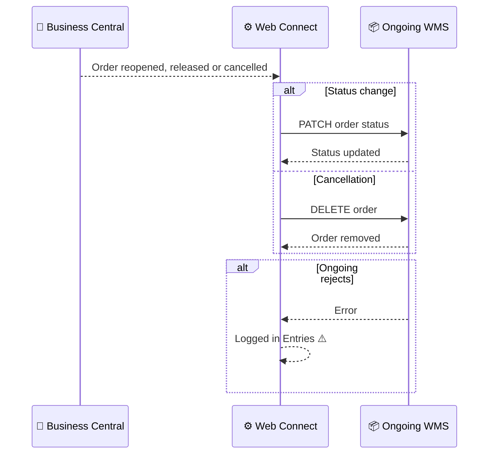

# Business Central to Ongoing WMS: order changes and cancellations

When a sales order that is already in Ongoing WMS is reopened or released again in Business Central, Web Connect updates the order status in Ongoing, so the warehouse knows whether it may pick the order. When the order is cancelled in Business Central, Web Connect removes the whole order from Ongoing.

| | |
|---|---|
| **Direction** | Business Central → Ongoing WMS |
| **Trigger** | Change of status on the sales order, or cancellation, in Business Central |
| **Result** | The order status in Ongoing is updated, or the order is removed from Ongoing |
| **Part of** | [Business Central and Ongoing WMS integration](../overview.md) |

## Step by step

1. Customer service reopens, releases or cancels an order that has been sent to Ongoing (Business Central).
2. An outgoing sync trigger on the sales order detects the change, as long as the warehouse has not reported the order as shipped (Web Connect).
3. For a status change, Web Connect translates the Business Central status to an Ongoing status number and sends it to `orders/{order ID}/orderStatus` (Web Connect).
4. For a cancellation of the whole order, Web Connect sends the order again with the method DELETE, which removes it from Ongoing (Web Connect).
5. Ongoing updates or removes the order (Ongoing).

## Data mapping

| Ongoing field | Business Central source | Note |
|---|---|---|
| `orderStatusNumber` | Status of the sales order (Open, Released) | Translated with a text mapping, or a fixed status number |
| Order ID in the address | Ongoing order ID on the warehouse document | Stored when the order was created |
| HTTP method DELETE | Cancel flag on the warehouse document | The text mapping `CANCEL-TRUE-GIVES-DELETE` turns a cancellation into DELETE |

## Web Connect objects

| Object | Role |
|---|---|
| `ONGOING-STATUSUPDATE` | Updates the order status in Ongoing |
| `ONGOING-ORDER` | Removes the order when it is cancelled |

## Error handling

| Situation | What happens | What to do |
|---|---|---|
| The warehouse has started on the order | [ATT FYLLA I: vad Ongoing svarar och vad Web Connect gör då] | Contact the warehouse to stop the order |
| No trigger on the sales order | Status changes in Business Central are not sent | Add an outgoing sync trigger from the sales header to `ONGOING-STATUSUPDATE` |
| The order has no Ongoing order ID | The update cannot be sent | Check that the order was created in Ongoing, see Entries |

## Frequently asked questions

### Can we cancel a single line on an order that is already in Ongoing?

It depends on the setting WMS Cancel Possibility in the logistics setup. Most Ongoing configurations allow only the whole order to be cancelled. It can also be set to allow selected lines. [ATT FYLLA I: hur en avbokad rad skickas till Ongoing när Select Lines är valt]

## Related

- [Business Central and Ongoing WMS integration](../overview.md)
- [Outbound orders](order-outbound.md) · [Shipments](shipment.md)
- [Outgoing Sync Triggers](../../../general/outgoing-mapping/outgoing-sync-triggers.md) · [Text Mapping](../../../general/text-mapping.md)
