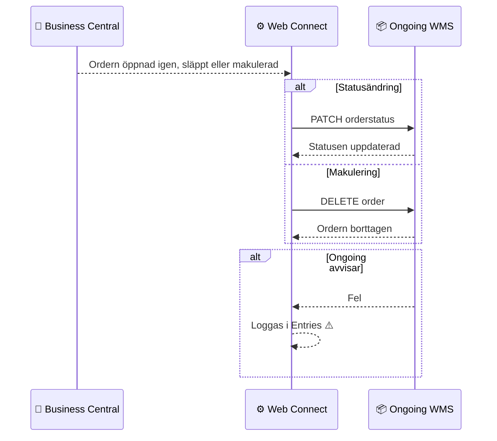

# Från Business Central till Ongoing WMS: orderändringar och makuleringar

När en försäljningsorder som redan finns i Ongoing WMS öppnas igen eller släpps på nytt i Business Central uppdaterar Web Connect orderstatusen i Ongoing, så att lagret vet om ordern får plockas. När ordern makuleras i Business Central tar Web Connect bort hela ordern från Ongoing.

| | |
|---|---|
| **Riktning** | Business Central → Ongoing WMS |
| **Startas av** | Ändrad status på försäljningsordern, eller makulering, i Business Central |
| **Resultat** | Orderstatusen i Ongoing uppdateras, eller ordern tas bort från Ongoing |
| **Del av** | [Business Central och Ongoing WMS: integration](../overview.md) |

## Steg för steg

1. Kundtjänst öppnar igen eller släpper en order som har skickats till Ongoing, eller makulerar den med åtgärden Send Cancel to Warehouse (Business Central).
2. En utgående synktrigger på försäljningsordern upptäcker ändringen, så länge lagret inte har rapporterat ordern som skickad (Web Connect).
3. Vid en statusändring översätter Web Connect statusen i Business Central till ett statusnummer i Ongoing och skickar det till `orders/{order ID}/orderStatus` (Web Connect).
4. Vid makulering av hela ordern skickar Web Connect ordern igen med metoden DELETE, som tar bort den från Ongoing (Web Connect).
5. Ongoing uppdaterar eller tar bort ordern (Ongoing).

## Mappning av data

| Fält i Ongoing | Källa i Business Central | Kommentar |
|---|---|---|
| `orderStatusNumber` | Försäljningsorderns status (Open, Released) | Översätts med en textmappning, eller ett fast statusnummer |
| Order-id i adressen | Ongoings order-id på lagerdokumentet | Sparades när ordern skapades |
| HTTP-metoden DELETE | Makuleringsflaggan på lagerdokumentet | Textmappningen `CANCEL-TRUE-GIVES-DELETE` gör om en makulering till DELETE |

## Objekt i Web Connect

| Objekt | Roll |
|---|---|
| `ONGOING-STATUSUPDATE` | Uppdaterar orderstatusen i Ongoing |
| `ONGOING-ORDER` | Tar bort ordern när den makuleras |

## Felhantering

| Situation | Vad som händer | Gör så här |
|---|---|---|
| Ordern har kommit längre än allokerad i Ongoing, till exempel håller den på att plockas | Ongoing svarar med ett fel när du väljer Send Cancel to Warehouse, och ordern ligger kvar i Ongoing | Kontakta lagret för att stoppa ordern |
| Ingen trigger på försäljningsordern | Statusändringar i Business Central skickas inte | Lägg till en utgående synktrigger från försäljningshuvudet till `ONGOING-STATUSUPDATE` |
| Ordern saknar order-id från Ongoing | Uppdateringen kan inte skickas | Kontrollera att ordern skapades i Ongoing, se Entries |

## Vanliga frågor

### Kan vi makulera en enskild rad på en order som redan finns i Ongoing?

Det beror på inställningen WMS Cancel Possibility i logistikinställningarna. De flesta Ongoing-konfigurationer tillåter bara att hela ordern makuleras. Den kan också ställas in så att utvalda rader får makuleras.

## Relaterat

- [Business Central och Ongoing WMS: integration](../overview.md)
- [Utleveransorder](order-outbound.md) · [Leveranser](shipment.md)
- [Outgoing Sync Triggers](../../../general/outgoing-mapping/outgoing-sync-triggers.md) · [Text Mapping](../../../general/text-mapping.md)
