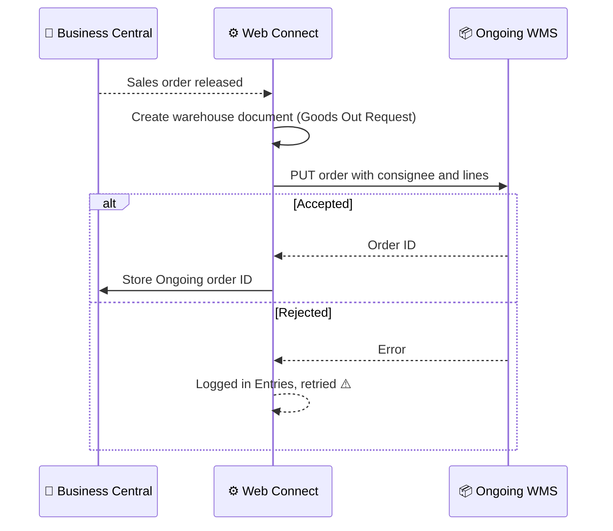

# Business Central to Ongoing WMS: outbound orders

When a sales order is released in Business Central for the location your 3PL runs, Web Connect creates the outbound order in Ongoing WMS. The order carries the consignee, delivery date, way of delivery and the order lines. Transfer orders can be sent the same way.

| | |
|---|---|
| **Direction** | Business Central → Ongoing WMS |
| **Trigger** | The sales order or transfer order is released in Business Central |
| **Result** | An outbound order in Ongoing, and a warehouse document in Business Central with the Ongoing order ID |
| **Part of** | [Business Central and Ongoing WMS integration](../overview.md) |

## Step by step

1. The sales order is released for the integrated location (Business Central).
2. A warehouse document of type Goods Out Request is created from the order (Web Connect).
3. Web Connect sends the order to `orders/{order number}` in Ongoing (Web Connect).
4. Ongoing creates the outbound order and returns its order ID, which is stored on the warehouse document (Ongoing, Web Connect).

## Data mapping

The warehouse document copies the values from the sales order or transfer order when it is created. Web Connect sends them from the warehouse document.

| Ongoing field | Business Central source | Note |
|---|---|---|
| `orderNumber` | Warehouse document number | |
| `referenceNumber` | Order number | |
| `deliveryDate` | Delivery date on the warehouse document | |
| `wayOfDelivery` | Shipment method code | Set with WMS document mapping |
| `servicePointCode` | Service point on the warehouse document | When the order has one |
| `consignee` | Ship-to name, address, post code, city and country | Organisation number from the customer card, VAT number from the order |
| `orderLines.articleNumber` | Item number | |
| `orderLines.numberOfItems` | Quantity | |
| `orderLines.rowNumber`, `externalId` | Line number | Used to match picked quantities back |
| `orderLines.prices`, `vat` | Price and VAT from the sales line | |
| `orderId` (response) | Ongoing order ID on the warehouse document | Used for status updates and cancellation |

## Web Connect objects

| Object | Role |
|---|---|
| `ONGOING-ORDER` | Sends the outbound order |
| `ONGOING-CONSIGNEE` | Consignee and invoice address |
| `ONGOING-ORDERLINES` | Order lines with prices and VAT |
| `ONGOING-WAYOFDELIVERY`, `ONGOING-TRANSPORTER` | Delivery method and carrier |
| `ONGOING-PICKABLE` | Reads whether the order can be picked. [ATT FYLLA I: hur plockbarheten hämtas och var den visas i Business Central] |

## Error handling

| Situation | What happens | What to do |
|---|---|---|
| An article on the order is missing in Ongoing | Ongoing rejects the order | Send the item, then resend the order. See [WMS request not sent](../../../../../how-to/web-connect/wms-request-not-sent-error.md) |
| The order is not released, or is for another location | Nothing is sent | Release the order on the integrated location |
| Ongoing cannot be reached | The message fails and is retried up to the maximum set in the logistics setup | Check Entries |

## Frequently asked questions

### Is freight sent to Ongoing as an order line?

Usually not. Lines without stock, such as freight and other service items, are left out of the order to Ongoing, but they are posted together with the shipment in Business Central. Both settings are in the logistics setup.

## Related

- [Business Central and Ongoing WMS integration](../overview.md)
- [Order changes and cancellations](order-change-cancellation.md) · [Shipments](shipment.md) · [Items](items.md)
- [WMS documents](../../../general/wms-documents.md) · [Logistics Setup](../../../general/logistics-setup.md)
