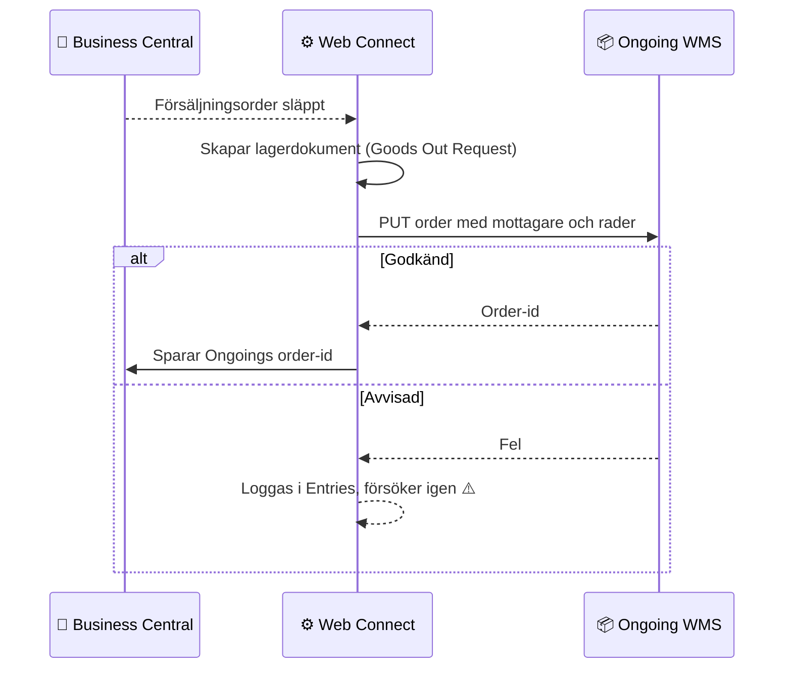

# Från Business Central till Ongoing WMS: utleveransorder

När en försäljningsorder släpps i Business Central för lagerstället som er 3PL driver skapar Web Connect utleveransordern i Ongoing WMS. Ordern innehåller mottagare, leveransdatum, leveranssätt och orderraderna. Flyttorder kan skickas på samma sätt.

| | |
|---|---|
| **Riktning** | Business Central → Ongoing WMS |
| **Startas av** | Försäljningsordern eller flyttordern släpps i Business Central, eller åtgärden Send to Warehouse på ordern |
| **Resultat** | En utleveransorder i Ongoing, och ett lagerdokument i Business Central med Ongoings order-id |
| **Del av** | [Business Central och Ongoing WMS: integration](../overview.md) |

## Steg för steg

1. Försäljningsordern släpps för det integrerade lagerstället (Business Central).
2. Ett lagerdokument av typen Goods Out Request skapas från ordern (Web Connect).
3. Web Connect skickar ordern till `orders/{order number}` i Ongoing (Web Connect).
4. Ongoing skapar utleveransordern och svarar med sitt order-id, som sparas på lagerdokumentet (Ongoing, Web Connect).

## Mappning av data

Lagerdokumentet kopierar värdena från försäljningsordern eller flyttordern när det skapas. Web Connect skickar dem från lagerdokumentet.

| Fält i Ongoing | Källa i Business Central | Kommentar |
|---|---|---|
| `orderNumber` | Lagerdokumentets nummer | |
| `referenceNumber` | Ordernummer | |
| `deliveryDate` | Leveransdatum på lagerdokumentet | |
| `wayOfDelivery` | Kod för leveransmetod | Ställs in med mappning av WMS-dokument |
| `servicePointCode` | Utlämningsställe på lagerdokumentet | När ordern har ett |
| `consignee` | Leveransadressens namn, adress, postnummer, ort och land | Organisationsnummer från kundkortet, momsnummer från ordern |
| `orderLines.articleNumber` | Artikelnummer | |
| `orderLines.numberOfItems` | Antal | |
| `orderLines.rowNumber`, `externalId` | Radnummer | Används för att matcha plockade antal tillbaka |
| `orderLines.prices`, `vat` | Pris och moms från försäljningsraden | |
| `orderId` (svar) | Ongoings order-id på lagerdokumentet | Används för statusuppdateringar och makulering |

## Objekt i Web Connect

| Objekt | Roll |
|---|---|
| `ONGOING-ORDER` | Skickar utleveransordern |
| `ONGOING-CONSIGNEE` | Mottagare och fakturaadress |
| `ONGOING-ORDERLINES` | Orderrader med priser och moms |
| `ONGOING-WAYOFDELIVERY`, `ONGOING-TRANSPORTER` | Leveranssätt och transportör |
| `ONGOING-PICKABLE` | Läser om ordern kan plockas. Hämtas när Ongoing rapporterar att ordern har bytt status, och sparas på lagerdokumentet |

## Felhantering

| Situation | Vad som händer | Gör så här |
|---|---|---|
| En artikel på ordern saknas i Ongoing | Ongoing avvisar ordern | Skicka artikeln och skicka sedan ordern igen. Se [WMS-förfrågan skickas inte](../../../../../how-to/web-connect/wms-request-not-sent-error.md) |
| Ordern är inte släppt, eller gäller ett annat lagerställe | Ingenting skickas | Släpp ordern på det integrerade lagerstället |
| Ongoing går inte att nå | Meddelandet misslyckas, och Web Connect försöker igen upp till det maxantal som är inställt i logistikinställningarna | Kontrollera Entries |

## Vanliga frågor

### Skickas frakt till Ongoing som en orderrad?

Oftast inte. Rader utan lagersaldo, till exempel frakt och andra tjänsteartiklar, skickas inte med ordern till Ongoing, men de bokförs tillsammans med leveransen i Business Central. Båda inställningarna finns i logistikinställningarna.

## Relaterat

- [Business Central och Ongoing WMS: integration](../overview.md)
- [Orderändringar och makuleringar](order-change-cancellation.md) · [Leveranser](shipment.md) · [Artiklar](items.md)
- [WMS-dokument](../../../general/wms-documents.md) · [Logistics Setup](../../../general/logistics-setup.md)
