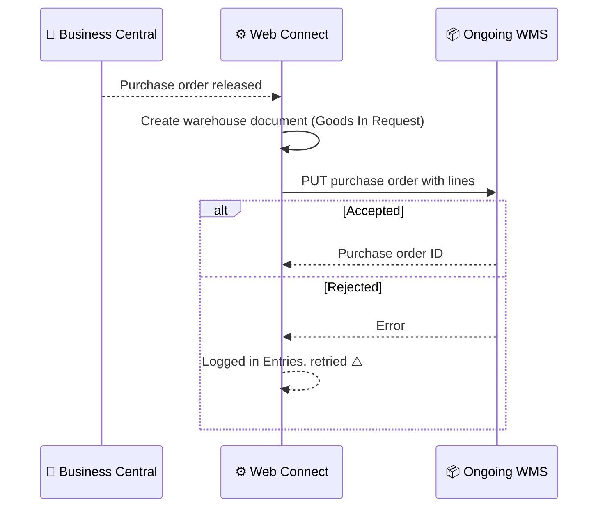

# Business Central to Ongoing WMS: purchase orders

When a purchase order is released in Business Central for the location your 3PL runs, Web Connect sends it to Ongoing WMS as an inbound order with supplier, expected date and lines. The warehouse then knows what is coming, and received quantities can be matched back line by line.

| | |
|---|---|
| **Direction** | Business Central → Ongoing WMS |
| **Trigger** | The purchase order is released in Business Central |
| **Result** | An inbound order in Ongoing, and a warehouse document in Business Central with the Ongoing purchase order ID |
| **Part of** | [Business Central and Ongoing WMS integration](../overview.md) |

## Step by step

1. The purchase order is released for the integrated location (Business Central).
2. A warehouse document of type Goods In Request is created (Web Connect).
3. Web Connect sends the purchase order to `purchaseOrders/{number}` in Ongoing (Web Connect).
4. Ongoing creates the inbound order and returns its ID (Ongoing).

## Data mapping

| Ongoing field | Business Central source | Note |
|---|---|---|
| `purchaseOrderNumber` | Warehouse document number | |
| `inDate` | Expected date on the warehouse document | |
| `supplierInfo` | Vendor name and address | |
| `purchaseOrderLines.articleNumber` | Item number | |
| `purchaseOrderLines.numberOfItems` | Quantity | |
| `purchaseOrderLines.rowPrice` | Price on the purchase line | |
| `purchaseOrderLines.rowNumber`, `externalOrderLineId` | Line number | Used to match received quantities back |
| `purchaseOrderId` (response) | Ongoing purchase order ID on the warehouse document | |

## Web Connect objects

| Object | Role |
|---|---|
| `ONGOING-PURCHASEORDER` | Sends the inbound order |
| `ONGOING-PURCHASEORDERLINES` | Purchase order lines |
| `ONGOING-PURCHASE-SUPPLIERINFO` | Vendor and address |

## Error handling

| Situation | What happens | What to do |
|---|---|---|
| An article on the purchase order is missing in Ongoing | Ongoing rejects the purchase order | Send the item, then resend the purchase order |
| The purchase order is for another location | Nothing is sent | Use the integrated location |

## Frequently asked questions

### What happens if we change a purchase order after it has been sent?

[ATT FYLLA I: hur en ändrad inköpsorder hanteras efter att den skickats till Ongoing]

## Related

- [Business Central and Ongoing WMS integration](../overview.md)
- [Receipts](receipt.md) · [Items](items.md)
- [WMS documents](../../../general/wms-documents.md)
