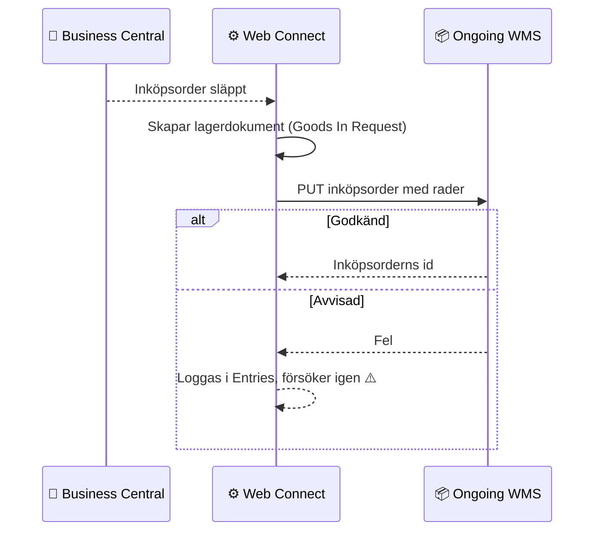

# Från Business Central till Ongoing WMS: inköpsorder

När en inköpsorder släpps i Business Central för lagerstället som er 3PL driver skickar Web Connect den till Ongoing WMS som en inleveransorder med leverantör, förväntat datum och rader. Då vet lagret vad som kommer, och mottagna antal kan matchas tillbaka rad för rad.

| | |
|---|---|
| **Riktning** | Business Central → Ongoing WMS |
| **Startas av** | Inköpsordern släpps i Business Central, eller åtgärden Send to Warehouse på inköpsordern |
| **Resultat** | En inleveransorder i Ongoing, och ett lagerdokument i Business Central med Ongoings id för inköpsordern |
| **Del av** | [Business Central och Ongoing WMS: integration](../overview.md) |

## Steg för steg

1. Inköpsordern släpps för det integrerade lagerstället (Business Central).
2. Ett lagerdokument av typen Goods In Request skapas (Web Connect).
3. Web Connect skickar inköpsordern till `purchaseOrders/{number}` i Ongoing (Web Connect).
4. Ongoing skapar inleveransordern och svarar med dess id (Ongoing).

## Mappning av data

| Fält i Ongoing | Källa i Business Central | Kommentar |
|---|---|---|
| `purchaseOrderNumber` | Lagerdokumentets nummer | |
| `inDate` | Förväntat datum på lagerdokumentet | |
| `supplierInfo` | Leverantörens namn och adress | |
| `purchaseOrderLines.articleNumber` | Artikelnummer | |
| `purchaseOrderLines.numberOfItems` | Antal | |
| `purchaseOrderLines.rowPrice` | Pris på inköpsraden | |
| `purchaseOrderLines.rowNumber`, `externalOrderLineId` | Radnummer | Används för att matcha mottagna antal tillbaka |
| `purchaseOrderId` (svar) | Ongoings id för inköpsordern på lagerdokumentet | |

## Objekt i Web Connect

| Objekt | Roll |
|---|---|
| `ONGOING-PURCHASEORDER` | Skickar inleveransordern |
| `ONGOING-PURCHASEORDERLINES` | Inköpsorderrader |
| `ONGOING-PURCHASE-SUPPLIERINFO` | Leverantör och adress |

## Felhantering

| Situation | Vad som händer | Gör så här |
|---|---|---|
| En artikel på inköpsordern saknas i Ongoing | Ongoing avvisar inköpsordern | Skicka artikeln och skicka sedan inköpsordern igen |
| Inköpsordern gäller ett annat lagerställe | Ingenting skickas | Använd det integrerade lagerstället |

## Vanliga frågor

### Vad händer om vi ändrar en inköpsorder efter att den har skickats?

Skicka den igen med åtgärden Send to Warehouse på inköpsordern. Web Connect skickar den uppdaterade inköpsordern till Ongoing.

## Relaterat

- [Business Central och Ongoing WMS: integration](../overview.md)
- [Inleveranser](receipt.md) · [Artiklar](items.md)
- [WMS-dokument](../../../general/wms-documents.md)
