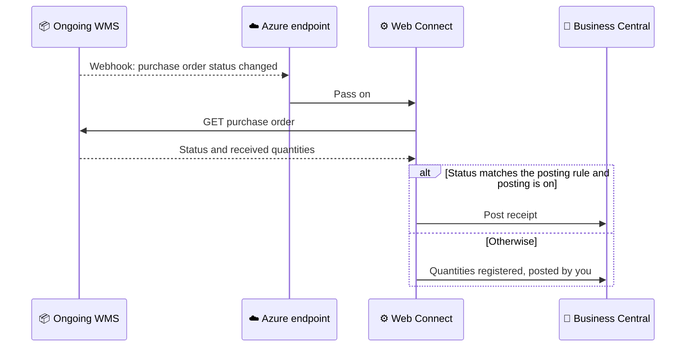

# Ongoing WMS to Business Central: receipts

When the warehouse receives a purchase order, Ongoing WMS sends a webhook. Web Connect fetches the purchase order with received quantities per line. When it has the status you have chosen, for example Lagerlagd or Avvikelse, the receipt can be posted in Business Central automatically, or left for you to post.

| | |
|---|---|
| **Direction** | Ongoing WMS → Business Central |
| **Trigger** | Webhook from Ongoing when the purchase order status changes |
| **Result** | Received quantities on the purchase order, and a posted purchase receipt if automatic posting is on |
| **Part of** | [Business Central and Ongoing WMS integration](../overview.md) |

## Step by step

1. The warehouse receives and puts away the goods (Ongoing).
2. Ongoing calls the webhook for purchase order status. The Azure endpoint passes the call on to Web Connect (Ongoing, Azure).
3. Web Connect fetches the purchase order from `purchaseOrders/?goodsOwnerId=…&purchaseOrderNumber=…` (Web Connect).
4. Status and received quantity per line are written to the warehouse document (Web Connect).
5. If automatic posting is on and the status matches the posting rule, the receipt is posted (Business Central).

## Data mapping

| Ongoing field | Business Central field | Note |
|---|---|---|
| `purchaseOrderInfo.purchaseOrderStatus.text` | Status on the warehouse document | Compared with the posting rule |
| `purchaseOrderLines.receivedNumberOfItems` | Quantity to receive | Per line |
| `purchaseOrderLines.externalOrderLineId` | Line number | Matches the line sent with the purchase order |
| `purchaseOrderLines.comment` | Comment on the warehouse document line | |
| `purchaseOrderInfo.purchaseOrderId` | Ongoing purchase order ID | |

## Web Connect objects

| Object | Role |
|---|---|
| `ONGOING-INSTATUSCHANGE` | Receives the webhook and starts the fetch |
| `ONGOING-INSTATUS` | Fetches the purchase order and its status |
| `ONGOING-PURCHASEORDERLINES1` | Received quantities per line |

## Error handling

| Situation | What happens | What to do |
|---|---|---|
| The webhook for purchase order status has stopped | Nothing is received in Business Central, while shipments still arrive | Ask the 3PL to check the webhook on the goods owner in Ongoing. Fetch the status manually for purchase orders received in the meantime |
| The status text does not match the posting rule | Quantities are stored, nothing is posted | Check which status text the 3PL uses, and change the posting rule |
| The receipt was already handled manually | Nothing more is posted | No action |

## Frequently asked questions

### Why is a purchase order not received in Business Central although the warehouse has put the goods away?

The receipt is only posted when the purchase order gets one of the statuses in the posting rule, and only when Ongoing has sent the webhook. Check Web Connect Entries for incoming status messages. If none have arrived, ask the 3PL to check the webhook for purchase order status in Ongoing. You can also fetch the status for a single purchase order manually.

## Related

- [Business Central and Ongoing WMS integration](../overview.md)
- [Purchase orders](purchase-order.md) · [Returns](returns.md)
- [Webhooks](../../../general/webhooks.md) · [Logistics Setup](../../../general/logistics-setup.md)
