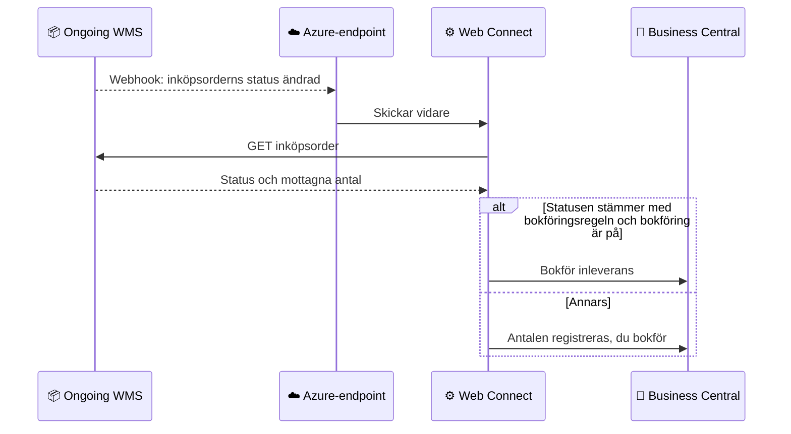

# Från Ongoing WMS till Business Central: inleveranser

När lagret tar emot en inköpsorder skickar Ongoing WMS en webhook. Web Connect hämtar inköpsordern med mottagna antal per rad. När den har den status du har valt, till exempel Lagerlagd eller Avvikelse, kan inleveransen bokföras automatiskt i Business Central eller lämnas åt dig att bokföra.

| | |
|---|---|
| **Riktning** | Ongoing WMS → Business Central |
| **Startas av** | En webhook från Ongoing när inköpsorderns status ändras |
| **Resultat** | Mottagna antal på inköpsordern, och en bokförd inköpsinleverans om automatisk bokföring är på |
| **Del av** | [Business Central och Ongoing WMS: integration](../overview.md) |

## Steg för steg

1. Lagret tar emot och lagrar in varorna (Ongoing).
2. Ongoing anropar webhooken för inköpsorderstatus. Azure-endpointen skickar anropet vidare till Web Connect (Ongoing, Azure).
3. Web Connect hämtar inköpsordern från `purchaseOrders/?goodsOwnerId=…&purchaseOrderNumber=…` (Web Connect).
4. Status och mottaget antal per rad skrivs till lagerdokumentet (Web Connect).
5. Är automatisk bokföring på och statusen stämmer med bokföringsregeln bokförs inleveransen (Business Central).

## Mappning av data

| Fält i Ongoing | Fält i Business Central | Kommentar |
|---|---|---|
| `purchaseOrderInfo.purchaseOrderStatus.text` | Status på lagerdokumentet | Jämförs med bokföringsregeln |
| `purchaseOrderLines.receivedNumberOfItems` | Antal att ta emot | Per rad |
| `purchaseOrderLines.externalOrderLineId` | Radnummer | Matchar raden som skickades med inköpsordern |
| `purchaseOrderLines.comment` | Kommentar på lagerdokumentets rad | |
| `purchaseOrderInfo.purchaseOrderId` | Ongoings id för inköpsordern | |

## Objekt i Web Connect

| Objekt | Roll |
|---|---|
| `ONGOING-INSTATUSCHANGE` | Tar emot webhooken och startar hämtningen |
| `ONGOING-INSTATUS` | Hämtar inköpsordern och dess status |
| `ONGOING-PURCHASEORDERLINES1` | Mottagna antal per rad |

## Felhantering

| Situation | Vad som händer | Gör så här |
|---|---|---|
| Webhooken för inköpsorderstatus har slutat fungera | Ingenting tas emot i Business Central, medan leveranser fortfarande kommer in | Be 3PL:en kontrollera webhooken på varuägaren i Ongoing. Hämta statusen manuellt för inköpsorder som tagits emot under tiden |
| Statustexten stämmer inte med bokföringsregeln | Antalen sparas, ingenting bokförs | Kontrollera vilken statustext 3PL:en använder, och ändra bokföringsregeln |
| Inleveransen har redan hanterats manuellt | Ingenting mer bokförs | Ingen åtgärd |

## Vanliga frågor

### Varför tas inte inköpsordern emot i Business Central fast lagret har lagrat in varorna?

Inleveransen bokförs bara när inköpsordern får någon av statusarna i bokföringsregeln, och bara när Ongoing har skickat webhooken. Leta efter inkommande statusmeddelanden i Web Connect Entries. Har inga kommit in, be 3PL:en kontrollera webhooken för inköpsorderstatus i Ongoing. Du kan också hämta statusen för en enskild inköpsorder manuellt.

## Relaterat

- [Business Central och Ongoing WMS: integration](../overview.md)
- [Inköpsorder](purchase-order.md) · [Returer](returns.md)
- [Webhooks](../../../general/webhooks.md) · [Logistics Setup](../../../general/logistics-setup.md)
