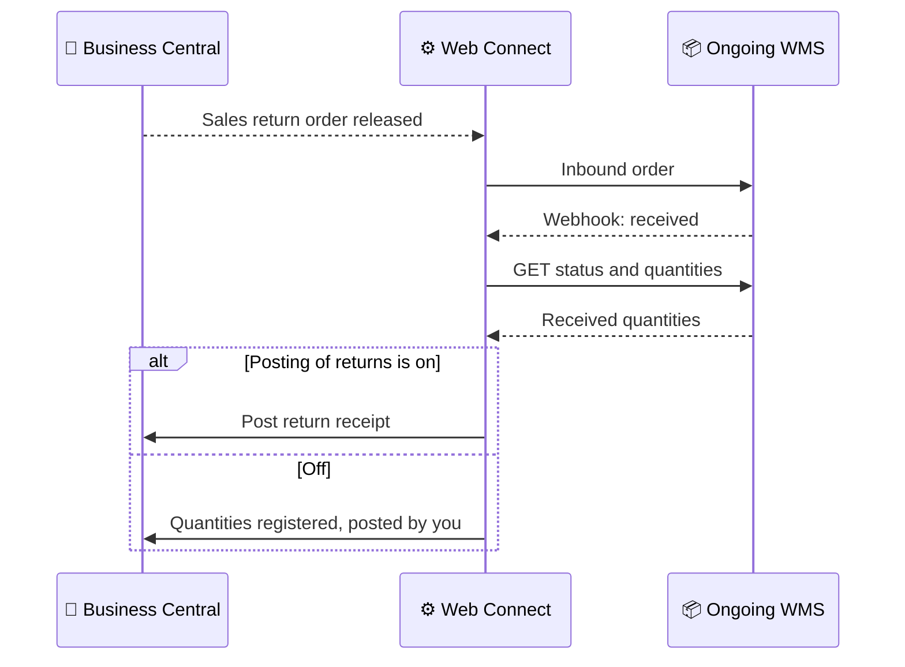

# Business Central and Ongoing WMS: returns

A customer return is registered as a sales return order in Business Central, copied from the posted shipment or invoice. Web Connect sends it to Ongoing WMS as an inbound order. When the warehouse has received the goods, the return receipt is posted in Business Central, so refund, VAT and stock follow the original sale.

| | |
|---|---|
| **Direction** | Business Central → Ongoing WMS, and back |
| **Trigger** | The sales return order is released in Business Central. The receipt comes back with a webhook from Ongoing |
| **Result** | An inbound order in Ongoing, and a posted return receipt in Business Central |
| **Part of** | [Business Central and Ongoing WMS integration](../overview.md) |

## Step by step

1. Customer service creates a sales return order from the posted shipment or invoice, with a return reason (Business Central).
2. The return order is released and sent to Ongoing as an inbound order (Web Connect).
3. The warehouse receives the goods (Ongoing).
4. Ongoing reports the received quantities, the same way as for a purchase order (Ongoing, Web Connect).
5. The return receipt is posted. The credit memo is created in Business Central (Business Central).

## Data mapping

| Ongoing field | Business Central source | Note |
|---|---|---|
| Inbound order | Sales return order | The setting Send Return Order as Receival in the logistics setup |
| Reference | External document number on the return order | Links the return to the original order |
| Return reason | Return reason on the return line | Mapped with [WMS return reason codes](../../../general/wms-return-reason-codes.md) |
| Received quantity | Return quantity to receive | |

## Web Connect objects

| Object | Role |
|---|---|
| [ATT FYLLA I: vilket webbobjekt som skickar returen till Ongoing] | Sends the return as an inbound order |
| `ONGOING-INSTATUSCHANGE`, `ONGOING-INSTATUS` | Receive and fetch the status of the inbound order |

## Error handling

| Situation | What happens | What to do |
|---|---|---|
| A return order is sent as a return in Ongoing, but the original order did not ship from Ongoing | Ongoing rejects it | Send returns as inbound orders |

## Frequently asked questions

### Why are returns sent as inbound orders and not as return orders in Ongoing?

Ongoing only accepts a return order when the original order was shipped from Ongoing. Sending the return as an inbound order works for every return, also for orders that were shipped from another warehouse or drop shipped.

## Related

- [Business Central and Ongoing WMS integration](../overview.md)
- [Receipts](receipt.md) · [Shipments](shipment.md)
- [WMS return reason codes](../../../general/wms-return-reason-codes.md)
