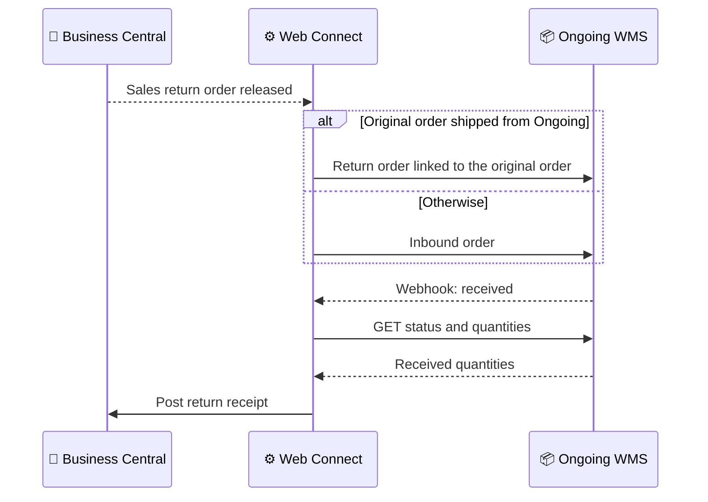

# Business Central and Ongoing WMS: returns

A customer return is registered as a sales return order in Business Central, copied from the posted shipment or invoice. Web Connect sends it to Ongoing WMS, either as a return order linked to the original Ongoing order or as an inbound order. When the warehouse has received the goods, the return receipt is posted in Business Central, so refund, VAT and stock follow the original sale.

| | |
|---|---|
| **Direction** | Business Central → Ongoing WMS, and back |
| **Trigger** | The sales return order is released in Business Central. The receipt comes back with a webhook from Ongoing |
| **Result** | A return order or inbound order in Ongoing, and a posted return receipt in Business Central |
| **Part of** | [Business Central and Ongoing WMS integration](../overview.md) |

## Step by step

1. Customer service creates a sales return order from the posted shipment or invoice, with a return reason on each line (Business Central).
2. The return order is released and sent to Ongoing (Web Connect).
   - **As a return order:** sent to `returnorders/` with the Ongoing ID of the original order and of each original order line.
   - **As an inbound order:** sent the same way as a purchase order.
3. The warehouse receives the goods (Ongoing).
4. Ongoing reports the received quantities, the same way as for a purchase order (Ongoing, Web Connect).
5. The return receipt is posted if posting of returns is on in the logistics setup. The credit memo is then handled in Business Central (Business Central).

## Data mapping

Return order in Ongoing:

| Ongoing field | Business Central source | Note |
|---|---|---|
| `returnOrderNumber` | Return order number | |
| `customerOrder.orderId` | Ongoing order ID of the original order | Stored when the original order was sent |
| `returnOrderLines.returnOrderRowNumber` | Line number | |
| `returnOrderLines.customerOrderLine.orderLineId` | Ongoing line ID of the original order line | |
| `returnOrderLines.toBeReturnedNumberOfItems` | Quantity | |
| `returnOrderLines.returnCause` | Return reason | Mapped with [WMS return reason codes](../../../general/wms-return-reason-codes.md) |

Inbound order in Ongoing: the same fields as a [purchase order](purchase-order.md), with the return reason code from the return line on each line.

## Web Connect objects

| Object | Role |
|---|---|
| `ONGOING-RETURNORDER` | Sends the return as a return order linked to the original order |
| `ONGOING-RETURNORDERLINES`, `ONGOING-CUSTOMERORDERLINE`, `ONGOING-RETURNCAUSE` | Return lines, original order line and return reason |
| `ONGOING-PURCHASEORDER` | Sends the return as an inbound order. This is CombineIT's standard, used when no return object is chosen in the logistics setup |
| `ONGOING-INSTATUSCHANGE`, `ONGOING-INSTATUS` | Receive and fetch the status of the received goods |

## Error handling

| Situation | What happens | What to do |
|---|---|---|
| A return order refers to an order that did not ship from Ongoing | Ongoing rejects it | Send returns as inbound orders, or handle that return outside the integration |
| The return order was not copied from a posted shipment or invoice | The link to the original Ongoing order is missing | Create the return order with Copy Document from the posted document |

## Frequently asked questions

### Should returns be sent as return orders or as inbound orders in Ongoing?

CombineIT's standard is inbound orders. Return orders are possible when every order ships from Ongoing. Ongoing links the return to the original order and its lines, but only accepts it when the original order was shipped from Ongoing. If some orders ship from another warehouse or are drop shipped, send returns as inbound orders instead.

## Related

- [Business Central and Ongoing WMS integration](../overview.md)
- [Receipts](receipt.md) · [Shipments](shipment.md) · [Purchase orders](purchase-order.md)
- [WMS return reason codes](../../../general/wms-return-reason-codes.md)
