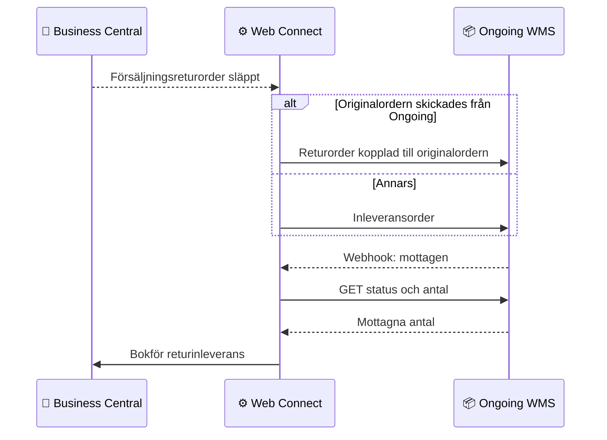

# Business Central och Ongoing WMS: returer

En kundretur registreras som en försäljningsreturorder i Business Central, kopierad från den bokförda leveransen eller fakturan. Web Connect skickar den till Ongoing WMS, antingen som en returorder kopplad till originalordern i Ongoing eller som en inleveransorder. När lagret har tagit emot varorna bokförs returinleveransen i Business Central, så att återbetalning, moms och lagersaldo följer den ursprungliga försäljningen.

| | |
|---|---|
| **Riktning** | Business Central → Ongoing WMS, och tillbaka |
| **Startas av** | Försäljningsreturordern släpps i Business Central. Inleveransen kommer tillbaka med en webhook från Ongoing |
| **Resultat** | En returorder eller inleveransorder i Ongoing, och en bokförd returinleverans i Business Central |
| **Del av** | [Business Central och Ongoing WMS: integration](../overview.md) |

## Steg för steg

1. Kundtjänst skapar en försäljningsreturorder från den bokförda leveransen eller fakturan, med en returorsak på varje rad (Business Central).
2. Returordern släpps och skickas till Ongoing (Web Connect).
   - **Som returorder:** skickas till `returnorders/` med Ongoing-id:t för originalordern och för varje ursprunglig orderrad.
   - **Som inleveransorder:** skickas på samma sätt som en inköpsorder.
3. Lagret tar emot varorna (Ongoing).
4. Ongoing rapporterar de mottagna antalen, på samma sätt som för en inköpsorder (Ongoing, Web Connect).
5. Returinleveransen bokförs om bokföring av returer är på i logistikinställningarna. Kreditnotan hanteras sedan i Business Central (Business Central).

## Mappning av data

Returorder i Ongoing:

| Fält i Ongoing | Källa i Business Central | Kommentar |
|---|---|---|
| `returnOrderNumber` | Returorderns nummer | |
| `customerOrder.orderId` | Ongoings order-id för originalordern | Sparades när originalordern skickades |
| `returnOrderLines.returnOrderRowNumber` | Radnummer | |
| `returnOrderLines.customerOrderLine.orderLineId` | Ongoings rad-id för den ursprungliga orderraden | |
| `returnOrderLines.toBeReturnedNumberOfItems` | Antal | |
| `returnOrderLines.returnCause` | Returorsak | Mappas med [orsakskoder för WMS-returer](../../../general/wms-return-reason-codes.md) |

Inleveransorder i Ongoing: samma fält som för en [inköpsorder](purchase-order.md), med returorsakskoden från returraden på varje rad.

## Objekt i Web Connect

| Objekt | Roll |
|---|---|
| `ONGOING-RETURNORDER` | Skickar returen som en returorder kopplad till originalordern |
| `ONGOING-RETURNORDERLINES`, `ONGOING-CUSTOMERORDERLINE`, `ONGOING-RETURNCAUSE` | Returrader, ursprunglig orderrad och returorsak |
| `ONGOING-PURCHASEORDER` | Skickar returen som en inleveransorder. Det är CombineIT:s standard och används när inget returobjekt är valt i logistikinställningarna |
| `ONGOING-INSTATUSCHANGE`, `ONGOING-INSTATUS` | Tar emot och hämtar statusen för de mottagna varorna |

## Felhantering

| Situation | Vad som händer | Gör så här |
|---|---|---|
| En returorder hänvisar till en order som inte skickades från Ongoing | Ongoing avvisar den | Skicka returer som inleveransorder, eller hantera den returen utanför integrationen |
| Returordern kopierades inte från en bokförd leverans eller faktura | Kopplingen till originalordern i Ongoing saknas | Skapa returordern med Copy Document från det bokförda dokumentet |

## Vanliga frågor

### Ska returer skickas som returorder eller som inleveransorder i Ongoing?

CombineIT:s standard är inleveransorder. Returorder går att använda när alla order skickas från Ongoing. Ongoing kopplar då returen till originalordern och dess rader, men tar bara emot den när originalordern skickades från Ongoing. Skickas en del order från ett annat lager eller som direktleverans, skicka returerna som inleveransorder i stället.

## Relaterat

- [Business Central och Ongoing WMS: integration](../overview.md)
- [Inleveranser](receipt.md) · [Leveranser](shipment.md) · [Inköpsorder](purchase-order.md)
- [Orsakskoder för WMS-returer](../../../general/wms-return-reason-codes.md)
