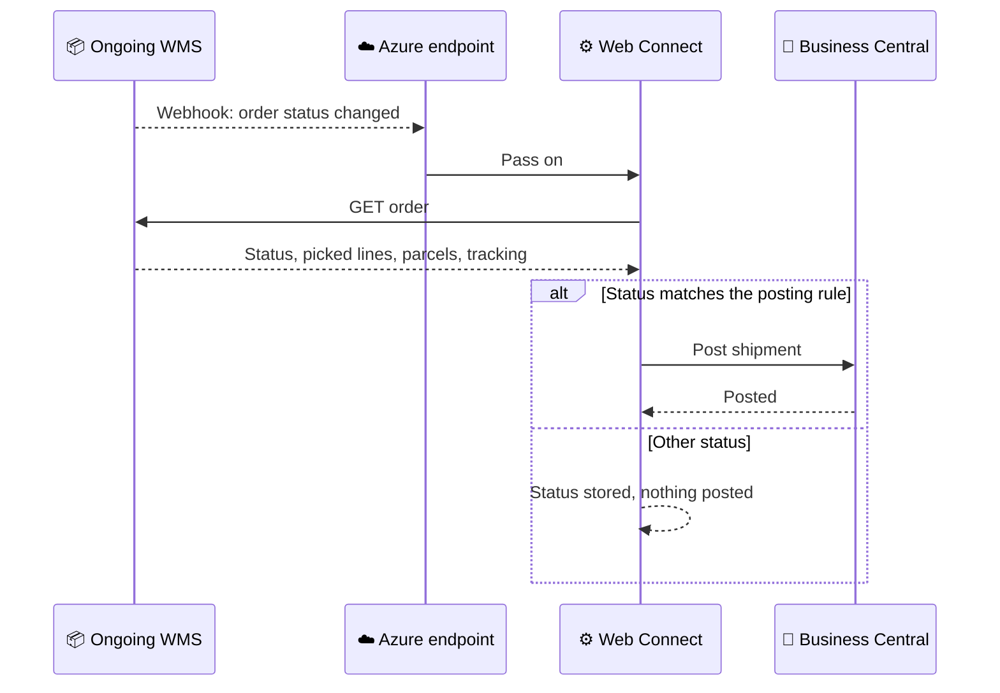

# Ongoing WMS to Business Central: shipments

When the warehouse ships an order, Ongoing WMS sends a webhook. Web Connect fetches the order from Ongoing with picked quantities, parcels and tracking, and posts the shipment in Business Central when the order has the status you have chosen.

| | |
|---|---|
| **Direction** | Ongoing WMS → Business Central |
| **Trigger** | Webhook from Ongoing when the order status changes. The status can also be fetched on a schedule from the job queue |
| **Result** | A posted sales shipment (or transfer shipment) in Business Central with the picked quantities |
| **Part of** | [Business Central and Ongoing WMS integration](../overview.md) |

## Step by step

1. The order status changes in Ongoing, for example when the order is shipped (Ongoing).
2. Ongoing calls the webhook. The Azure endpoint passes the call on to Web Connect (Ongoing, Azure).
3. Web Connect fetches the order from `orders/?goodsOwnerId=…&orderNumber=…` (Web Connect).
4. Status, picked quantities per line, parcel numbers and tracking links are written to the warehouse document (Web Connect).
5. If the status matches the status set in the logistics setup, the shipment is posted. Lines without stock, such as freight, are posted with it (Business Central).

## Data mapping

| Ongoing field | Business Central field | Note |
|---|---|---|
| `orderInfo.orderStatus.text` | Status on the warehouse document | Compared with the posting rule |
| `orderLines.pickedNumberOfItems` | Quantity to ship | Per line |
| `orderLines.externalId` | Line number | Matches the line sent with the order |
| `parcels.parcelNumber` | Parcel number on the warehouse document | Can also be written to Package Tracking No. on the sales order |
| `parcels.tracking.trackingUrl` | Tracking link on the warehouse document | |
| `orderInfo.orderId` | Ongoing order ID | |

## Web Connect objects

| Object | Role |
|---|---|
| `ONGOING-OUTSTATUSCHANGE` | Receives the webhook and starts the fetch |
| `ONGOING-OUTSTATUS` | Fetches the order and its status from Ongoing |
| `ONGOING-STATUS-ORDERLINES` | Picked quantities per line |
| `ONGOING-PARCELS` | Parcels and tracking |

## Error handling

| Situation | What happens | What to do |
|---|---|---|
| The shipment cannot be posted, for example because of a blocked item or a missing setup | The error is logged on the warehouse document and retried up to the maximum in the logistics setup | Correct the cause and process the document again |
| No webhooks arrive | Shipments are not posted | Check Entries for incoming messages. Ask the 3PL to check the webhook on the goods owner in Ongoing |
| The status text in Ongoing does not match the posting rule | The status is stored, but nothing is posted | Change the status in the posting rule |

## Frequently asked questions

### At which status in Ongoing is the shipment posted?

At the status you set in the logistics setup, for example Sent. The status text comes from the 3PL's Ongoing system and can differ between 3PLs, so it is checked when the integration is set up.

## Related

- [Business Central and Ongoing WMS integration](../overview.md)
- [Outbound orders](order-outbound.md) · [Order changes and cancellations](order-change-cancellation.md)
- [Webhooks](../../../general/webhooks.md) · [Logistics Setup](../../../general/logistics-setup.md)
